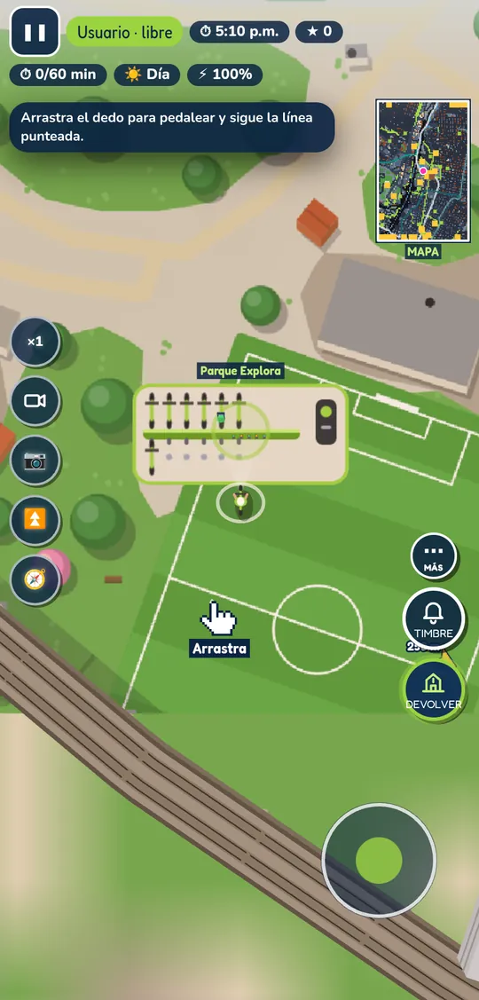
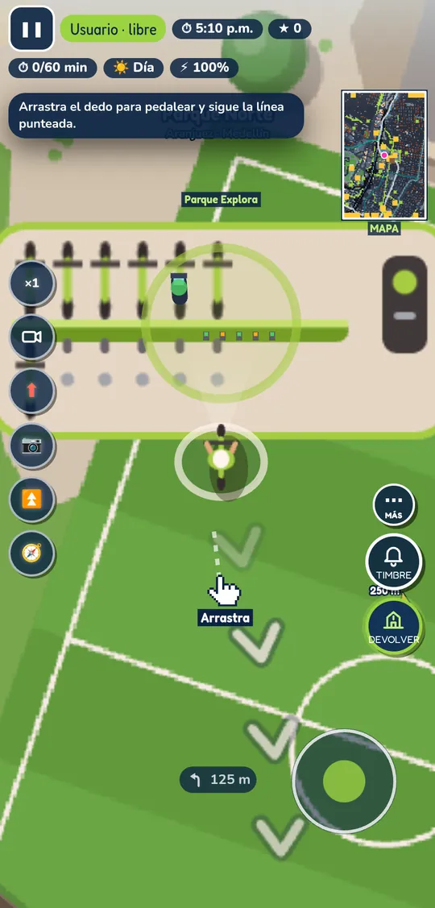
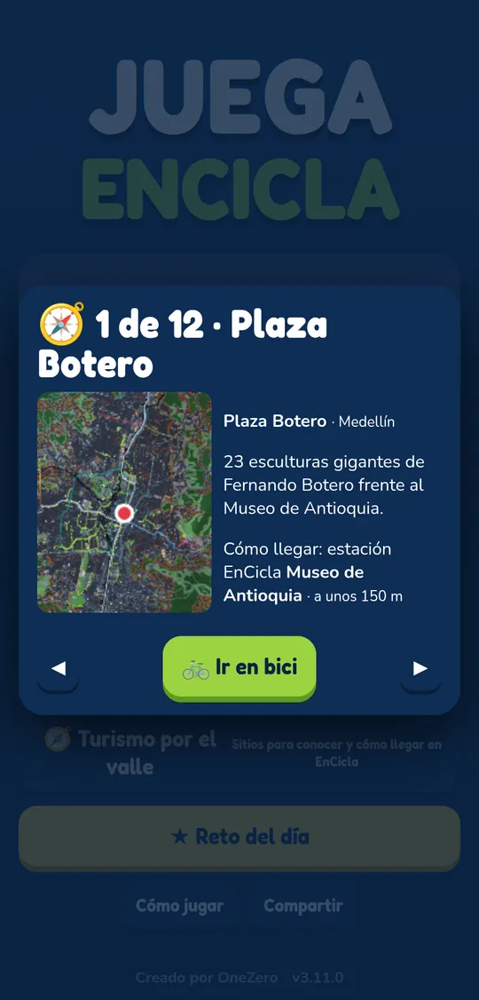

# Auditoría crítica y forense · Juega EnCicla (`BicicletasUno` v3.11.0) y Motor del Valle

> **Fecha:** 27-nov-2026 · **Informe completo del ecosistema (los 5 productos):** [`motorcity/docs/AUDITORIA-CRITICA-2026-11-27.md`](https://github.com/juanfeliperico369-stack/motorcity/blob/main/docs/AUDITORIA-CRITICA-2026-11-27.md)
>
> **Metodología:** revisión directa línea por línea de los 100 archivos de `src/js/`, `tools/build.js`, `motor-valle/`, `tests/` y `dist/juega-encicla.html`, más ejecución y captura visual real en Google Chrome 158 móvil (`412 × 860`, DPR 2, táctil). Sin confiar en los `✅` de `BITACORA.md`.

---

## 1. Evidencia visual real (`412 × 860`, v3.11.0)

Lo que se ve a simple vista en el juego publicado hoy:
1. **Estación en mitad de una cancha de fútbol (`encicla-libre.webp`):** la estación «Parque Explora» aparece estampada como un rectángulo plano beige encima del área grande y el círculo central de una cancha de fútbol.
2. **Sopa borrosa sin cargar:** las mitades superior e inferior izquierda son bloques borrosos de `8×8` píxeles estirados (`boceto()` de `99w-chunks-progresivos.js`) con costuras rectas visibles.
3. **100 % 2D plano pintado en el suelo:** al acercar la cámara a «casi tercera persona» (`encicla-zoom-cerca.webp`, zoom `2,7×`), solo se estira el lienzo 2D borroso; no existe perspectiva 3D, ni horizonte, ni objetos 3D.
4. **HUD roto:** el indicador de distancia (`250 m`) queda oculto detrás del botón `TIMBRE`; el nombre de barrio (`Parque Norte / Aranjuez`) se transparenta detrás del cartel azul de instrucciones; el botón `⋯ MÁS` mide `40×40 px` (< 44 px); y en `encicla-pausa.webp` el último botón (`Terminar práctica`) queda recortado abajo.
5. **Turismo (`encicla-turismo.webp`):** es un modal de fichas de texto sin siquiera botón visible de cierre `×` en la cabecera, y al darle `🚲 Ir en bici` te suelta en la estación sin poner ruta ni flecha hacia Plaza Botero.

---

## 2. Dónde falla técnicamente (evidencia exacta en código)

### 2.1 Catástrofe de arquitectura: 100 archivos, 28 cargan DESPUÉS de `99-boot.js` y hasta 17 capas de monkey-patching
- **`tools/build.js:10`** ordena `src/js/*.js` con `.sort()` ASCII (`'-' = 45 < 'a' = 97`). Resultado verificado en `dist/build.json`: **`99-boot.js` (#72) se ejecuta ANTES de 28 módulos de parche (`99a-fluidez.js` #73 hasta `99zz2-turismo.js` #100)**. Solo no revienta porque `99-boot.js:9` hace un `await` de 1 cuadro. `99u-todo-junto.js:117,174` incluso usa `setTimeout(instalar, 0)` para ganarle la carrera a otros parches.
- **Cadenas de sobrescritura por cuadro:**
  - `Ride.prototype.update`: parcheado **16 veces** (17 capas en cada cuadro!).
  - `Ride.prototype.drawGround`, `UI.renderMas`, `ModeUsuarioR.prototype.actions` y `Game.start`: parcheados **14 veces cada uno**.
  - `99v-rendimiento.js:127-132`: **sobrescribe y restaura `M.lotes` dentro de `Ride.prototype.draw3D` en cada cuadro (60×/s)**.
  - `99a-fluidez.js:41`: reemplaza entero `Game.loop` rompiendo el encadenamiento de `88-camara.js:184`.

### 2.2 Cuatro *reflows* DOM forzados cada cuadro a 60 FPS
- `Game.dom()` corre en cada `requestAnimationFrame` (`99a-fluidez.js:47`) y llama `this.layout(ride)` (`60-ui.js:412`).
- **`60-ui.js:430-442`** lee `$('#hud').getBoundingClientRect()` → escribe `gm.style.top` → lee `gm.getBoundingClientRect()` → escribe incondicionalmente `document.documentElement.style.setProperty('--toastTop', tt)` (invalidando los estilos de **todo** el DOM!) → vuelve a leer `ab.getBoundingClientRect()` y `ab.firstElementChild.getBoundingClientRect()` → y luego `88-camara.js:129-136` llama `getComputedStyle(documentElement)`.
- Eso destroza la fluidez en cualquier celular sin importar qué tan bueno sea el canvas.

### 2.3 Desglose del HTML de 9,79 MiB (10.267.721 B) y 157–167 MB de RAM
- **`EDIF_BIN`:** **4,20 MiB (42,9 %)** — 625.880 huellas que solo se usan en Modo Libre y que `99z-huellas.js:25-33` descomprime de golpe con `atob()` + `inflateRaw()` en el hilo principal (congelón al entrar a Libre).
- **`VALLE_BIN`:** **2,16 MiB (22,1 %)** — `20-map.js:68-107` y `75-graficos.js:18-128` recorren 21,24 millones de casillas síncronamente ~5 veces al arrancar (medimos **1,6 FPS / 1.967 ms** en la portada y **1,2–1,5 FPS / 1.350–1.900 ms** en Modo Libre; carga a Modo Libre: **6,38 s**).
- **100 archivos JS sin minificar ni limpiar comentarios:** **1,62 MiB (16,6 %)**, incluyendo **1.237+ líneas de WebGL/cámaras muertas** (`99d`, `99f`, `99o`).
- **`motor-city/` (50 MB):** **100 % peso muerto**, 0 bytes usados en `tools/build.js`.
- **`motor-valle/js/valle.js`:** se pega al final del bundle, pero **ninguna línea de `src/js/` lo llama jamás** (solo `tests/run.js:451`).

### 2.4 Bugs de cámara, teclado, audio y controles
- **Cámara única mal hecha (`99zz-camara-unica.js`):** en vez de borrar las cámaras viejas, ocultó `#b3D,#pVista,#camPop` con `display:none!important` (línea 21), llama `aCenital()` en cada cuadro (línea 61), dejó **13 botones zombis de cámara activos en `Más › Cámaras`** (`99u:67`, `99o:193`, `88:151`, `75:650`), dejó vivo `⬢ Maqueta 2:1` en el mapa (`86-maqueta.js:86-105`), dejó vivas las teclas `T`/`V`/`Y`, y al rotar el canvas 2D en zoom `2,7×` las casas de 1–2 pisos quedan **patas arriba** al ir hacia el sur (`75-graficos.js:383`).
- **Teclado roto:** `MGMetro2D` (`99p:912-915`) y `MGPalmas` (`99p:1042`) no tienen `keyup`: acelerador y freno quedan pegados para siempre en escritorio.
- **Audio (`00b-sonido-guardian.js` + `60-ui.js:40`):** `Snd.timer` (`setInterval` de 70 ms) sigue disparando bajo `pause`/`app:pausa`, `fanfare()` sigue encolando osciladores en `setTimeout`, y al volver de otra pestaña la música del menú queda muda porque `60-ui.js:40` llamó `Snd.music(false)` y el guardián no la reinicia.

---

## 3. Evaluación de tus pedidos (P1–P13) en Juega EnCicla

| Pedido | Estado real | Veredicto |
|---|---|---|
| **P1 · Mundo enteramente 3D** | **NO implementado** (`99zz` apagó el único WebGL en juego) | **MAL** — sigue 100 % 2D Canvas. |
| **P2 · Cámara única, eliminar las demás** | **Parche CSS + 13 botones zombis + Maqueta viva** | **MAL** — acercar solo estira 2D borroso y voltea casas. |
| **P3 · Nada pintado en el suelo** | **NO implementado** | **PÉSIMO** — casas de 1–2 pisos, árboles (4 círculos), postes, bancas, hitos, estaciones y 5 skateparks siguen pintados en el suelo. |
| **P6 · Carga sin huecos** | **`99w` pinta sopa borrosa `8×8` + saltos bruscos** | **REGULAR/MAL** — además `99z` congela al descomprimir 4,4 MB. |
| **P7 · Fluidez** | **Sin paso fijo + 4 reflows DOM/cuadro** | **MAL** — el manejo de bici es decente, el motor de UI lo frena. |
| **P8 · Música al salir** | **Funciona lo básico, fugas en timer/menú/fanfare** | **REGULAR** |
| **P9 · Portada viva** | **Parche `
` encima de un bloqueo de 2–8,6 s** | **MAL** — oculta el síntoma sin arreglar `20-map.js`. |
| **P10 · Controles personalizables + vertical/horizontal** | **NO implementado** (0 líneas de recomendación de orientación) | **NO EXISTE** |
| **P11 · Escalafón en portada** | **Existe**, pero `80-limpieza.js:125` lo tapa con modal al entrar | **REGULAR** |
| **P12 · Lámina apertura/cierre** | **Solo plan** | **OK (respetado)** |
| **P13 · Modo turismo** | **Modal de 12 fichas + teletransporte sin ruta ni flecha** | **MAL** — no es un modo jugable. |

---

## 4. Por qué NO es divertido (crítica de diseño) y por qué las pruebas mienten

1. **Minijuegos de relleno en vez de diversión:** se amontonaron **12 oficios + 16 juegos arcade + 24 actividades RPG + 15 vecinos + 6 mentores + 16 capítulos**. La mayoría son esqueletos de 80–125 líneas: `MGPlaneador` («Cities: Skylines») es tocar 6 círculos sobre fondo azul 8 segundos; `MGMetro2D` («Tiny Rails») es imposible perder; `MGPalmas` («Ley 1811») no tiene mecánica de 1,5 m (solo el texto en cabecera); los 5 «skateparks» disparan trucos solos sin tocar un botón; `MGRutina` es una barra con botón `Adelantar`; `MGLlamadas` es un quiz obvio.
2. **Progresión rota por defecto:** `99a-fluidez.js:75-76` enciende `JE.debugUnlock = true` por defecto, volviendo inútiles las estrellas, el escalafón y la tienda.
3. **Pruebas complacientes:**
   - `tests/benchmark-2km-gpt6.mjs` corre a `dpr = 1`, teletransporta a `v = 0` y **no exige `terminados > 0`** (0 trozos terminados pasa como `META CUMPLIDA`).
   - `tests/run.js` corre el bot con `JE.headless = true` (apaga render, chunks, WebGL y controles), mide FPS quieto sin mover la bici y prueba el guardián con un `AudioContext` falso.
   - `tests/revolucion-encicla.js:456-457` **castiga limpiar el juego**: falla si bajas de 21 opciones en `Más` o de 17 juegos en `Escalafón`.

---

## 5. Cómo convertir a Juega EnCicla en un gran juego

1. **Poda radical:** borra los 50 MB muertos de `motor-city/`, elimina los 12–14 minijuegos stubs (especialmente `MGPlaneador`, `MGMetro2D`, `MGPalmas`, `Despacho`/`Maquinista` duplicados), quita los 13 botones zombis de cámara y el botón `⬢` Maqueta, y actualiza `revolucion-encicla.js` para dejar de blindar grasa.
2. **Arregla la base de rendimiento primero:** saca `Game.layout()` del bucle de 60 FPS (solo en `resize`/cambio de barra); mueve el parsing de `valle.bin` y `edificios-ligero.bin` a un **Web Worker** para eliminar el congelón de arranque; pasa el mapa a carga binaria offline por Cache API (PWA/Capacitor) en lugar de un `<script>` de 10 MB.
3. **Un solo mundo 3D WebGL de verdad (Fase E + D juntas, no parcheadas sobre 2D):** en vez de mantener dos mundos, construye un único renderizador WebGL liviano con edificios instanciados, árboles/estaciones/ciclista 3D reales y cámara única cenital que baje limpiamente a 40° con *spring-arm*.
4. **Menos oficios, mucho más jugables:** enfócate en **Modo Libre con verdadero *game feel*** (rebufo, cadena de flujo verde, timbre interactivo, **Modo Turismo jugable** con ruta guiada por 6 sitios, arcos/fotos y pasaporte) + **3 oficios pulidos** (Anfitrión, Mecánico, Balance) y apaga `debugUnlock` por defecto para que avanzar importe.
5. **Implementa P10 de verdad:** sensibilidad continua, esquema de deslizar, opacidad/tamaño y recomendación automática al girar el celular entre vertical y horizontal.
