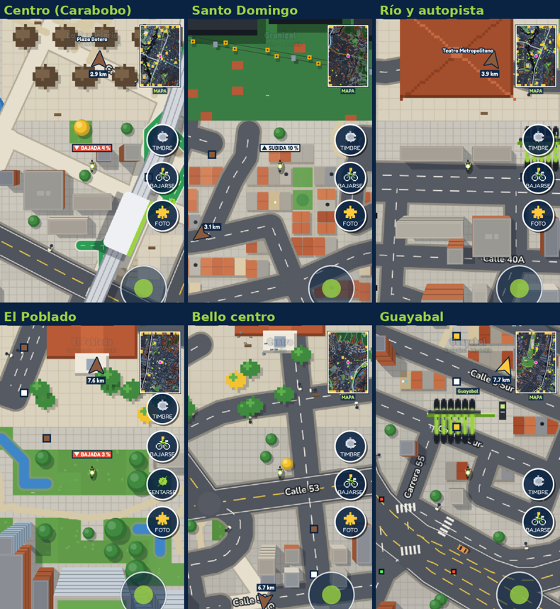

# Auditoría de Juega EnCicla v1.2.0

**Fecha:** 17 de noviembre de 2026 · **Alcance:** el juego completo y, en especial, el mapa. Cada hallazgo sale de una medición, una prueba o una captura de esta versión.

## 1. Resumen

**Estado:** sólido y completo. Tiene 12 oficios, modo libre de 24 horas, dos historias, multijugador (red local, internet y Bluetooth), retos por QR y 63 logros.
- Pruebas: pasan las 73 comprobaciones, más 100 partidas del bot sin errores.
- Rendimiento: 16,7 ms por cuadro con la CPU 4 veces más lenta.
- Funciona sin internet, como página instalable y como APK.

**Lo mejor**
- El mapa ya sale de los datos reales: 32.785 vías con 2.607 nombres de calle y 672 barrios.
- Horarios oficiales, vida urbana y una batería de pruebas muy completa.

**Los 5 riesgos principales**
1. **La resolución del mapa (20 m por casilla)** infla las vías y deja las manzanas medio vacías justo donde la ciudad es más densa: centro, Bello y laderas.
2. **La arquitectura por “envolturas”** (89 funciones reemplazadas por otras que las envuelven) es frágil. Ya causó un choque de datos: la historia y las misiones diarias usaban la misma clave (corregido en v1.2.0).
3. **Faltan datos oficiales:** coordenadas de las estaciones, festivos y el horario de ColMayor.
4. **El peso:** el HTML pesa 2,87 MB y en un celular modesto carga en ~3,5 s.
5. **El arte final** sigue siendo dibujado por código; la entrega de las IA no sirvió (ver `AUDITORIA-C99.md`).

---

## 2. El juego

### 2.1 Arquitectura y código
- 39 módulos y 8.122 líneas, concatenados en orden alfabético dentro de un solo `<script>`.
- **89 envolturas:** cada módulo reemplaza un método envolviendo al anterior. Las más envueltas:

  | Función | Veces |
  |---|---|
  | `Game.start` | 7 |
  | `UI.brief` | 6 |
  | `Ride.prototype.drawGround` | 5 |
  | `UI.renderMas` | 4 |
  | `Ride.prototype.update` · `updLife` · `renderTop` | 3 |
  | `ModeUsuarioR.prototype.tick` · `libreInit` | 3 |

- **Riesgo:** el orden de los archivos decide el orden de ejecución. Cuesta saber qué hace de verdad `Game.start`, y un módulo nuevo puede pisar datos de otro sin que se note.
- **Propuesta:**
  1. Un registro de ganchos (`Ganchos.on('inicio' | 'ficha' | 'resultado' | 'cuadro' | 'suelo', fn)`) que reemplace las envolturas, migrando una función por versión.
  2. Un módulo de guardado con esquema: claves declaradas, versión y migraciones explícitas.
  3. Una prueba que liste todas las claves de `Save.data` y falle si dos módulos usan la misma para cosas distintas.

### 2.2 Guardado
- **Claves:** `settings`, `profile`, `stats`, `history` (300 partidas), `flags`, `dia` (misiones del día), `diaValle` (historia), `perks`, `postales`, `logros`, `best`, `owned`, `stars`, `encicla`, `xp`, `spent` y `fotos`.
- **Lo bueno:** ya existe exportar e importar el progreso como texto.
- **Riesgo:** todo vive en `localStorage`. Borrar los datos del navegador, o desinstalar el APK (`allowBackup=false`), borra el progreso.
- **Propuesta:** exportar también con QR o archivo, recordarlo de vez en cuando y, en el APK, ofrecer un respaldo opcional.

### 2.3 Rendimiento
| Medida | Valor |
|---|---|
| Carga en computador | ~1,1 s |
| Carga con CPU 4 veces más lenta (celular modesto) | ~3,5 s |
| Memoria tras cargar | ~43 MB |
| Tiempo por cuadro, CPU 4 veces más lenta | 16,7 ms (mediana) |
| HTML único | 2,87 MB (el mapa son ~1,7 MB en base64: casillas 0,7 · vías 0,58 · metadatos 0,16) |

**Propuesta**
- Descomprimir y preparar el mapa en un Web Worker, para que la interfaz no se congele.
- Cuantizar las vías a 5 m y comprimir las diferencias (puede bajar el peso ~30 %).
- Medir en 2 o 3 celulares reales de gama baja antes de publicar en tiendas.

### 2.4 Pruebas
- **Fuertes:**
  - 100 partidas del bot y humo de toda la interfaz.
  - Rendimiento con la CPU lenta y multijugador con 3 dispositivos.
  - Secciones 3c a 3j: horarios, préstamo, guion, mapa, historia y misiones.
- **Faltan:**
  - Regresión visual: capturas de 8 lugares comparadas contra la versión anterior.
  - Migraciones de guardado.
  - Textos largos en pantallas de 320 px.
  - Memoria tras 30 minutos de juego.
  - El APK en un dispositivo real.

### 2.5 Experiencia y contenido
- Hay mucho contenido para un jugador nuevo: 12 oficios, dos historias (por oficio y *Un día del valle*), modo libre con misiones, retos, multijugador, tienda, postales y 63 logros.
- **Ideas:**
  1. Una pantalla **“Hoy”** que diga qué hacer: el siguiente capítulo de la historia, el reto del día, las misiones del modo libre y la fiesta del día.
  2. Al terminar cada partida, un solo botón con “lo siguiente” (ya pasa en *Un día del valle*; extenderlo a todo).
  3. Revisar los textos de la historia con alguien de EnCicla, para pulir el tono y los procedimientos reales.

### 2.6 Datos reales pendientes
- **Estaciones:** la lista oficial con coordenadas, tipo, zona y dificultad por turno. Hoy son aproximadas: Floresta e Industriales vienen de Overture y el resto es manual.
- **Festivos:** la página oficial dice “no hay servicio”; el juego los trata como domingo, por decisión del autor.
- **Horario especial:** I.U. ColMayor (5:30 a. m. – 7 p. m.) no está entre las estaciones del juego.
- **Corredores eléctricos:** las ubicaciones de C4TA, Hospital Infantil, La Estrella y Pablo Tobón Uribe son aproximadas.

### 2.7 Accesibilidad
- **Hay:** modo para daltonismo, controles configurables (tipo, lado y tamaño) y vibración.
- **Falta:**
  - Tamaño de letra y alto contraste.
  - Un modo **“menos movimiento”** que quite las palomas, las nubes, los brillos y el temblor.
  - Etiquetas para lectores de pantalla en los menús.
  - Indicadores visuales para los sonidos importantes.

### 2.8 Publicación en tiendas
- El APK actual es **de depuración**. Para Play Store hace falta:
  - firma de publicación, con la llave guardada fuera del repositorio;
  - paquete AAB;
  - versión de Android de destino al día;
  - fichas de tienda.
- `tools/store.js` todavía dice **“La revista arcade más pedaleada”**, del estilo de revista que pediste quitar; hay que rehacer esos gráficos.

### 2.9 Multijugador
- Por internet usa WebRTC sin servidor TURN: en algunas redes (datos móviles o NAT estricta) no conecta.
- **Propuesta:** un servidor TURN propio o contratado, un diagnóstico claro de por qué no conecta y salas con código corto.

---

## 3. El mapa: análisis

### 3.1 Qué está bien (cifras de v1.2.0)
| Tipo de vía | Vías | Km | Con nombre |
|---|---|---|---|
| Calles (1) | 18.881 | 3.837 | 49 % |
| Carreras y terciarias (4) | 1.469 | 583 | 83 % |
| Avenidas (2) | 1.344 | 653 | 54 % |
| Autopistas (3) | 373 | 326 | **17 %** |
| Peatonales (6) | 696 | 75 | 58 % |
| Escalas (7) | 2.147 | 92 | 18 % |
| Senderos (8) | 7.875 | 1.294 | 12 % |
| Ciclorrutas (5, de la cuadrícula) | 842 | 61 | — |

- **Estaciones:** las 133 quedan a 46 m de su coordenada como valor típico; el 90 % a menos de 101 m y la más lejana a 195 m. Todas dan a una calle conectada y el camión de balance llega a todas.
- **Barrios:** 672 nombres, que cubren el **72 %** del área municipal (el resto es rural y queda lejos de cualquier punto con nombre).
- **Tráfico:** 758 semáforos con cebras orientadas (2 sin cebra) y 1.235 carriles de tráfico.
- **Lo que se reconoce:** Laureles (circulares y diagonales), Floresta, Estadio y la unidad deportiva, Plaza Botero, el metro y el metrocable.

### 3.2 Problemas encontrados, con evidencia
1. **Vías infladas por la resolución.** Esta es la causa principal de que algunas zonas no se reconozcan. A 20 m por casilla, una calle de barrio ocupa 20 m (en la realidad mide 8–12 m) y una avenida 40–60 m. Composición de muestras de 29×15 casillas:

   | Zona | Vías y andenes | Casas y edificios |
   |---|---|---|
   | Santo Domingo (ladera) | 49 % calle + 9 % escalas y andenes | 28 % |
   | Bello centro | 76 % (avenida 28 %, andén 22 %, calle 26 %) | 18 % |
   | Centro, Plaza Botero | 62 % (avenida 31 %, andén 23 %, calle 8 %) + 7 % ciclorruta | 18 % |

   El resultado: manzanas medio vacías justo donde la ciudad es más densa.
2. **Escalas y senderos de casilla completa.** Hay 4.299 casillas de escalas y 89.399 de andén. En las laderas, cada escala se come una fila de casas.
3. **Lugares emblemáticos sobredimensionados y corridos.** Miden de 9.600 a 149.600 m²: el Cerro Nutibara 280×280 m, la Comuna 13 220×180 m, EAFIT 240×200 m. Para no tapar avenidas se corren entre 135 y 170 m. Las esculturas de Botero se leen como árboles.
4. **Nombres incompletos o dispares.**
   - Solo el 17 % de los tramos de autopista tiene nombre.
   - Se mezclan “sur” y “Sur”, y hay nombres como “40 sur” o “Salida a Diagonal 47A”.
5. **Barrios aproximados.** Se asignan por el punto con nombre más cercano, así que el límite puede correrse unas cuadras. Algunos nombres no son barrios (“Finca 56 E”, “Proyecto ecológico Mejía”).
6. **Ciclorrutas de la cuadrícula.** Los 61 km de ciclorruta se rastrean de la cuadrícula, no de los vectores, así que no siempre siguen la geometría ni el sentido reales.
7. **Edificios generados.** Las alturas son al azar, salvo 6 puntos altos. No hay huellas reales, así que el centro y El Poblado no se reconocen por sus edificios.
8. **Quebradas.** Hay 74.440 casillas de canal, sólidas. Muchas quebradas van canalizadas bajo las vías en la realidad, y aquí cortan manzanas.
9. **Falta Metroplús.** No se dibujan sus corredores ni sus estaciones, y es de lo más reconocible de la ciudad.
10. **Pocos puntos de interés.** Solo están los 45 lugares con postal; faltan centros comerciales, universidades, hospitales, iglesias y parques de barrio.

### 3.3 Plan de mejora del mapa
**Fase 1 · rápida (1 a 2 sesiones)**
- Nombres: normalizar (“Sur”, “Norte”, abreviaturas) y nombrar las autopistas y avenidas con una lista curada: Autopista Norte y Sur, Avenida Regional, Las Vegas, Avenida 80, Oriental, San Juan, Colombia, La 33, La 10 y El Poblado.
- Lugares emblemáticos a su tamaño real y en su punto, usando su huella de OpenStreetMap: estadio, Pueblito Paisa, Explora, Jardín Botánico y Plaza Botero con esculturas dibujadas como esculturas.
- Barrios: filtrar los nombres que no son barrios y mostrar en el mapa grande los de la zona visible.
- Rótulos de las estaciones del metro y del tranvía en la vista de juego.
- Lugares en el mapa: los 2 semáforos sin cebra y revisar los nombres repetidos sobre una misma vía.

**Fase 2 · media (2 a 4 sesiones)**
- Ciclorrutas desde los vectores de OpenStreetMap, exactas y con su sentido.
- **Metroplús:** carriles exclusivos, estaciones y buses articulados.
- **Puntos de interés** de Overture en el mapa grande, filtrados por zoom (como en Google Maps).
- **Edificios reales** (huellas de Overture u OSM, con altura cuando la tengan) en el centro, El Poblado y alrededor de los lugares emblemáticos.
- Quebradas: quitar las canalizadas o dibujarlas finas y no sólidas.

**Fase 3 · grande (decisión del autor)**
- **Opción A · cuadrícula de 10 m** para la física y el dibujo: vías de ancho real, manzanas llenas y escalas finas.
  - Costo estimado: 4 veces más casillas (21 millones; ~21 MB en memoria), +1–1,5 MB de HTML y una carga 2 a 3 veces más lenta (hay que medir).
- **Opción B · física por vectores:** se choca contra los polígonos de las manzanas en lugar de las casillas, y la cuadrícula de 20 m queda solo para las rutas. Pesa menos, pero cuesta más hacerla.
- Límites oficiales de barrios: el mapa catastral de barrios y veredas de GeoMedellín y los de los otros 9 municipios.

### 3.4 Cómo medir el avance
- Un script de métricas del mapa en cada versión:
  - porcentaje de área vial por zona (meta: centro < 45 %, laderas < 35 %);
  - desplazamiento de estaciones (meta con datos oficiales: < 30 m);
  - porcentaje de tramos con nombre por tipo;
  - porcentaje del área con barrio;
  - carga con la CPU 4 veces más lenta.
- Capturas de referencia de 8 lugares (Laureles, Floresta, Estadio, Centro, Santo Domingo, El Poblado, Bello y Envigado), comparadas en cada versión.

---

## 4. Ideas nuevas
1. **Mi barrio:** al crear el personaje escoges tu barrio real, el modo libre empieza allí y hay misiones y una postal de tu barrio.
2. **Rutas guiadas:** Centro histórico, metrocable + bici, ciclovía del domingo y “de Caldas a Barbosa”.
3. **Día sin carro** como fiesta del calendario, con calles para bicis.
4. **Fantasma de récord:** competir contra tu mejor intento en cada turno.
5. **Licencia de ciclista:** preguntas cortas de cultura vial en las estaciones, con insignia.
6. **Modo tranquilo:** turnos sin reloj, para niños y personas mayores.
7. **Más cooperativo:** Técnico + Apoyo (abrir estaciones y repararlas en equipo).
8. **Más huevos de pascua del Metro** (ya están en el documento para IA, parte 10): Wílmar pita dos veces, las arepas de Doña Marleny, Don Efraín por la radio de Monitoreo y el cumpleaños del Metro con banderines.
9. **Disponibilidad real:** si EnCicla tiene datos abiertos de bicis por estación, mostrarlos en el mapa grande cuando haya internet.

---

## 5. Hoja de ruta propuesta
| Versión | Contenido |
|---|---|
| **v1.3** | Fase 1 del mapa · registro de ganchos y guardado con esquema · pantalla “Hoy” · accesibilidad básica (letra, contraste, menos movimiento) · datos oficiales si llegan |
| **v1.4** | Fase 2 del mapa (Metroplús, ciclorrutas vectoriales, puntos de interés, edificios reales) · exportar el progreso con QR · Play Store (firma, AAB, fichas nuevas) · TURN |
| **v2.0** | Fase 3 del mapa (10 m o física por vectores) · límites oficiales de barrios · arte final de personajes |

## 6. Decisiones del autor
1. **Festivos:** ¿sin servicio (página oficial) o como domingo (como está hoy)?
2. **Mapa de 10 m:** ¿se acepta más peso y más carga a cambio de manzanas y calles de tamaño real?
3. **Lista oficial de estaciones:** coordenadas, tipo, zona y dificultad por turno.
4. **Play Store:** ¿se publica? Hace falta la cuenta de desarrollador y la llave de firma.
5. **Arte final:** ¿se contrata un ilustrador para retratos y escenas, o se mantiene el estilo dibujado por código?
