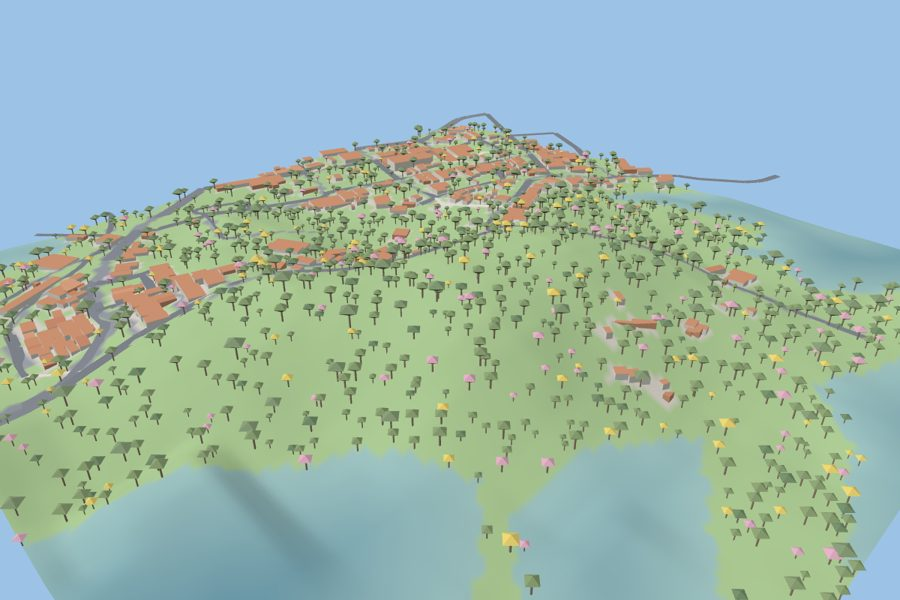

# Motor City en motores más potentes · Godot, Unity, Unreal, Blender, three.js y WebGPU

> **La idea:** Motor City nació para correr en un HTML, en cualquier celular y sin internet. Eso no lo encierra:
> - sus **mundos** salen en formatos estándar;
> - su **simulación** (física, terreno, ciudad, historias, economía) es JavaScript puro, que también corre sin pantalla;
> - su **estado vivo** se puede mandar a otro motor que solo dibuje.
>
> Así, un mismo juego puede tener una versión liviana (Motor City) y una de consola o PC (Unreal o Godot) **sin rehacer el mundo**.



*Guatapé exportado con `node motor.mjs exportar guatape` y abierto en three.js, sin tocar nada. El validador oficial de Khronos da 0 errores y 0 avisos.*

## Tres niveles para sacarle el máximo provecho
| Nivel | Qué se lleva | Cómo | Para qué |
|---|---|---|---|
| **1. El mundo** | Terreno, edificios, vías, árboles y lugares | `node motor.mjs exportar <mundo>` → `mundo.glb`, `alturas.r16` y `escena.json` | Hacer el juego en Godot, Unity o Unreal con el pueblo o la ciudad real ya armados. |
| **2. La simulación en vivo** | Jugador, vehículos, gente, hora y clima | `MC.Puente.instantanea(E)` cada cuadro, enviado por WebSocket (o `postMessage`) | Que Motor City siga simulando y otro motor dibuje con más detalle (luz global, sombras suaves y más polígonos). |
| **3. Otro dibujante en la web** | La vista | Una vista registrada que use three.js, Babylon o WebGPU con el mismo `E` | Gráficos de PC en el navegador, con el mismo juego (C‑M18). |

## Nivel 1 · Exportar el mundo
```bash
node motor.mjs exportar guatape                              # 600 × 600 m alrededor del centro del pueblo
node motor.mjs exportar medellin --centro 15680,13534 --lado 800 --paso 4
```
Sale en `dist/exportar/<mundo>/`:
- `mundo.glb` (glTF 2.0 binario):
  - mallas `terreno` (relieve real; color por suelo y el agua por profundidad), `edificios` (extruidos con el color de su zona), `vias` (cintas sobre el terreno) y `arboles` (tronco y copa por especie);
  - un solo material con colores por vértice;
  - +Y arriba, en metros, y el origen en el centro de la caja (en `extras.origen_mundo` quedan las coordenadas originales).
- `alturas.r16` y `alturas.json`: el relieve en RAW de 16 bits *little endian*, con su mínimo y máximo.
- `escena.json`: edificios (huella, altura, clase y colores), vías (polilínea, ancho y tipo), árboles (especie, alto y copa) y lugares jugables. El motor de destino pone **su** lógica y **su** arte sobre esto.
- `LEEME.md`: cómo abrirlo en cada motor.

| Motor | El mundo | El terreno de alta calidad | La lógica |
|---|---|---|---|
| **Godot 4** | Arrastrar `mundo.glb` al proyecto | `HTerrain` o *Terrain3D* con `alturas.r16` | GDScript lee `escena.json` y pone `MultiMeshInstance3D` para los árboles. |
| **Unity** | Paquete *glTFast* | *Terrain* → Import Raw (16 bits, Windows, ancho × alto de `alturas.json`) | C# lee `escena.json`. |
| **Unreal 5** | Import (Interchange) de `mundo.glb` | *Landscape* desde `.r16`, con escala Z = (max − min) / 512 × 100 | Blueprint o C++ con el JSON; *PCG* para poblar con los árboles. |
| **Blender** | Archivo → Importar → glTF 2.0 | — | Python lee el JSON (render de cine). |
| **three.js y Babylon** | `GLTFLoader` y `SceneLoader` | `PlaneGeometry` desplazada con las alturas | El mismo JavaScript de Motor City. |

**Comprobado:**
- `mundo.glb` de Guatapé (300 edificios, 66 vías, 1.396 árboles, 86 mil vértices) pasa el **glTF Validator de Khronos con 0 errores**;
- three.js lo dibuja (la imagen de arriba).

En Godot, Unity y Unreal no se pudo abrir desde aquí; esa prueba le toca a Codex (C‑M18).

## Nivel 2 · El puente en vivo
```js
// en Motor City (navegador o Node), en cada cuadro:
const estado = MC.Puente.instantanea(E);   // { t, hora, clima, estilo, jugador: { x, y, z, a, v, vehiculo, estado }, vehiculos: [...], peatones: [...] }
socket.send(JSON.stringify(estado));       // al motor que dibuja
// del lado del otro motor: posición glTF = [x, z, y] (MC.Puente.aGltf)
```
- La simulación sigue siendo la de Motor City (Terreno, Cuerpo, Urbe, Historias…). El otro motor solo dibuja.
- Es la arquitectura de los juegos en red: un servidor autoritativo y clientes que dibujan.

## Nivel 3 · Lo que conviene hacer para otro motor
1. **Primero el juego en Motor City**, liviano, para validar que es divertido en un celular.
2. **Después exportar el mundo** y llevar el arte final (los atlas de ChatGPT valen en cualquier motor).
3. **El peso y la vida** (`MC.Vida`) y los **estilos** (`MC.Estilo`) son ideas fáciles de rehacer en un *shader*:
   - el cómic, con semitono por luminancia y contorno por normales;
   - el manga, con umbral y trama;
   - el anime, con *cel shading* en bandas;
   - la novela, con umbral y un color de acento.

   Están descritos con sus fuentes en `docs/INSPIRACION-VISUAL.md`.
4. **Lo que no se lleva:** el guardado de cada juego y su interfaz, que se hacen en el motor de destino.
