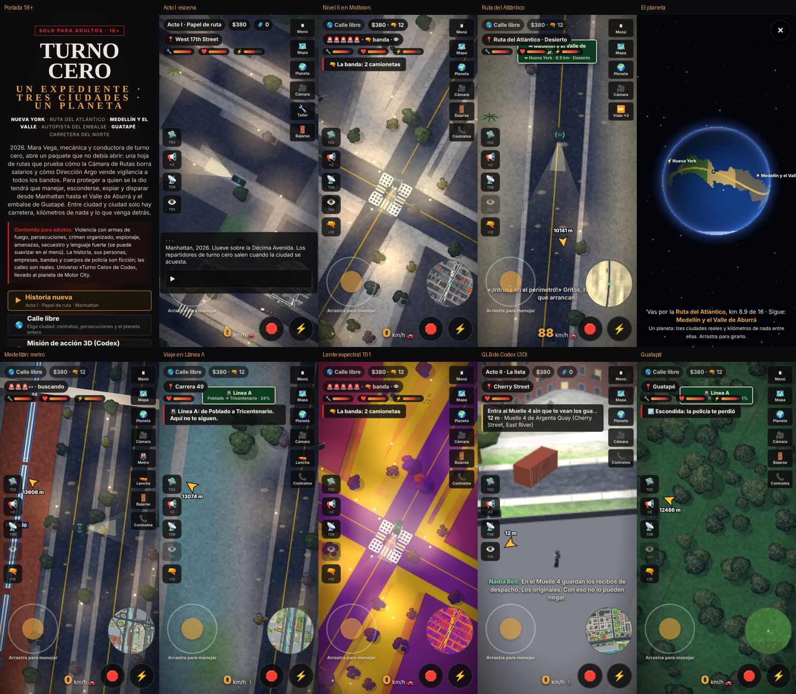

# Turno Cero · el juego grande de Motor City 4.0

> **Pedido del autor (20‑nov‑2026):**
> - «empieza con la creación del monstruo»;
> - «nada de *family friendly*: hay que usar por completo el potencial del motor»;
> - «combina ese mundo con el de Guatapé, exporta también la mejor versión de Medellín y el valle, sus modos de juego, vehículos y transporte, todo en un mismo planeta»;
> - «para llegar a cada ciudad, solo caminos largos en medio de la nada».
>
> **Después:** «adapta todo lo nuevo que se agregó». Codex subió *Turno Cero: Manhattan* (espionaje en 2026, artefactos T01–T12 y 42 modelos GLB), y este juego toma ese canon y lo lleva al planeta.

**Jugar:** `dist/juegos/getaway.html`, también en la página del motor. **Código:** `juegos/getaway/` (`10-contenido.js`, `20-juego.js`, `30-historia.js`, `40-dibujo.js`, `90-inicio.js`). **Pruebas:** `node motor.mjs prueba --navegador`, secciones 19, 20 y la prueba «Turno Cero en Chromium móvil».

## 1. Qué es
- **Género y público:** thriller de conducción, espionaje y crimen organizado. Para **adultos (18+)**.
- **Contenido:** armas de fuego, persecuciones, secuestro, amenazas y lenguaje fuerte de Medellín y Nueva York. El lenguaje se puede suavizar en el menú.
- **Ficción:** todas las personas, empresas, bandas y cuerpos de policía son inventados. Las calles y los barrios son reales, y no se acusa de nada a ningún lugar, institución ni persona real.
- **El planeta (`MC.Planeta`):** un anillo de seis mundos:

  | # | Mundo | Tipo | Detalle |
  |---|---|---|---|
  | 1 | Nueva York | ciudad | Manhattan real, craqueado a 6 m |
  | 2 | Ruta del Atlántico | carretera | 16 km: costa, llanura, desierto y montaña |
  | 3 | Medellín y el Valle de Aburrá | ciudad | 639.457 edificios, metro, cables, tranvía, Metroplús y EnCicla |
  | 4 | Autopista del Embalse | carretera | 12 km: montaña, bosque y lagos |
  | 5 | Guatapé | ciudad | el pueblo, el embalse y la Piedra |
  | 6 | Carretera del Norte | carretera | 15 km: lagos, bosque, nieve y llanura; vuelve a Nueva York |

  - **Puertas reales:**
    - en Nueva York, el puente George Washington y el de Brooklyn;
    - en Medellín, la Autopista Norte y la Autopista Medellín–Bogotá;
    - en Guatapé, la vía a El Peñol.
  - **Al verlo:** el horizonte se curva (`E.curvatura`) y 🌍 muestra el globo entero con sus biomas, la carretera y las luces.

## 2. La historia (canon de Codex, llevado al planeta)
**Personajes:**
- **Mara Vega**, mecánica y conductora de turno cero. Nació en Medellín y se crió en Queens.
- **Nadia Bell**, archivista del sindicato.
- **Isaac Ward**, intermediario de Argenta Quay.
- **Noah Kim**, que tiene una radio independiente.
- **Elena Cross**, inspectora de tránsito ficticia.
- **Elías Rook**, exoperador de Argo.
- **Don Efraín**, mecánico de Barrio Colombia.
- **El Contador**, el estratega financiero de Argo.

**Antagonistas:** la **Cámara de Rutas** y **Dirección Argo**.

| Acto | Capítulo | Dónde | Qué se juega |
|---|---|---|---|
| I | Papel de ruta | Chelsea, Gansevoort, Lower Manhattan | Recoger el encargo y leer la hoja de rutas (decisión); recoger a Nadia contra el reloj; perder a la policía; ruta discreta o visible |
| II | La lista | Lower East Side, East River | Encontrar a Noah con el **Dron Cuervo**; difundir o callar; **sigilo** en el Muelle 4; **módulo de acceso**; **foto**; rescatar al conductor o los recibos; la Cámara de Rutas ataca; aparece Rook |
| III | Cruce de cuentas | Puente George Washington → Ruta del Atlántico → Medellín | 16 km de carretera con la banda y un retén; Don Efraín; el intermediario del Parque Lleras; **perder a la policía en el metro**; sigilo y foto en la Bodega 9 de Itagüí; copia a Cross o a Noah; interceptores de Argo |
| IV | Después de las tres | Medellín → Autopista del Embalse | Camioneta de trocha y pistola de Efraín; **seguir a El Contador con el Rastreador Cerbero**; romper el cerco con nivel 5 y helicóptero |
| V | Saldo | Guatapé | La finca de El Contador (en lancha por el embalse es más rápido); **finales A, B o C**; la huida a la Piedra del Peñol |

**Los finales** dependen de lo que hiciste, no de un botón:
- **A (exposición completa)** exige al menos 3 pruebas y una copia a Noah o a Cross, o haber difundido la muestra. Si no, queda «A · una verdad sin pruebas».
- **B (proteger a los vivos).**
- **C (negociación).**

## 3. Sistemas (todo es del motor y sirve para cualquier juego)
| Sistema | Dónde | Qué hace |
|---|---|---|
| Planeta | `MC.Planeta` (`js/13-planeta.js`) | El anillo de ciudades y carreteras generadas (`Generador.carretera`), las puertas, las llegadas, el globo y el lugar en el globo |
| Búsqueda 0–5 | `MC.Busqueda` (`js/28-busqueda.js`) | El calor y los niveles con los umbrales de Codex (15/35/55/70/85) y un tope de 4 perseguidores. Además:<ul><li>nacen detrás y fuera de la vista;</li><li>van **a donde te vieron por última vez**;</li><li>tácticas seguir, cerrar y embestir;</li><li>embestidas por masa;</li><li>disparos que fallan con la distancia y la velocidad;</li><li>púas, retenes y helicóptero con reflector;</li><li>cebo, pulso y disparos del jugador;</li><li>captura.</li></ul> |
| Modelos GLB | `MC.Modelos` (`js/45-glb.js`) | Lee glTF 2.0 binario sin librerías. La vista 3D usa los 42 modelos de Codex en los carros, las patrullas (con barra de luces), las camionetas, el carro del jugador y lo que el juego ponga en `E.modelos3d` (guardias, retenes, contenedores). La carrocería se tiñe por instancia. |
| Varios mundos por juego | `herramientas/construir.mjs` | `"mundos": [...]` en `juego.json` mete cada MC4 en un `<script type="text/plain">`, y solo se descomprime el mundo al que se llega. `"modelos": "arte/modelos/…"` mete los GLB. |
| Transporte de Medellín | `MC.Transporte` | Subirse al metro, a un cable, al tranvía o al Metroplús en su línea real; la policía te pierde |
| EnCicla, lancha y robo de carros | `MC.Cuerpo` | Las estaciones EnCicla reales, el embalse con su profundidad y los carros del tráfico |
| Piel y animación glTF | `MC.Modelos.posar` | Los actores de Codex con esqueleto (12 huesos y 8 clips: reposo, caminar, correr, sigilo, golpe, interactuar, esquivar e impacto) se animan en la cámara 3D. Mara a pie camina y corre con ellos, y los guardias respiran, se distraen y corren con la alarma. Pendiente que Codex marcó: «reproducir el rig dentro del render web». |
| La escena 3D de Codex | `dist/juegos/turno-cero-accion-3d.html` | Su misión autónoma de acción a pie (distrito de prueba, WebGL2), enlazada desde la portada como «Misión de acción 3D» |
| 4.0.1 | Varios archivos | Faros de noche y abolladuras por zona en los GLB. Motor con sonido y sirena con Doppler. Dron policial 3D. ✊ Reducción no letal a pie. Alejar la cámara hasta el planeta. Eventos de carretera en Calle libre. Contratos nuevos. Arte de portada. |
| 4.0.2 | `50-extras.js` | Run en la ciclovía (el modo de Medellín) para perder a la policía; carreras callejeras con apuestas; guardias que persiguen a pie; ♿ accesibilidad (menos destellos, sin sacudidas, subtítulos grandes) |
| 4.1 · mundo abierto primero | `90-inicio.js`, `55-clasicos.js` | Pedido del autor: «mundo abierto desde el principio; el tutorial o el contexto de la historia es opcional».<ul><li>En la portada, el primer botón es ▶ **Jugar · mundo abierto**: Medellín o donde quedaste, sin tarjetas ni diálogos.</li><li>La historia es 📖 **opcional**: en la portada, en el botón 📖 del juego, en ⏸ Menú y con la tecla H.</li><li>«Cómo se juega» sigue plegado y es opcional.</li><li>La casilla «Entrar directo» salta la portada la próxima vez, después de aceptar el aviso 18+; `?portada` la vuelve a mostrar.</li></ul> |
| 4.1 · motores clásicos | `55-clasicos.js` y `js/47-clasicos.js` | <ul><li>Sigilo a lo *Thief*: gema ◆ de luz (en lo oscuro, los guardias ven a un tercio) y ruido que dobla las esquinas (correr o el motor los atrae).</li><li>Cámaras 🏁 Arcade (*OutRun*) y ⛰️ Vuelo (*Comanche*).</li></ul> |
| 4.2 · la historia se encuentra | `56-abierto.js`, `50-extras.js` | <ul><li>📖 en la calle y en el minimapa donde empieza el próximo capítulo o donde quedó la historia; al pasar cerca solo avisa, se juega si uno quiere.</li><li>La carrera callejera tiene la meta adelante y el rival sale en el carril de al lado.</li><li>Ganchos `EXTRAS.capas` y `EXTRAS.mapa`.</li></ul> |
| Artefactos (ficción de juego) | `juegos/getaway/20-juego.js` | T02 Dron Cuervo, T05 Cebo acústico, T08 Pulso de interferencia, T01 Lente espectral (estilo térmico del motor), T03 Rastreador, T06 Acceso, T11 Cámara, T09 Custodia y T04 VELA |

## 3a. ⏫ Acelerador fijo (4.6.1)
Un toque en ⏫ (o la tecla V) y el carro acelera solo: el joystick solo da la dirección. Otro toque y frena hasta parar. 🛑 sigue frenando mientras se oprime (y, girando, derrapa). Sirve en carro, moto, bici y manejando el tren de 🎮 Modos; a pie se esconde.

## 3b. 🎮 Modos (4.6): el único juego de prueba trae todo
Pedido del autor: «la idea era tener solo un juego de prueba: entrega los cuatro en Turno Cero y rescata lo de EnCicla y El Metro». En el mundo abierto de cualquier ciudad (botón 🎮, ⏸ Menú o la portada, «Modos de juego»), sin policía mientras dura el modo (`juegos/getaway/60-modos.js`):
| Modo | De dónde viene | Qué se juega |
|---|---|---|
| 🏁 Carreras | Motor City · Carreras (4.5) | Circuito o sprint por las calles de aquí (rutas A* del motor), 3 rivales con `MC.Manejo.pilotar` que se adaptan al ritmo, cuenta regresiva, posición, vueltas, premio y récord por ciudad. |
| 🚵 Extremo | Extremo (4.5) | Bici de montaña desde lo más alto de las vías cercanas hasta lo más bajo (1 a 4 km); 🦘 saltar y derrapar suman puntos; dos rivales. |
| 📦 Mandados | Mandados (demo del motor) | Tres entregas encadenadas: parar para recoger, llevar con reloj; los golpes dañan el paquete y bajan el pago. |
| 🚲 EnCicla | Juega EnCicla | Tomar la cicla en una estación y llevarla a la que tiene menos (rebalanceo, tres vueltas); la racha por la ciclorruta multiplica hasta ×3 y volarse un semáforo en rojo (las luces de `MC.Trafico`) resta 50. |
| 🚇 Metro, tranvía y Metroplús | El Metro | Manejas el tren por su línea real (`MC.Transporte`): ⚡ acelera, 🛑 frena; parar dentro del andén da puntos por precisión, abren las puertas y suben y bajan pasajeros; pasarse de la estación resta. |
| 🧪 Laboratorio | El motor | Estilo gráfico, hora, clima y cualquier vehículo, para probarlo todo. |
Prueba: `node pruebas/modos.mjs` juega los cinco de punta a punta en Medellín y abre el mapa.

## 4. Las 13 referencias del autor y lo que se tomó (técnica, nunca arte)
| Referencia | Lo que se tomó |
|---|---|
| Reckless Getaway 2 | La escalada de búsqueda; las patrullas que embisten y cierran; el helicóptero; la persecución que no se acaba hasta perderlos |
| Getaway (MoonLight Games) | Persecuciones cortas sobre calles reales con un objetivo claro |
| #DRIVE | La carretera larga «de la nada», el letrero con los km, el bioma que cambia y el viaje ×3 cuando nadie te sigue |
| Solar Smash | El planeta que se ve entero (🌍), con atmósfera y estrellas |
| Space Frontier 2 | La sensación de escala al alejarse: del carro al planeta |
| WorldBox | El planeta de biomas (costa, desierto, bosque, nieve y lagos) donde caben ciudades |
| Bullet Echo | Los conos de visión de los guardias, el sigilo y la última posición vista |
| Idle Drift | El turbo que se gana con riesgo (casi choques) |
| Pako 2, Forever, 3 y Highway | La cámara aérea de persecución que se aleja y se inclina, y las carreteras largas con tráfico |
| GTA Chinatown Wars | Cámara cenital de crimen urbano, robar carros, la radio, el taller que repinta y misiones con capítulos |

## 5. Lo que falta (y quién lo hace)
Está en `TAREAS-IA.md` § «4.0». En resumen:
- **Codex:**
  - el globo en WebGL y la transición continua;
  - pasar su combate a pie (la escena 3D) a `MC` y a las tres ciudades;
  - LOD de los GLB;
  - el streaming por sectores de Manhattan;
  - el daño por piezas.
  - Los esqueletos ya se reproducen.
- **ChatGPT:** las texturas de los modelos y la portada.
- **Gemini:** medir en un celular real, verificar los lugares y revisar el lenguaje.

## 4.8 · Cómo se juega ahora (Flexibilidad, rescate, un solo mapa y pantalla en mitades)
- **Pantalla en mitades:**
  - **abajo se maneja:** el joystick sale en el cuarto de abajo de tu mano (izquierda, o derecha si eres zurdo) y los botones van del otro lado;
  - **arriba es siempre la cámara:** arrastra para girarla e inclinarla y pellizca para acercar o alejar. El encuadre se queda donde lo dejes y el doble toque arriba lo endereza;
  - el dedo del joystick no se suelta aunque otro dedo mueva la cámara.
- **🗺️ Un solo mapa:** el minimapa, el botón 🗺️ y la tecla M abren el mismo.
  - Toca un punto y aparece **🚀 Ir**: te deja en la calle más cercana a ese punto o, si no hay calle a 400 m, en el sitio transitable más cercano.
  - **🌍** (o alejar más allá de la ciudad) pasa al planeta, y **🗺️** en el planeta vuelve al mapa.
- **🆘 Rescate:** está en el HUD y en ⏸ Menú.
  - Servicios: salir a la calle, 🔧 grúa y mecánico, 🚕 taxi, 🚇 estación más cercana, 🚑 ambulancia, 🏠 volver a donde empezaste y 🗺️ elegir un punto.
  - Si llevas 3,5 s empujando sin moverte, o vas en carro lejos de toda calle, el botón se enciende y te lo ofrece.
  - Con la policía encima, o dentro de un capítulo, no hay saltos.
- **⚙️ Flexibilidad** (⏸ Menú): control, giro, velocidad de los vehículos, distancia de la cámara, acelerador fijo al subir, tren con palanca, mano, tamaño de la interfaz, calidad, vibración y pantalla (en mitades o clásica).
- **🌄 Miradores:** en las lomas, ▶ Mirar pone la cámara de cine sobre el valle y cuenta los miradores que descubres.
- **🖼️ Gráficos (4.9)** en ⚙️ Flexibilidad:
  - **automáticos:** realistas si el aparato da la talla;
  - **realistas:** three.js, con sol y sombras de verdad, luz física, cielo y ventanas encendidas de noche;
  - **clásicos:** más livianos.

  Se cambia en caliente.

## 5.2 · La ciudad viva, los retos del semáforo y 📏 medir
- **La gente reacciona** a lo que haces: un choque fuerte, un derrape, un atropello, un disparo, una explosión o una sirena se oyen hasta cierta distancia. Quien lo oye **mira** (❗), **huye** (💨), **llama** por celular (📞) o **se acerca a ayudar** (🩹), y algunos lo comentan en un globo.
- **Hay gente sentada en las bancas y esperando en los paraderos** de verdad del mapa; de día más, de noche poca, con lluvia menos en las bancas.
- **Testigos:** si alguien llama por algo grave que hiciste, la búsqueda sube («un vecino llamó a la policía») y llega 🚑 la ambulancia (se lleva a los heridos) o 🚒 los bomberos, por las calles reales y con la sirena.
- **🚦 Retos del semáforo:** quieto junto a un semáforo, sostén 🛑 y acelera a la vez (⏫ o el joystick): quemas llanta y el de al lado acepta una carrera hasta un sitio con nombre a medio kilómetro o más.
- **🏍️ Las motos y las bicis se inclinan** en las curvas, con el piloto.
- **🪟 De noche**, con GPU media o alta, detrás de cada ventana encendida se ve un cuarto con su lámpara.
- **📏 Medir el rendimiento:** ⏸ Menú → 📏, o `?medir` en la dirección. Guía en `docs/MEDIR-EN-EL-CELULAR.md`.

## 5.3 · Sitios icónicos, vuelcos, puentear, química y guía de cine
- **🏛️ Los sitios icónicos de Medellín en el 3D realista:**
  - el Coltejer, la Candelaria, la Catedral y el Palacio de la Cultura;
  - el Planetario, Explora y el Orquideorama;
  - la Biblioteca España y la Biblioteca EPM;
  - el estadio, el Parque de las Luces y la Plaza Botero;
  - el Pueblito Paisa, y más.

  Se ven al pasar y de noche se encienden.
- **🚗 Vuelcos:** una curva muy cerrada a alta velocidad o un golpe fuerte de costado vuelca el carro. Se apoya en el costado o en el techo, se endereza solo a los 2,7 s y queda abollado.
- **🔌 Puentear:** después de robar un carro, toca «Puentear» (opcional) y une los cables: si lo logras, nadie reporta el robo.
- **🧪 Química del mundo:** la lluvia apaga el carro en llamas, los charcos salpican y el viento lleva el humo.
- **🍃 Modo cine:** sin flecha, las hojas y las palomas vuelan hacia el destino.

