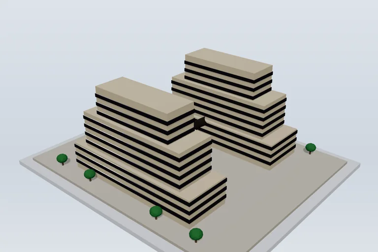

# Centro Administrativo La Alpujarra

> **Ficha G5-07 para C5-02 (Codex)** · ID: `alpujarra` · Categoría: `institucional-moderno`

*Maqueta 3D de estudio limpia (sin texto, sin logos ni marcas), generada con proporciones y paleta exactas de esta ficha para desbloquear C5-02 mientras se restablece la cuota de Nano Banana.*

## Datos geográficos y de Motor City (`mundo.mc4`)

| Campo | Valor |
|---|---|
| **Ubicación** | La Alpujarra · Calle 44 × Carrera 52–55 |
| **Coordenadas WGS84** | `6.244657, -75.573731` |
| **Coordenadas MC4 (metros)** | `x = 13973`, `y = 23811` |
| **Cota del terreno (`relieve`)** | `1478 m s. n. m.` |
| **Hito(s) en `mundo.mc4`** | `alcaldia` (alpujarra, alto MC4 48 m, 1 pol.), `gobernacion` (alpujarra, alto MC4 48 m, 1 pol.), `concejo` (moderno, alto MC4 18 m, 1 pol.), `justicia` (alpujarra, alto MC4 36 m, 1 pol.) |
| **Lugar MC4 asociado** | `alpujarra` |
| **OpenStreetMap** | `way/32470917` (verificado) · consulta Overpass: `way["name"~"Alcaldía de Medellín|Gobernación de Antioquia|Alpujarra"](6.242,-75.576,6.246,-75.571)` |

## Dimensiones y presupuesto de malla (C5-02)

| Parámetro | Valor |
|---|---|
| **Altura aproximada** | **48 m** (~13 pisos) |
| **Planta aproximada (ancho × fondo)** | **180 m × 145 m** |
| **Presupuesto LOD0 (cerca)** | ≤ **940 triángulos** |
| **Presupuesto LOD1 (lejos)** | ≤ **280 triángulos** |

## Materiales

- Concreto arquitectónico a la vista color arena-ocre cálido en volúmenes brutalistas
- Vidrio ahumado bronce oscuro profundamente retranqueado tras quiebrasoles
- Piedra y losas prefabricadas gris cálido en la gran plazoleta cívica
- Concreto y bronce oscuro en el Monumento a la Raza (Rodrigo Arenas Betancur)

## Paleta de referencia (HEX)

| Rol | HEX |
|---|---|
| `fachada` | `#C7B89E` |
| `vidrio` | `#2B2B2E` |
| `plaza` | `#B9B3A8` |
| `monumento` | `#4B443E` |
| `luz_noche` | `#FFE2A8` |

## Rasgos que lo hacen reconocible

1. Dos grandes bloques institucionales gemelos y escalonados (Alcaldía al norte y Gobernación al sur) de ~48 m con quiebrasoles profundos.
2. Amplia plazoleta cívica central presidida por el Monumento a la Raza, de gran silueta curva ascendente en concreto y bronce.
3. Volúmenes complementarios del Concejo (bajo y horizontal) y el Palacio de Justicia en los bordes del conjunto.
4. Articulación directa con la avenida San Juan (calle 44) y la Antigua Estación del Ferrocarril.

## Guía de modelado para Codex (`C5-02`)

- **Volumetría sugerida:** Reemplazar los 4 hitos MC4 (alcaldia, gobernacion, concejo, justicia) con el conjunto unificado: dos torres escalonadas en concreto beige de 48 m con bandas horizontales de sombra profunda, plataforma cívica unificada y arco escultural inclinado de 24 m de alto en el centro de la plazoleta.
- **Lectura nocturna:** Iluminación monumental dirigida al Monumento a la Raza y bandas de oficina cálidas en Alcaldía y Gobernación.
- **Integración en `VistaTres`:** al cargar el sector de `(x=13973, y=23811)`, omitir los bloques genéricos ED1 dentro de la planta de `alpujarra` (o los hitos `alcaldia`, `gobernacion`, `concejo`, `justicia`) y anclar la base a la cota real del terreno (`M.altura(x, y)`) con faldón subterráneo de 2–4 m (12 m en ladera para Biblioteca España) para que nunca flote en pendiente.
