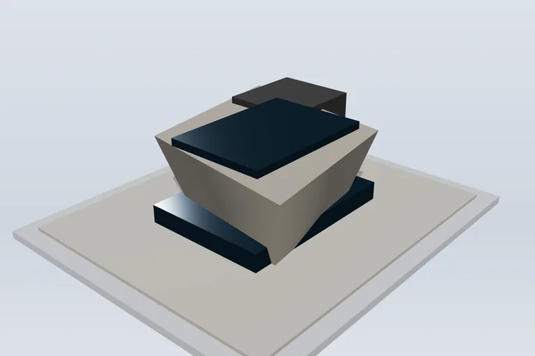

# Biblioteca EPM

> **Ficha G5-07 para C5-02 (Codex)** · ID: `biblioteca_epm` · Categoría: `equipamiento-cultural`

*Maqueta 3D de estudio limpia (sin texto, sin logos ni marcas), generada con proporciones y paleta exactas de esta ficha para desbloquear C5-02 mientras se restablece la cuota de Nano Banana.*

## Datos geográficos y de Motor City (`mundo.mc4`)

| Campo | Valor |
|---|---|
| **Ubicación** | La Candelaria · Costado occidental de Plaza Cisneros (Carrera 54 # 44-48) |
| **Coordenadas WGS84** | `6.246407, -75.573133` |
| **Coordenadas MC4 (metros)** | `x = 14039`, `y = 23618` |
| **Cota del terreno (`relieve`)** | `1473 m s. n. m.` |
| **Hito(s) en `mundo.mc4`** | `bibepm` (ladrillo, alto MC4 22 m, 1 pol.) |
| **Lugar MC4 asociado** | `luces` |
| **OpenStreetMap** | `way/32474558` (verificado) · consulta Overpass: `way["name"~"Biblioteca EPM"](6.245,-75.575,6.248,-75.571)` |

## Dimensiones y presupuesto de malla (C5-02)

| Parámetro | Valor |
|---|---|
| **Altura aproximada** | **22 m** (~4 pisos) |
| **Planta aproximada (ancho × fondo)** | **62 m × 90 m** |
| **Presupuesto LOD0 (cerca)** | ≤ **660 triángulos** |
| **Presupuesto LOD1 (lejos)** | ≤ **190 triángulos** |

## Materiales

- Piedra gris-arena y concreto arquitectónico en el gran volumen piramidal truncado invertido
- Ladrillo y placas oscuras en el núcleo vertical posterior
- Vidrio ahumado en rasgaduras verticales y en la fachada acristalada que mira a Plaza Cisneros
- Acero pintado gris en pérgolas y escalinata de acceso

## Paleta de referencia (HEX)

| Rol | HEX |
|---|---|
| `piedra` | `#B5ADA0` |
| `oscuro` | `#4A4947` |
| `vidrio` | `#283F4C` |
| `acento` | `#8A8175` |
| `luz_noche` | `#FFE3A8` |

## Rasgos que lo hacen reconocible

1. Inconfundible volumen en pirámide truncada invertida (más ancho arriba que en la base) que parece abrirse sobre Plaza Cisneros.
2. Cara inclinada masiva en tono piedra gris-arena que genera un gran alero natural de sombra hacia la plaza.
3. Volumen posterior ortogonal que alberga salas de lectura y auditorio con lucernarios superiores.
4. Contrapunto contemporáneo directo frente al bosque de postes de luz y los edificios republicanos de ladrillo.

## Guía de modelado para Codex (`C5-02`)

- **Volumetría sugerida:** Reemplazar hito `bibepm`: prisma de base más estrecha (46×72 m en z=0) cuyas caras oriente y norte se inclinan hacia afuera hasta alcanzar 60×84 m en z=22 m (pirámide invertida truncada) en tono piedra cálida con franja acristalada retranqueada en la planta baja.
- **Lectura nocturna:** Resplandor cálido en la galería baja bajo el voladizo inclinado y en las rasgaduras verticales.
- **Integración en `VistaTres`:** al cargar el sector de `(x=14039, y=23618)`, omitir los bloques genéricos ED1 dentro de la planta de `biblioteca_epm` (o los hitos `bibepm`) y anclar la base a la cota real del terreno (`M.altura(x, y)`) con faldón subterráneo de 2–4 m (12 m en ladera para Biblioteca España) para que nunca flote en pendiente.
