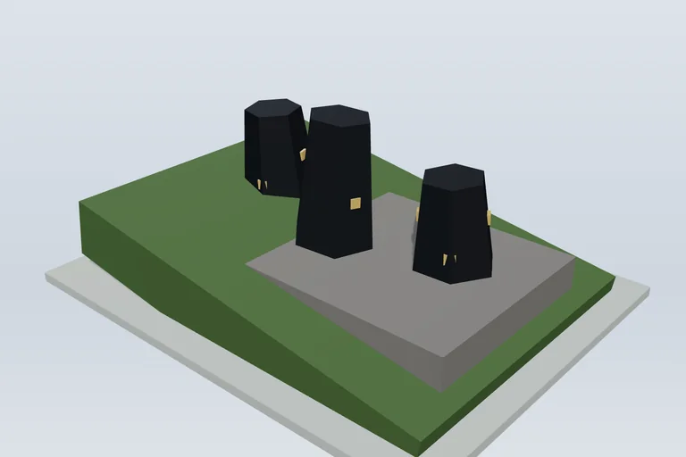

# Parque Biblioteca España

> **Ficha G5-07 para C5-02 (Codex)** · ID: `biblioteca_espana` · Categoría: `equipamiento-cultural`

*Maqueta 3D de estudio limpia (sin texto, sin logos ni marcas), generada con proporciones y paleta exactas de esta ficha para desbloquear C5-02 mientras se restablece la cuota de Nano Banana.*

## Datos geográficos y de Motor City (`mundo.mc4`)

| Campo | Valor |
|---|---|
| **Ubicación** | Popular (Comuna 1) · Santo Domingo Savio (cota ~1 827 m, junto al Metrocable) |
| **Coordenadas WGS84** | `6.294721, -75.544104` |
| **Coordenadas MC4 (metros)** | `x = 17252`, `y = 18276` |
| **Cota del terreno (`relieve`)** | `1827 m s. n. m.` |
| **Hito(s) en `mundo.mc4`** | `bibespana` (rocas, alto MC4 20 m, 3 pol.) |
| **Lugar MC4 asociado** | `santo_domingo` |
| **OpenStreetMap** | Complejo multi-way / sin ID único verificado · consulta Overpass: `way["name"~"Biblioteca España"](6.293,-75.546,6.296,-75.542)` |

## Dimensiones y presupuesto de malla (C5-02)

| Parámetro | Valor |
|---|---|
| **Altura aproximada** | **26 m** (~5 pisos) |
| **Planta aproximada (ancho × fondo)** | **53 m × 70 m** |
| **Presupuesto LOD0 (cerca)** | ≤ **720 triángulos** |
| **Presupuesto LOD1 (lejos)** | ≤ **200 triángulos** |

## Materiales

- Revestimiento oscuro en pizarra negra-grafito / paneles metálicos oscuros facetados
- Concreto gris oscuro en plataforma-mirador escalonada anclada a la ladera
- Vidrio con marcos negros en ventanas cuadradas y rasgaduras asimétricas
- Barandas metálicas en la terraza panorámica que domina todo el Valle de Aburrá

## Paleta de referencia (HEX)

| Rol | HEX |
|---|---|
| `rocas` | `#2C3036` |
| `aristas` | `#464C54` |
| `plataforma` | `#8E8C88` |
| `vidrio` | `#1D2933` |
| `luz_noche` | `#FFD678` |

## Rasgos que lo hacen reconocible

1. Tres grandes volúmenes monolíticos oscuros y facetados inspirados en rocas de la montaña antioqueña.
2. Posados en lo alto de la ladera nororiental (Santo Domingo Savio, cota ~1 827 m), visibles desde kilómetros de distancia en el valle.
3. Plataforma-balcón continua en la base que une los tres bloques y sirve de mirador urbano junto al Metrocable línea K.
4. Aberturas acristaladas geométricas dispersas que de noche brillan como faroles sobre el cerro.

## Guía de modelado para Codex (`C5-02`)

- **Volumetría sugerida:** Plataforma mirador de 53×70×4 m anclada a la pendiente (con faldón profundo de 12 m hacia la ladera occidental para nunca flotar); encima, 3 prismas irregulares biselados/inclinados en color pizarra oscura (#2C3036) de alturas 26 m, 22 m y 19 m, reemplazando las 3 huellas de hito `bibespana`.
- **Lectura nocturna:** Ventanas cuadradas cálidas brillando intensamente sobre las tres siluetas oscuras en lo alto de la montaña.
- **Integración en `VistaTres`:** al cargar el sector de `(x=17252, y=18276)`, omitir los bloques genéricos ED1 dentro de la planta de `biblioteca_espana` (o los hitos `bibespana`) y anclar la base a la cota real del terreno (`M.altura(x, y)`) con faldón subterráneo de 2–4 m (12 m en ladera para Biblioteca España) para que nunca flote en pendiente.
