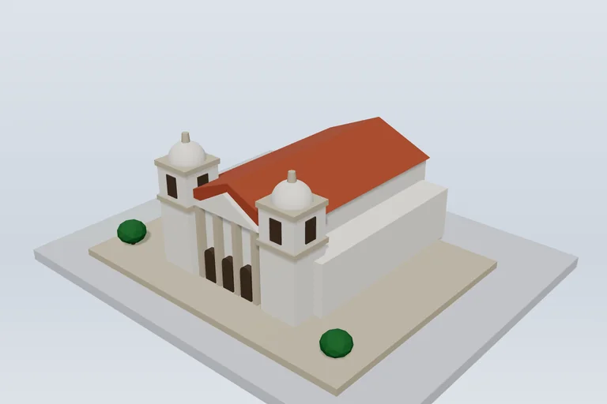

# Basílica de Nuestra Señora de la Candelaria y Parque Berrío

> **Ficha G5-07 para C5-02 (Codex)** · ID: `candelaria` · Categoría: `patrimonio-religioso`

*Maqueta 3D de estudio limpia (sin texto, sin logos ni marcas), generada con proporciones y paleta exactas de esta ficha para desbloquear C5-02 mientras se restablece la cuota de Nano Banana.*

## Datos geográficos y de Motor City (`mundo.mc4`)

| Campo | Valor |
|---|---|
| **Ubicación** | La Candelaria · Parque Berrío (Calle 50 × Carrera 49) |
| **Coordenadas WGS84** | `6.249958, -75.567388` |
| **Coordenadas MC4 (metros)** | `x = 14675`, `y = 23225` |
| **Cota del terreno (`relieve`)** | `1494 m s. n. m.` |
| **Hito(s) en `mundo.mc4`** | `candelaria` (iglesia, alto MC4 16 m, 1 pol.) |
| **Lugar MC4 asociado** | `berrio` |
| **OpenStreetMap** | Complejo multi-way / sin ID único verificado · consulta Overpass: `way["amenity"="place_of_worship"]["name"~"Candelaria"](6.248,-75.569,6.252,-75.565)` |

## Dimensiones y presupuesto de malla (C5-02)

| Parámetro | Valor |
|---|---|
| **Altura aproximada** | **28 m** (~4 pisos) |
| **Planta aproximada (ancho × fondo)** | **67 m × 50 m** |
| **Presupuesto LOD0 (cerca)** | ≤ **820 triángulos** |
| **Presupuesto LOD1 (lejos)** | ≤ **240 triángulos** |

## Materiales

- Mampostería encalada blanca y crema marfil en fachada neoclásica
- Piedra arenisca ocre claro en pilastras, zócalo y triple portada arqueada
- Teja de barro cocido terracota en nave central y naves laterales a dos aguas
- Cobre envejecido o bronce oscuro en campanas y cruces de cúpulas

## Paleta de referencia (HEX)

| Rol | HEX |
|---|---|
| `fachada` | `#F2EEE6` |
| `piedra` | `#CBBFA8` |
| `techo` | `#B45B3A` |
| `acento` | `#5C4A3B` |
| `luz_noche` | `#FFD68A` |

## Rasgos que lo hacen reconocible

1. Dos torres campanario gemelas simétricas flanqueando la fachada occidental, coronadas por cupulines blancos con linterna.
2. Pórtico neoclásico con tres arcos de medio punto, pilastras adosadas y frontón triangular centrado sobre la nave.
3. Cubierta larga a dos aguas de teja de barro rojiza muy visible desde el viaducto del Metro en Parque Berrío.
4. Atrio elevado con escalinata corta que abre directamente a la plaza peatonal y esculturas del Parque Berrío.

## Guía de modelado para Codex (`C5-02`)

- **Volumetría sugerida:** Nave basilical de 58×28×15 m con cubierta a dos aguas (cumbrera en z=19 m), dos torres cuadradas frontales de 7×7×23 m con cuerpo de campanas abierto y semiesfera blanca hasta z=28 m, más frontón triangular intermedio y atrio escalonado frontal.
- **Lectura nocturna:** Reflectores cálidos ascendentes en la fachada blanca y luz tenue ámbar dentro de los arcos del campanario.
- **Integración en `VistaTres`:** al cargar el sector de `(x=14675, y=23225)`, omitir los bloques genéricos ED1 dentro de la planta de `candelaria` (o los hitos `candelaria`) y anclar la base a la cota real del terreno (`M.altura(x, y)`) con faldón subterráneo de 2–4 m (12 m en ladera para Biblioteca España) para que nunca flote en pendiente.
