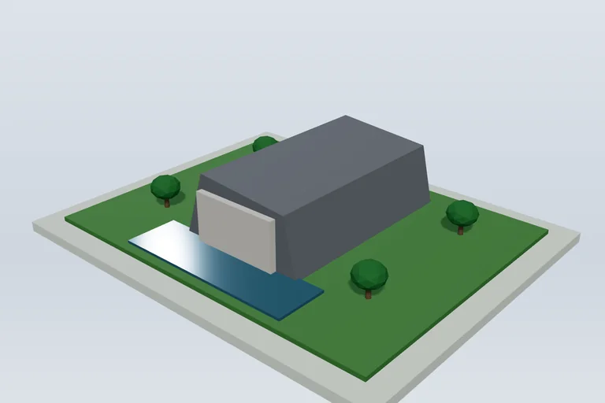

# Museo Casa de la Memoria

> **Ficha G5-07 para C5-02 (Codex)** · ID: `casa_memoria` · Categoría: `museo-contemporaneo`

*Maqueta 3D de estudio limpia (sin texto, sin logos ni marcas), generada con proporciones y paleta exactas de esta ficha para desbloquear C5-02 mientras se restablece la cuota de Nano Banana.*

## Datos geográficos y de Motor City (`mundo.mc4`)

| Campo | Valor |
|---|---|
| **Ubicación** | La Candelaria · Parque Bicentenario (Calle 51 # 36-66) |
| **Coordenadas WGS84** | `6.245899, -75.556501` |
| **Coordenadas MC4 (metros)** | `x = 15880`, `y = 23674` |
| **Cota del terreno (`relieve`)** | `1517 m s. n. m.` |
| **Hito(s) en `mundo.mc4`** | `memoria` (moderno, alto MC4 12 m, 1 pol.) |
| **Lugar MC4 asociado** | `playa` |
| **OpenStreetMap** | Complejo multi-way / sin ID único verificado · consulta Overpass: `way["name"~"Casa de la Memoria"](6.244,-75.558,6.247,-75.555)` |

## Dimensiones y presupuesto de malla (C5-02)

| Parámetro | Valor |
|---|---|
| **Altura aproximada** | **12 m** (~2 pisos) |
| **Planta aproximada (ancho × fondo)** | **49 m × 60 m** |
| **Presupuesto LOD0 (cerca)** | ≤ **620 triángulos** |
| **Presupuesto LOD1 (lejos)** | ≤ **180 triángulos** |

## Materiales

- Concreto arquitectónico gris claro moldeado en placas lisas y muros inclinados
- Lámina metálica gris-zinc en la envolvente superior continua tipo túnel
- Vidrio claro en los dos grandes portales abiertos (acceso y salida al espejo de agua)
- Espejo de agua somero y prados del Parque Bicentenario rodeando el volumen

## Paleta de referencia (HEX)

| Rol | HEX |
|---|---|
| `concreto` | `#C4C2BC` |
| `zinc` | `#6D7278` |
| `vidrio` | `#2E4552` |
| `agua` | `#437082` |
| `luz_noche` | `#FFE4AE` |

## Rasgos que lo hacen reconocible

1. Volumen escultórico monolítico en forma de túnel trapezoidal biselado que emerge suavemente del terreno del Parque Bicentenario.
2. Dos grandes bocas abiertas en sus extremos que enmarcan el paisaje y dejan entrar la luz natural.
3. Espejo de agua tranquilo adyacente y plazoleta conmemorativa arbolada junto a la quebrada Santa Elena.
4. Estética minimalista y serena sin ornamentos, muy fácil de leer por su silueta geométrica pura.

## Guía de modelado para Codex (`C5-02`)

- **Volumetría sugerida:** Reemplazar hito `memoria`: volumen alargado de 46×24×11 m con sección transversal trapezoidal biselada (techo y muros continuos en concreto/zinc gris) ligeramente enterrado en talud verde, con extremos rebajados acristalados y espejo de agua frontal de 36×10 m.
- **Lectura nocturna:** Luz interior cálida emergiendo suavemente desde las dos bocas del túnel y reflejándose en el espejo de agua.
- **Integración en `VistaTres`:** al cargar el sector de `(x=15880, y=23674)`, omitir los bloques genéricos ED1 dentro de la planta de `casa_memoria` (o los hitos `memoria`) y anclar la base a la cota real del terreno (`M.altura(x, y)`) con faldón subterráneo de 2–4 m (12 m en ladera para Biblioteca España) para que nunca flote en pendiente.
