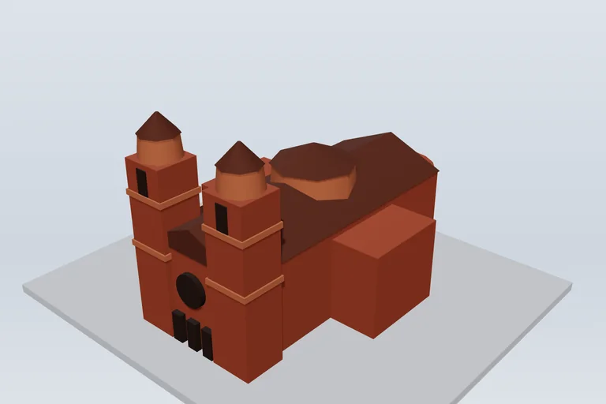

# Catedral Basílica Metropolitana de Medellín

> **Ficha G5-07 para C5-02 (Codex)** · ID: `catedral_metropolitana` · Categoría: `patrimonio-religioso`

*Maqueta 3D de estudio limpia (sin texto, sin logos ni marcas), generada con proporciones y paleta exactas de esta ficha para desbloquear C5-02 mientras se restablece la cuota de Nano Banana.*

## Datos geográficos y de Motor City (`mundo.mc4`)

| Campo | Valor |
|---|---|
| **Ubicación** | La Candelaria · Parque de Bolívar (Carrera 48 × Calle 56) |
| **Coordenadas WGS84** | `6.254030, -75.563926` |
| **Coordenadas MC4 (metros)** | `x = 15058`, `y = 22775` |
| **Cota del terreno (`relieve`)** | `1495 m s. n. m.` |
| **Hito(s) en `mundo.mc4`** | `catedral` (basilica, alto MC4 30 m, 1 pol.) |
| **Lugar MC4 asociado** | `bolivar` |
| **OpenStreetMap** | `way/366050226` (verificado) · consulta Overpass: `way["name"~"Catedral.*Metropolitana"](6.252,-75.566,6.256,-75.562)` |

## Dimensiones y presupuesto de malla (C5-02)

| Parámetro | Valor |
|---|---|
| **Altura aproximada** | **52 m** (~8 pisos) |
| **Planta aproximada (ancho × fondo)** | **101 m × 113 m** |
| **Presupuesto LOD0 (cerca)** | ≤ **960 triángulos** |
| **Presupuesto LOD1 (lejos)** | ≤ **280 triángulos** |

## Materiales

- Ladrillo macizo cocido (1,12 millones de piezas) en tonos terracota-ocre cálido
- Teja de barro y lámina oscura en cubiertas inclinadas de la cruz latina
- Piedra y ladrillo moldeado en arquivoltas del triple portal románico y rosetón central
- Bronce oscuro en puertas monumentales y cruces de las torres

## Paleta de referencia (HEX)

| Rol | HEX |
|---|---|
| `ladrillo` | `#A85438` |
| `ladrillo_claro` | `#C4734F` |
| `techo` | `#6B3D2E` |
| `acento` | `#3E2E28` |
| `luz_noche` | `#FFD68C` |

## Rasgos que lo hacen reconocible

1. La mayor construcción del mundo en ladrillo cocido macizo, de estilo neorrománico monumental frente al Parque de Bolívar.
2. Dos imponentes torres cuadradas gemelas de ~52 m en la fachada sur, rematadas con cuerpos octogonales y chapiteles cortos.
3. Gran planta de cruz latina con cimborrio/cúpula baja en el crucero, rosetón circular central y triple portada arqueada.
4. Color terracota uniforme muy cálido que contrasta con el verde denso de los árboles del Parque de Bolívar.

## Guía de modelado para Codex (`C5-02`)

- **Volumetría sugerida:** Cruz latina en ladrillo terracota: nave principal de 82×32×26 m, transepto de 54×24×24 m con tambor octogonal central (z=32 m) y ábside semicircular al norte; en el frente sur, dos torres gemelas de 12×12×52 m con arcos de medio punto y frontón con rosetón.
- **Lectura nocturna:** Bañadores cálidos dorados sobre las dos torres de ladrillo y la fachada principal hacia el Parque de Bolívar.
- **Integración en `VistaTres`:** al cargar el sector de `(x=15058, y=22775)`, omitir los bloques genéricos ED1 dentro de la planta de `catedral_metropolitana` (o los hitos `catedral`) y anclar la base a la cota real del terreno (`M.altura(x, y)`) con faldón subterráneo de 2–4 m (12 m en ladera para Biblioteca España) para que nunca flote en pendiente.
