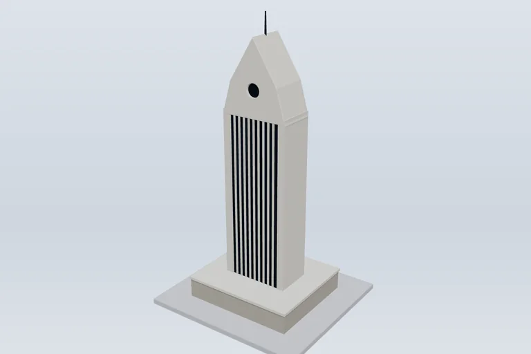

# Edificio Coltejer

> **Ficha G5-07 para C5-02 (Codex)** · ID: `coltejer` · Categoría: `rascacielos`

*Maqueta 3D de estudio limpia (sin texto, sin logos ni marcas), generada con proporciones y paleta exactas de esta ficha para desbloquear C5-02 mientras se restablece la cuota de Nano Banana.*

## Datos geográficos y de Motor City (`mundo.mc4`)

| Campo | Valor |
|---|---|
| **Ubicación** | La Candelaria · Centro (Calle 52 × Carrera 46) |
| **Coordenadas WGS84** | `6.250136, -75.566060` |
| **Coordenadas MC4 (metros)** | `x = 14822`, `y = 23206` |
| **Cota del terreno (`relieve`)** | `1497 m s. n. m.` |
| **Hito(s) en `mundo.mc4`** | `coltejer` (aguja, alto MC4 150 m, 1 pol.) |
| **Lugar MC4 asociado** | `coltejer` |
| **OpenStreetMap** | `way/31973359` (verificado) · consulta Overpass: `way["name"~"Coltejer"](6.248,-75.568,6.252,-75.564)` |

## Dimensiones y presupuesto de malla (C5-02)

| Parámetro | Valor |
|---|---|
| **Altura aproximada** | **175 m** (~36 pisos) |
| **Planta aproximada (ancho × fondo)** | **52 m × 45 m** |
| **Presupuesto LOD0 (cerca)** | ≤ **780 triángulos** |
| **Presupuesto LOD1 (lejos)** | ≤ **220 triángulos** |

## Materiales

- Concreto prefabricado blanco-marfil en costillas verticales estructurales
- Vidrio ahumado oscuro corrido en franjas horizontales retranqueadas
- Concreto gris cálido en podio comercial escalonado de 3 pisos
- Acero pintado gris grafito en marcos de óculos y antena de remate

## Paleta de referencia (HEX)

| Rol | HEX |
|---|---|
| `fachada` | `#EAE7DF` |
| `vidrio` | `#26343F` |
| `podio` | `#B8B3A8` |
| `acento` | `#46525C` |
| `luz_noche` | `#FFE6A8` |

## Rasgos que lo hacen reconocible

1. Silueta icónica en aguja o lanzadera textil que se estrecha hacia los costados desde el piso 24 hasta la punta.
2. Corona triangular afilada de ~25 m con dos grandes óculos circulares acristalados («ojo de la aguja») cerca de la cúspide.
3. Ritmo vertical muy marcado de costillas blancas prefabricadas que envuelven las fachadas norte y sur.
4. Podio rectangular amplio en la base con marquesina volada hacia la avenida La Playa y la calle Colombia.
5. Faro nocturno de referencia desde todo el valle: iluminación vertical cálida en la corona y franjas de oficina.

## Guía de modelado para Codex (`C5-02`)

- **Volumetría sugerida:** Extrudir podio de 52×45×12 m; cuerpo principal retranqueado de 36×22 m hasta z=118 m con ligero estrechamiento lateral; de z=118 a z=175 m converger las caras menores en bisel triangular agudo (corona) con dos rebajes circulares acristalados en las caras principales. Repetir costillas verticales con textura de atlas o geometría ligera en LOD0.
- **Lectura nocturna:** Banda cálida en ventanas de pisos 5–32 con variación pseudoaleatoria y brillo suave en los óculos circulares y la arista de la aguja.
- **Integración en `VistaTres`:** al cargar el sector de `(x=14822, y=23206)`, omitir los bloques genéricos ED1 dentro de la planta de `coltejer` (o los hitos `coltejer`) y anclar la base a la cota real del terreno (`M.altura(x, y)`) con faldón subterráneo de 2–4 m (12 m en ladera para Biblioteca España) para que nunca flote en pendiente.
