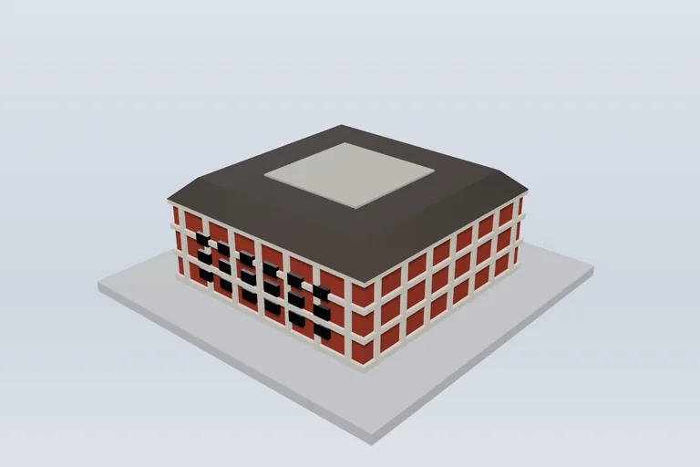

# Edificio Carré

> **Ficha G5-07 para C5-02 (Codex)** · ID: `edificio_carre` · Categoría: `patrimonio-republicano`

*Maqueta 3D de estudio limpia (sin texto, sin logos ni marcas), generada con proporciones y paleta exactas de esta ficha para desbloquear C5-02 mientras se restablece la cuota de Nano Banana.*

## Datos geográficos y de Motor City (`mundo.mc4`)

| Campo | Valor |
|---|---|
| **Ubicación** | La Candelaria · Plaza Cisneros (Carrera 52 × Calle 45) |
| **Coordenadas WGS84** | `6.245966, -75.571389` |
| **Coordenadas MC4 (metros)** | `x = 14232`, `y = 23667` |
| **Cota del terreno (`relieve`)** | `1475 m s. n. m.` |
| **Hito(s) en `mundo.mc4`** | `carre` (republicano, alto MC4 16 m, 1 pol.) |
| **Lugar MC4 asociado** | `luces` |
| **OpenStreetMap** | `way/32474597` (verificado) · consulta Overpass: `way["name"~"Edificio Carré"](6.245,-75.573,6.247,-75.570)` |

## Dimensiones y presupuesto de malla (C5-02)

| Parámetro | Valor |
|---|---|
| **Altura aproximada** | **16 m** (~3 pisos) |
| **Planta aproximada (ancho × fondo)** | **43 m × 42 m** |
| **Presupuesto LOD0 (cerca)** | ≤ **680 triángulos** |
| **Presupuesto LOD1 (lejos)** | ≤ **190 triángulos** |

## Materiales

- Ladrillo cocido terracota y paños ocre-ladrillo de arquitectura republicana francesa
- Cornisas, dovelas y marcos de ventanas en estuco marfil claro
- Barandillas de hierro forjado negro en balcones corridos
- Cubierta de mansarda gris pizarra / teja de barro con remates en esquinas

## Paleta de referencia (HEX)

| Rol | HEX |
|---|---|
| `ladrillo` | `#B3553D` |
| `estuco` | `#EFE8D8` |
| `hierro` | `#2E3134` |
| `techo` | `#645A54` |
| `luz_noche` | `#FFDA90` |

## Rasgos que lo hacen reconocible

1. Gemelo estilístico del Edificio Vásquez, obra de Charles Émile Carré (1895) en el costado oriental de Plaza Cisneros.
2. Ritmo estricto de arcos rebajados y de medio punto enmarcados por pilastras de ladrillo y bandas claras.
3. Tejado con ligero aire de mansarda y buhardillas discretas rematando la cornisa superior.
4. Gran presencia urbana al reflejar la luz nocturna de los 300 postes del Parque de las Luces.

## Guía de modelado para Codex (`C5-02`)

- **Volumetría sugerida:** Bloque cuadrado de 43×42×15,5 m con patio interior central, fachada en ladrillo cálido con molduras crema por piso, arcos en planta baja y cubierta perimetral tipo mansarda inclinada gris-terracota.
- **Lectura nocturna:** Iluminación cálida de fachada resaltando las pilastras y el diálogo arquitectónico con el Edificio Vásquez.
- **Integración en `VistaTres`:** al cargar el sector de `(x=14232, y=23667)`, omitir los bloques genéricos ED1 dentro de la planta de `edificio_carre` (o los hitos `carre`) y anclar la base a la cota real del terreno (`M.altura(x, y)`) con faldón subterráneo de 2–4 m (12 m en ladera para Biblioteca España) para que nunca flote en pendiente.
