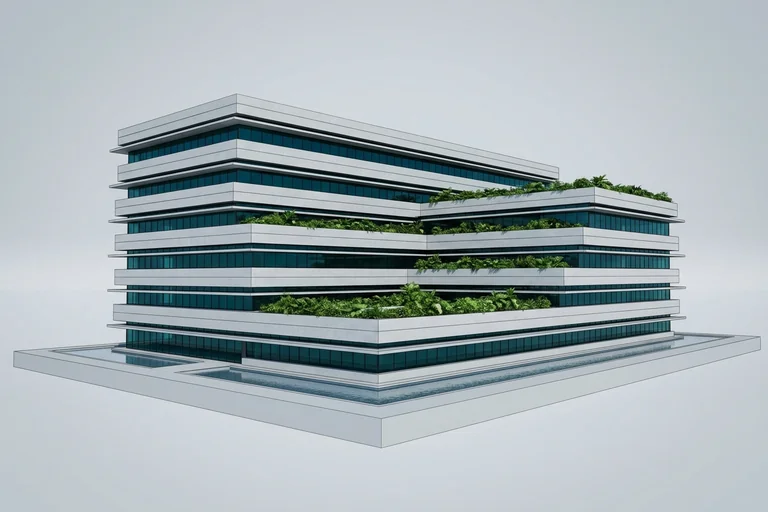

# Edificio Inteligente de EPM

> **Ficha G5-07 para C5-02 (Codex)** · ID: `edificio_epm` · Categoría: `institucional-moderno`

*Dibujo arquitectónico original generado con Nano Banana (sin texto, sin logos ni marcas).*

## Datos geográficos y de Motor City (`mundo.mc4`)

| Campo | Valor |
|---|---|
| **Ubicación** | La Alpujarra · Carrera 58 # 42-125 (junto al río Medellín) |
| **Coordenadas WGS84** | `6.245284, -75.577855` |
| **Coordenadas MC4 (metros)** | `x = 13517`, `y = 23742` |
| **Cota del terreno (`relieve`)** | `1480 m s. n. m.` |
| **Hito(s) en `mundo.mc4`** | `epm` (vidrio, alto MC4 85 m, 1 pol.) |
| **Lugar MC4 asociado** | `epm` |
| **OpenStreetMap** | Complejo multi-way / sin ID único verificado · consulta Overpass: `way["name"~"Edificio.*EPM|Empresas Públicas"](6.243,-75.580,6.247,-75.575)` |

## Dimensiones y presupuesto de malla (C5-02)

| Parámetro | Valor |
|---|---|
| **Altura aproximada** | **56 m** (~14 pisos) |
| **Planta aproximada (ancho × fondo)** | **100 m × 134 m** |
| **Presupuesto LOD0 (cerca)** | ≤ **760 triángulos** |
| **Presupuesto LOD1 (lejos)** | ≤ **220 triángulos** |

## Materiales

- Losas y parasoles horizontales de concreto prefabricado gris plateado
- Fachada continua de vidrio reflectante azul-petróleo verdoso
- Jardines colgantes y terrazas verdes escalonadas con vegetación tropical
- Espejo de agua perimetral reflectante con puentes de acceso peatonales

## Paleta de referencia (HEX)

| Rol | HEX |
|---|---|
| `fachada` | `#D4D8DC` |
| `vidrio` | `#1D4952` |
| `vegetacion` | `#3E7A38` |
| `agua` | `#386A7A` |
| `luz_noche` | `#BFE6FF` |

## Rasgos que lo hacen reconocible

1. Volumetría horizontal escalonada en terrazas que se abren hacia el oriente y el Parque de los Pies Descalzos.
2. Franjas muy nítidas alternando antepechos/parasoles blanco-plata y bandas corridas de vidrio azul verdoso.
3. Terrazas ajardinadas con vegetación densa integradas en varios niveles del edificio.
4. Foso de agua (espejo perimetral) que rodea la planta baja y refleja el edificio sobre el costado del río.

## Guía de modelado para Codex (`C5-02`)

- **Volumetría sugerida:** Espejo de agua basal de 102×136×0,4 m; sobre él, 3 cuerpos escalonados en L/U (z=0..18 m, z=18..36 m, z=36..56 m) con voladizos de losa claros cada 4 m, franjas de vidrio azul-petróleo retranqueadas 0,8 m y franjas verdes de terraza en los descansos. Nota: en MC4 el hito genérico tiene alto=85 m; usar la altura real escalonada (~56 m) para mantener fidelidad.
- **Lectura nocturna:** Bandas interiores blanco-frías y reflejo celeste suave sobre el espejo de agua basal.
- **Integración en `VistaTres`:** al cargar el sector de `(x=13517, y=23742)`, omitir los bloques genéricos ED1 dentro de la planta de `edificio_epm` (o los hitos `epm`) y anclar la base a la cota real del terreno (`M.altura(x, y)`) con faldón subterráneo de 2–4 m (12 m en ladera para Biblioteca España) para que nunca flote en pendiente.
