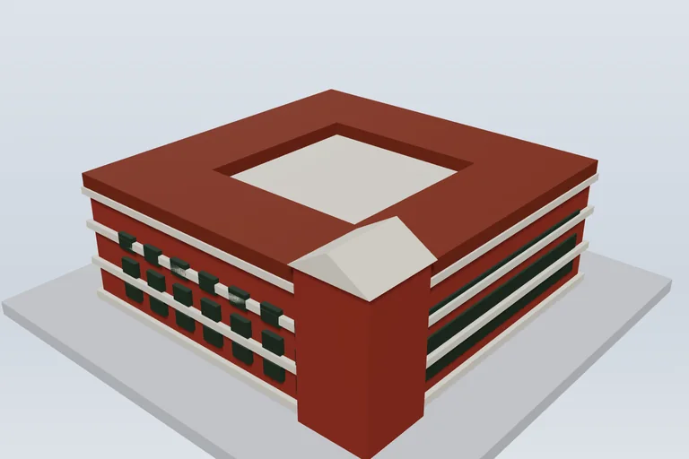

# Edificio Vásquez

> **Ficha G5-07 para C5-02 (Codex)** · ID: `edificio_vasquez` · Categoría: `patrimonio-republicano`

*Maqueta 3D de estudio limpia (sin texto, sin logos ni marcas), generada con proporciones y paleta exactas de esta ficha para desbloquear C5-02 mientras se restablece la cuota de Nano Banana.*

## Datos geográficos y de Motor City (`mundo.mc4`)

| Campo | Valor |
|---|---|
| **Ubicación** | La Candelaria · Plaza Cisneros (Carrera 52 × Calle 44) |
| **Coordenadas WGS84** | `6.245556, -75.571517` |
| **Coordenadas MC4 (metros)** | `x = 14218`, `y = 23712` |
| **Cota del terreno (`relieve`)** | `1475 m s. n. m.` |
| **Hito(s) en `mundo.mc4`** | `vasquez` (republicano, alto MC4 16 m, 1 pol.) |
| **Lugar MC4 asociado** | `luces` |
| **OpenStreetMap** | `way/32474590` (verificado) · consulta Overpass: `way["name"~"Edificio Vásquez"](6.244,-75.573,6.247,-75.570)` |

## Dimensiones y presupuesto de malla (C5-02)

| Parámetro | Valor |
|---|---|
| **Altura aproximada** | **16 m** (~3 pisos) |
| **Planta aproximada (ancho × fondo)** | **46 m × 45 m** |
| **Presupuesto LOD0 (cerca)** | ≤ **680 triángulos** |
| **Presupuesto LOD1 (lejos)** | ≤ **190 triángulos** |

## Materiales

- Ladrillo a la vista rojo-terracota de aparejo republicano francés (diseño de Charles Émile Carré)
- Molduras, cornisas, arcos y pilastras en estuco crema marfil
- Carpintería de madera pintada verde oscuro / café en balcones y portones
- Cubierta inclinada de teja de barro con claraboya sobre el patio interior

## Paleta de referencia (HEX)

| Rol | HEX |
|---|---|
| `ladrillo` | `#A94D38` |
| `estuco` | `#EDE6D6` |
| `carpinteria` | `#3D4D3E` |
| `techo` | `#8F462F` |
| `luz_noche` | `#FFD98E` |

## Rasgos que lo hacen reconocible

1. Bloque esquinero republicano de finales del siglo XIX con fachada bicoloreada en ladrillo rojo y molduras crema.
2. Tres pisos de arcos repetidos con balcones metálicos delicados y cornisas horizontales muy marcadas.
3. Esquina en chaflán jerarquizada con frontón y remate decorativo frente al Parque de las Luces.
4. Forma pareja patrimonial inseparable con el vecino Edificio Carré al otro lado de la calle.

## Guía de modelado para Codex (`C5-02`)

- **Volumetría sugerida:** Bloque cuadrado de 45×45×15 m con patio interior central y chaflán en la esquina noroccidental; fachada en ladrillo terracota con 3 cornisas corridas crema, zócalo de arcos en primer piso y cubierta de teja a cuatro aguas.
- **Lectura nocturna:** Baño arquitectónico cálido en los arcos del primer piso y balcones del segundo nivel.
- **Integración en `VistaTres`:** al cargar el sector de `(x=14218, y=23712)`, omitir los bloques genéricos ED1 dentro de la planta de `edificio_vasquez` (o los hitos `vasquez`) y anclar la base a la cota real del terreno (`M.altura(x, y)`) con faldón subterráneo de 2–4 m (12 m en ladera para Biblioteca España) para que nunca flote en pendiente.
