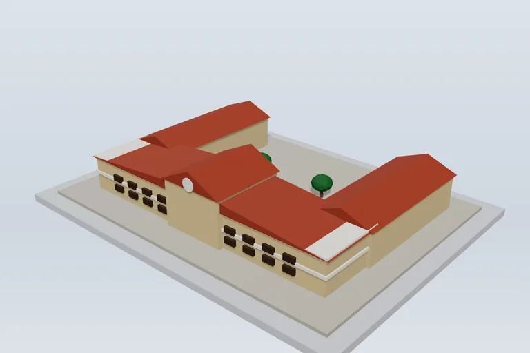

# Antigua Estación del Ferrocarril de Antioquia

> **Ficha G5-07 para C5-02 (Codex)** · ID: `estacion_ferrocarril` · Categoría: `patrimonio-republicano`

*Maqueta 3D de estudio limpia (sin texto, sin logos ni marcas), generada con proporciones y paleta exactas de esta ficha para desbloquear C5-02 mientras se restablece la cuota de Nano Banana.*

## Datos geográficos y de Motor City (`mundo.mc4`)

| Campo | Valor |
|---|---|
| **Ubicación** | La Alpujarra · Avenida San Juan (Calle 44 # 52-51) |
| **Coordenadas WGS84** | `6.244712, -75.572092` |
| **Coordenadas MC4 (metros)** | `x = 14154`, `y = 23805` |
| **Cota del terreno (`relieve`)** | `1475 m s. n. m.` |
| **Hito(s) en `mundo.mc4`** | `ferrocarril` (republicano, alto MC4 12 m, 1 pol.) |
| **Lugar MC4 asociado** | `alpujarra` |
| **OpenStreetMap** | `node/14261984136` (verificado) · consulta Overpass: `way["name"~"Ferrocarril de Antioquia|Estación Medellín"](6.243,-75.574,6.246,-75.570)` |

## Dimensiones y presupuesto de malla (C5-02)

| Parámetro | Valor |
|---|---|
| **Altura aproximada** | **14 m** (~2 pisos) |
| **Planta aproximada (ancho × fondo)** | **96 m × 83 m** |
| **Presupuesto LOD0 (cerca)** | ≤ **760 triángulos** |
| **Presupuesto LOD1 (lejos)** | ≤ **220 triángulos** |

## Materiales

- Mampostería revocada en tono ocre-dorado cálido y crema marfil en cornisas y pilastras
- Cubiertas inclinadas a varias aguas de teja de barro terracota
- Carpintería tradicional en madera café oscuro y vidrio con arcos
- Hierro forjado oscuro en faroles y barandas de los pabellones laterales

## Paleta de referencia (HEX)

| Rol | HEX |
|---|---|
| `fachada` | `#E0C798` |
| `molduras` | `#F4EFE4` |
| `techo` | `#AE4F33` |
| `madera` | `#4E3828` |
| `luz_noche` | `#FFD68A` |

## Rasgos que lo hacen reconocible

1. Composición palaciega simétrica en U / H con cuerpo central más alto coronado por frontón y reloj clásico.
2. Dos alas laterales alargadas de 2 pisos con galería porticada de arcos y remate de pabellones esquineros.
3. Color ocre-crema muy cálido bajo tejados rojos de barro que contrasta con el concreto de La Alpujarra.
4. Patio interior ajardinado y antigua marquesina de andenes en la parte posterior.

## Guía de modelado para Codex (`C5-02`)

- **Volumetría sugerida:** Reemplazar hito `ferrocarril`: bloque principal alargado de 86×24×10 m en tono ocre-crema con dos alas perpendiculares hacia el sur formando patio, cuerpo central elevado a z=14 m con frontón triangular y disco de reloj, y cubiertas de teja terracota a dos aguas.
- **Lectura nocturna:** Baño cálido sobre las arcadas frontales y esfera iluminada del reloj central.
- **Integración en `VistaTres`:** al cargar el sector de `(x=14154, y=23805)`, omitir los bloques genéricos ED1 dentro de la planta de `estacion_ferrocarril` (o los hitos `ferrocarril`) y anclar la base a la cota real del terreno (`M.altura(x, y)`) con faldón subterráneo de 2–4 m (12 m en ladera para Biblioteca España) para que nunca flote en pendiente.
