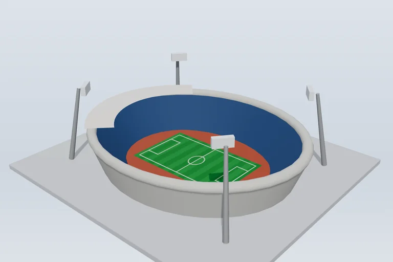

# Estadio Atanasio Girardot

> **Ficha G5-07 para C5-02 (Codex)** · ID: `estadio_atanasio` · Categoría: `deportivo`

*Maqueta 3D de estudio limpia (sin texto, sin logos ni marcas), generada con proporciones y paleta exactas de esta ficha para desbloquear C5-02 mientras se restablece la cuota de Nano Banana.*

## Datos geográficos y de Motor City (`mundo.mc4`)

| Campo | Valor |
|---|---|
| **Ubicación** | Laureles–Estadio · Carrera 74 × Calle 48 |
| **Coordenadas WGS84** | `6.256797, -75.590146` |
| **Coordenadas MC4 (metros)** | `x = 12157`, `y = 22469` |
| **Cota del terreno (`relieve`)** | `1484 m s. n. m.` |
| **Hito(s) en `mundo.mc4`** | `estadio` (estadio, alto MC4 22 m, 1 pol.) |
| **Lugar MC4 asociado** | `estadio` |
| **OpenStreetMap** | Complejo multi-way / sin ID único verificado · consulta Overpass: `way["leisure"="stadium"]["name"~"Atanasio Girardot"](6.254,-75.593,6.259,-75.588)` |

## Dimensiones y presupuesto de malla (C5-02)

| Parámetro | Valor |
|---|---|
| **Altura aproximada** | **44 m** (~5 pisos) |
| **Planta aproximada (ancho × fondo)** | **197 m × 213 m** |
| **Presupuesto LOD0 (cerca)** | ≤ **980 triángulos** |
| **Presupuesto LOD1 (lejos)** | ≤ **300 triángulos** |

## Materiales

- Concreto arquitectónico blanco-gris en tribunas, anillos exteriores y cubierta occidental
- Césped verde intenso en la cancha reglamentaria rodeada de pista atlética terracota
- Graderías con sillería tricolor (azul, verde, rojo/blanco) en el cuenco interior
- Acero blanco en las cuatro grandes torres inclinadas de reflectores esquineros

## Paleta de referencia (HEX)

| Rol | HEX |
|---|---|
| `estructura` | `#D9D8D3` |
| `cesped` | `#2F8A3B` |
| `pista` | `#B85A3F` |
| `tribunas` | `#3C5F8A` |
| `luz_noche` | `#F5FAFF` |

## Rasgos que lo hacen reconocible

1. Gran cuenco ovalado de 197×213 m abierto al cielo, con cubierta volada característicamente concentrada en la tribuna occidental.
2. Cuatro torres metálicas inclinadas de iluminación de ~44 m coronadas por parrillas rectangulares de reflectores.
3. Cancha verde nítida con marcación blanca y pista atlética ocre-terracota perfectamente visibles desde vistas altas y vuelo.
4. Fachada exterior rítmica de costillas estructurales y rampas helicoidales que rodean la Unidad Deportiva.

## Guía de modelado para Codex (`C5-02`)

- **Volumetría sugerida:** Óvalo exterior de 190×208 m en anillo inclinado (z=0..22 m) con piso interior verde (cancha 105×68 m) y borde terracota de pista; añadir visera curva de cubierta sobre el costado occidental (z=24..27 m) y 4 torres inclinadas metálicas hasta z=44 m con cabezales de reflectores.
- **Lectura nocturna:** Parrillas blancas brillantes en las 4 torres y resplandor claro que ilumina el óvalo verde desde arriba.
- **Integración en `VistaTres`:** al cargar el sector de `(x=12157, y=22469)`, omitir los bloques genéricos ED1 dentro de la planta de `estadio_atanasio` (o los hitos `estadio`) y anclar la base a la cota real del terreno (`M.altura(x, y)`) con faldón subterráneo de 2–4 m (12 m en ladera para Biblioteca España) para que nunca flote en pendiente.
