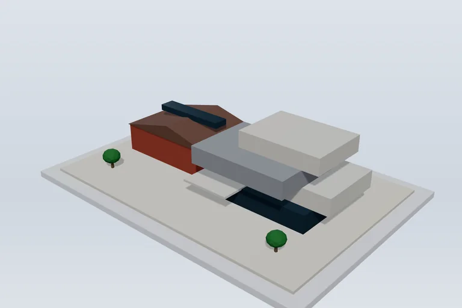

# Museo de Arte Moderno de Medellín — MAMM

> **Ficha G5-07 para C5-02 (Codex)** · ID: `mamm` · Categoría: `museo-contemporaneo`

*Maqueta 3D de estudio limpia (sin texto, sin logos ni marcas), generada con proporciones y paleta exactas de esta ficha para desbloquear C5-02 mientras se restablece la cuota de Nano Banana.*

## Datos geográficos y de Motor City (`mundo.mc4`)

| Campo | Valor |
|---|---|
| **Ubicación** | El Poblado · Ciudad del Río (Carrera 44 # 19A-100) |
| **Coordenadas WGS84** | `6.223673, -75.574045` |
| **Coordenadas MC4 (metros)** | `x = 13938`, `y = 26132` |
| **Cota del terreno (`relieve`)** | `1488 m s. n. m.` |
| **Hito(s) en `mundo.mc4`** | `mamm` (ladrillo, alto MC4 18 m, 1 pol.) |
| **Lugar MC4 asociado** | `ciudad_rio` |
| **OpenStreetMap** | Complejo multi-way / sin ID único verificado · consulta Overpass: `way["name"~"Museo de Arte Moderno|MAMM"](6.222,-75.576,6.225,-75.572)` |

## Dimensiones y presupuesto de malla (C5-02)

| Parámetro | Valor |
|---|---|
| **Altura aproximada** | **22 m** (~5 pisos) |
| **Planta aproximada (ancho × fondo)** | **94 m × 59 m** |
| **Presupuesto LOD0 (cerca)** | ≤ **820 triángulos** |
| **Presupuesto LOD1 (lejos)** | ≤ **230 triángulos** |

## Materiales

- Concreto arquitectónico gris claro y malla metálica microperforada en las cajas apiladas de la ampliación
- Ladrillo industrial histórico y cerchas metálicas de los antiguos Talleres Robledo (ala norte)
- Vidrio claro en vestíbulos y terrazas públicas escalonadas
- Adoquín y madera en la gran plazoleta-teatro al aire libre de Ciudad del Río

## Paleta de referencia (HEX)

| Rol | HEX |
|---|---|
| `concreto` | `#C7C5BF` |
| `malla` | `#8F9398` |
| `ladrillo` | `#9E4F3A` |
| `vidrio` | `#304856` |
| `luz_noche` | `#FFE09A` |

## Rasgos que lo hacen reconocible

1. Contraste emblemático entre la nave industrial histórica de ladrillo (Talleres Robledo, cubierta a dos aguas) y la ampliación moderna.
2. Ampliación compuesta por cajas de concreto apiladas y desplazadas en voladizo (inspiradas en la arquitectura escalonada de las laderas).
3. Terrazas públicas exteriores conectadas por escaleras abiertas que miran al Parque Lineal de Ciudad del Río.
4. Gran pared blanca exterior sobre la plazoleta para cine al aire libre nocturno.

## Guía de modelado para Codex (`C5-02`)

- **Volumetría sugerida:** Reemplazar hito `mamm`: combinar dos cuerpos adosados sobre plazoleta de 94×59 m: (1) nave industrial histórica de ladrillo rojo de 42×24×10 m con cubierta a dos aguas y monitor de luz; (2) torre de ampliación contemporánea de 46×28×22 m hecha de 4 cajas de concreto gris apiladas con voladizos desplazados de 3–5 m y terrazas escalonadas.
- **Lectura nocturna:** Resplandor cálido en las terrazas escalonadas y tras la malla metálica de las cajas en voladizo.
- **Integración en `VistaTres`:** al cargar el sector de `(x=13938, y=26132)`, omitir los bloques genéricos ED1 dentro de la planta de `mamm` (o los hitos `mamm`) y anclar la base a la cota real del terreno (`M.altura(x, y)`) con faldón subterráneo de 2–4 m (12 m en ladera para Biblioteca España) para que nunca flote en pendiente.
