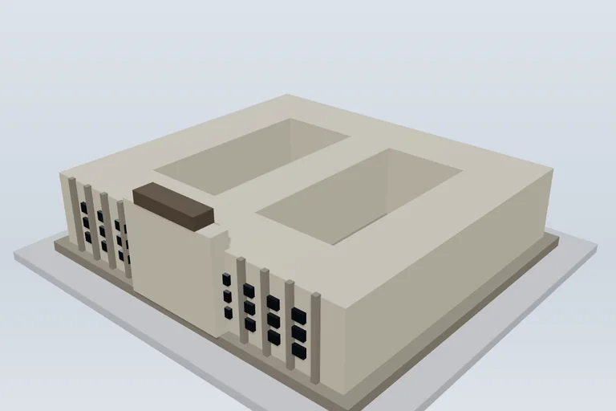

# Museo de Antioquia

> **Ficha G5-07 para C5-02 (Codex)** · ID: `museo_antioquia` · Categoría: `museo-patrimonio`

*Maqueta 3D de estudio limpia (sin texto, sin logos ni marcas), generada con proporciones y paleta exactas de esta ficha para desbloquear C5-02 mientras se restablece la cuota de Nano Banana.*

## Datos geográficos y de Motor City (`mundo.mc4`)

| Campo | Valor |
|---|---|
| **Ubicación** | La Candelaria · Plaza Botero (Carrera 52 × Calle 52) |
| **Coordenadas WGS84** | `6.252403, -75.569144` |
| **Coordenadas MC4 (metros)** | `x = 14481`, `y = 22955` |
| **Cota del terreno (`relieve`)** | `1481 m s. n. m.` |
| **Hito(s) en `mundo.mc4`** | `museo` (republicano, alto MC4 20 m, 1 pol.) |
| **Lugar MC4 asociado** | `museo` |
| **OpenStreetMap** | Complejo multi-way / sin ID único verificado · consulta Overpass: `way["name"~"Museo de Antioquia"](6.251,-75.571,6.254,-75.567)` |

## Dimensiones y presupuesto de malla (C5-02)

| Parámetro | Valor |
|---|---|
| **Altura aproximada** | **20 m** (~4 pisos) |
| **Planta aproximada (ancho × fondo)** | **90 m × 101 m** |
| **Presupuesto LOD0 (cerca)** | ≤ **780 triángulos** |
| **Presupuesto LOD1 (lejos)** | ≤ **220 triángulos** |

## Materiales

- Revoque y concreto labrado en tono crema-arena cálido de estética Art Déco (antiguo Palacio Municipal)
- Piedra gris claro en zócalo, columnas estriadas y escalinata monumental
- Carpintería metálica bronce oscuro en ventanales verticales y portales
- Teja y cubiertas planas con lucernarios en los patios interiores

## Paleta de referencia (HEX)

| Rol | HEX |
|---|---|
| `fachada` | `#DED4C0` |
| `zocalo` | `#9E9689` |
| `vidrio` | `#2B3136` |
| `acento` | `#6E6254` |
| `luz_noche` | `#FFE2A6` |

## Rasgos que lo hacen reconocible

1. Gran bloque palaciego Art Déco de geometría simétrica y sobria que cierra el costado occidental de Plaza Botero.
2. Fachada principal con pilastras verticales continuas, cornisas escalonadas y pórtico central jerarquizado.
3. Dos patios interiores ajardinados que perforan la manzana y se aprecian desde vistas elevadas.
4. Basamento elevado con acceso frontal directo a las esculturas de bronce de la plaza.

## Guía de modelado para Codex (`C5-02`)

- **Volumetría sugerida:** Manzana rectangular de 88×96×19 m con dos patios interiores huecos, fachada oriental Art Déco con cuerpo central saliente escalonado (+2 m) y pilastras verticales en relieve suave; remate perimetral con cornisa escalonada.
- **Lectura nocturna:** Luz cálida en el pórtico principal y en la hilera regular de ventanales verticales sobre Plaza Botero.
- **Integración en `VistaTres`:** al cargar el sector de `(x=14481, y=22955)`, omitir los bloques genéricos ED1 dentro de la planta de `museo_antioquia` (o los hitos `museo`) y anclar la base a la cota real del terreno (`M.altura(x, y)`) con faldón subterráneo de 2–4 m (12 m en ladera para Biblioteca España) para que nunca flote en pendiente.
