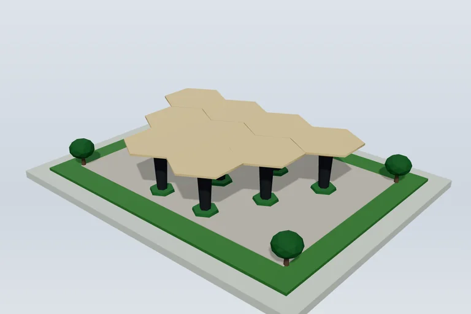

# Orquideorama del Jardín Botánico

> **Ficha G5-07 para C5-02 (Codex)** · ID: `orquideorama` · Categoría: `pabellon-botanico`

*Maqueta 3D de estudio limpia (sin texto, sin logos ni marcas), generada con proporciones y paleta exactas de esta ficha para desbloquear C5-02 mientras se restablece la cuota de Nano Banana.*

## Datos geográficos y de Motor City (`mundo.mc4`)

| Campo | Valor |
|---|---|
| **Ubicación** | Aranjuez · Jardín Botánico Joaquín Antonio Uribe (Calle 73 # 51D-14) |
| **Coordenadas WGS84** | `6.270650, -75.563720` |
| **Coordenadas MC4 (metros)** | `x = 15081`, `y = 20937` |
| **Cota del terreno (`relieve`)** | `1471 m s. n. m.` |
| **Hito(s) en `mundo.mc4`** | Sin hito dedicado en `mundo.mc4` (reemplazar o superponer sobre huella ED1 local) |
| **Lugar MC4 asociado** | `botanico` |
| **OpenStreetMap** | `way/174369253` (verificado) · consulta Overpass: `way["name"~"Orquideorama"](6.269,-75.566,6.272,-75.562)` |

## Dimensiones y presupuesto de malla (C5-02)

| Parámetro | Valor |
|---|---|
| **Altura aproximada** | **16 m** (~1 pisos) |
| **Planta aproximada (ancho × fondo)** | **75 m × 56 m** |
| **Presupuesto LOD0 (cerca)** | ≤ **880 triángulos** |
| **Presupuesto LOD1 (lejos)** | ≤ **240 triángulos** |

## Materiales

- Listones de madera de pino pátula color miel-dorado en la celosía hexagonal de la cubierta
- Columnas huecas de acero pintado gris oscuro y malla metálica en los «árboles-flor»
- Policarbonato traslúcido en la capa superior de protección contra lluvia
- Pavimento de piedra y jardines densos con estanques y orquídeas en el suelo

## Paleta de referencia (HEX)

| Rol | HEX |
|---|---|
| `madera` | `#C89B5B` |
| `acero` | `#4E5459` |
| `vegetacion` | `#367439` |
| `pavimento` | `#BFB8AA` |
| `luz_noche` | `#FFE09A` |

## Rasgos que lo hacen reconocible

1. Malla modular de ~10–14 «árboles-flor» hexagonales de 14–16 m de altura que conforman un dosel orgánico continuo.
2. Cada módulo combina un tronco calado hexagonal hueco y seis pétalos triangulares de listones de madera cálida.
3. Espacio completamente abierto en sus bordes sin muros cerrados, fundido con los senderos del Jardín Botánico.
4. Patrón de luz filtrada en panal muy reconocible tanto desde arriba (vista Historieta/2D) como desde el nivel peatonal.

## Guía de modelado para Codex (`C5-02`)

- **Volumetría sugerida:** Instanciar 10 módulos «flor-árbol» en teselación hexagonal sobre planta de 75×56 m: cada módulo es un tronco prismático hexagonal estrecho (r=1,6 m, z=0..11 m) que se abre en copa hexagonal acampanada (r=9 m, z=11..15 m) con textura calada de listones dorados de madera y base ajardinada.
- **Lectura nocturna:** Luz cálida ámbar que baña desde abajo las copas de madera dorada, creando una linterna orgánica entre los árboles.
- **Integración en `VistaTres`:** al cargar el sector de `(x=15081, y=20937)`, omitir los bloques genéricos ED1 dentro de la planta de `orquideorama` (o los hitos locales) y anclar la base a la cota real del terreno (`M.altura(x, y)`) con faldón subterráneo de 2–4 m (12 m en ladera para Biblioteca España) para que nunca flote en pendiente.
