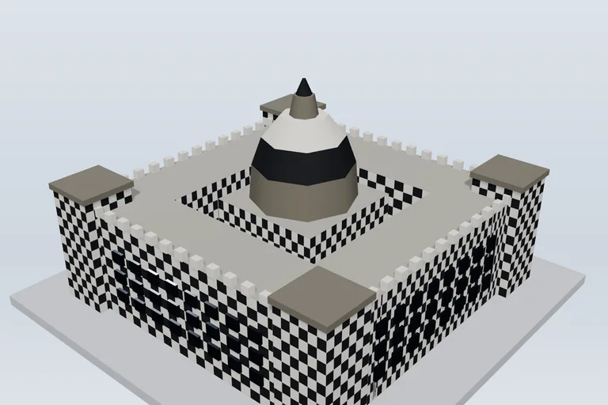

# Palacio de la Cultura Rafael Uribe Uribe

> **Ficha G5-07 para C5-02 (Codex)** · ID: `palacio_cultura` · Categoría: `patrimonio-civico`

*Maqueta 3D de estudio limpia (sin texto, sin logos ni marcas), generada con proporciones y paleta exactas de esta ficha para desbloquear C5-02 mientras se restablece la cuota de Nano Banana.*

## Datos geográficos y de Motor City (`mundo.mc4`)

| Campo | Valor |
|---|---|
| **Ubicación** | La Candelaria · Plaza Botero (Carrera 51 × Calle 52) |
| **Coordenadas WGS84** | `6.251705, -75.568210` |
| **Coordenadas MC4 (metros)** | `x = 14584`, `y = 23032` |
| **Cota del terreno (`relieve`)** | `1487 m s. n. m.` |
| **Hito(s) en `mundo.mc4`** | `palacio` (palacio, alto MC4 24 m, 1 pol.) |
| **Lugar MC4 asociado** | `palacio` |
| **OpenStreetMap** | Complejo multi-way / sin ID único verificado · consulta Overpass: `way["name"~"Palacio de la Cultura|Rafael Uribe"](6.250,-75.570,6.253,-75.566)` |

## Dimensiones y presupuesto de malla (C5-02)

| Parámetro | Valor |
|---|---|
| **Altura aproximada** | **34 m** (~5 pisos) |
| **Planta aproximada (ancho × fondo)** | **68 m × 72 m** |
| **Presupuesto LOD0 (cerca)** | ≤ **920 triángulos** |
| **Presupuesto LOD1 (lejos)** | ≤ **280 triángulos** |

## Materiales

- Concreto y revoque alternado en damero blanco marfil y gris carbón (estilo neogótico belga de Agustín Goovaerts)
- Piedra gris labrada en arcos ojivales, cornisas y remates almenados
- Vidrio emplomado oscuro con tracería gótica en ventanales verticales
- Cúpula metálica y de concreto en franjas grises y marfil

## Paleta de referencia (HEX)

| Rol | HEX |
|---|---|
| `fachada_clara` | `#EFECE4` |
| `fachada_oscura` | `#2E3136` |
| `vidrio` | `#1E2730` |
| `acento` | `#8A8478` |
| `luz_noche` | `#FFE09E` |

## Rasgos que lo hacen reconocible

1. Inconfundible patrón ajedrezado en blanco y negro a lo largo de toda la fachada y los torreones esquineros.
2. Gran cúpula octogonal central escalonada con tambor fenestrado y linterna que domina la vista sobre Plaza Botero.
3. Arcos ojivales góticos repetidos en los cuatro pisos y parapeto superior almenado con pináculos.
4. Patio interior central rodeado de galerías y terrazas transitables con mirador al centro histórico.

## Guía de modelado para Codex (`C5-02`)

- **Volumetría sugerida:** Bloque cuadrado con patio central hueco de 64×64×22 m y cuatro torreones esquineros ligeramente salientes (+2 m); en el centro, tambor octogonal (radio 9 m, z=22..28 m) coronado por cúpula ojival y linterna hasta z=34 m. Aplicar textura procedural de damero bicoloreado en muros.
- **Lectura nocturna:** Baño de luz cálida resaltando el ajedrezado frontal y la cúpula octogonal como faro de Plaza Botero.
- **Integración en `VistaTres`:** al cargar el sector de `(x=14584, y=23032)`, omitir los bloques genéricos ED1 dentro de la planta de `palacio_cultura` (o los hitos `palacio`) y anclar la base a la cota real del terreno (`M.altura(x, y)`) con faldón subterráneo de 2–4 m (12 m en ladera para Biblioteca España) para que nunca flote en pendiente.
