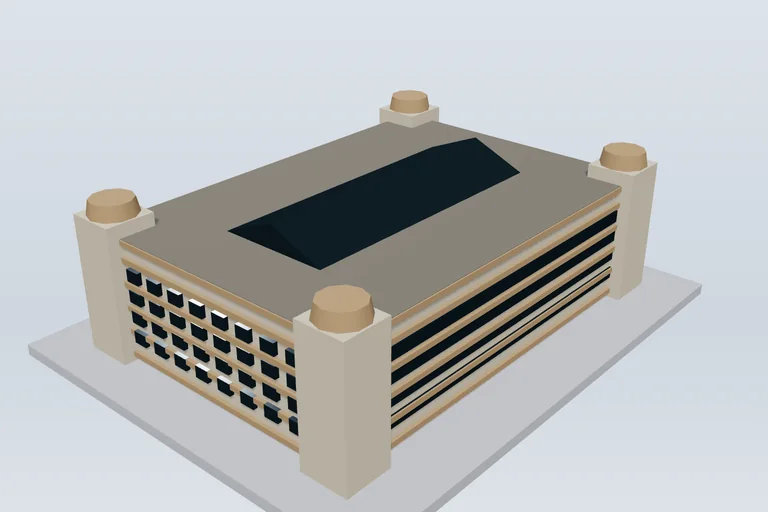

# Palacio Nacional

> **Ficha G5-07 para C5-02 (Codex)** · ID: `palacio_nacional` · Categoría: `patrimonio-civico`

*Maqueta 3D de estudio limpia (sin texto, sin logos ni marcas), generada con proporciones y paleta exactas de esta ficha para desbloquear C5-02 mientras se restablece la cuota de Nano Banana.*

## Datos geográficos y de Motor City (`mundo.mc4`)

| Campo | Valor |
|---|---|
| **Ubicación** | La Candelaria · Carrera 52 (Carabobo) × Calle 48 |
| **Coordenadas WGS84** | `6.249010, -75.570401` |
| **Coordenadas MC4 (metros)** | `x = 14342`, `y = 23330` |
| **Cota del terreno (`relieve`)** | `1484 m s. n. m.` |
| **Hito(s) en `mundo.mc4`** | `nacional` (republicano, alto MC4 24 m, 1 pol.) |
| **Lugar MC4 asociado** | `berrio` |
| **OpenStreetMap** | `way/31973366` (verificado) · consulta Overpass: `way["name"~"Palacio Nacional"](6.248,-75.572,6.250,-75.569)` |

## Dimensiones y presupuesto de malla (C5-02)

| Parámetro | Valor |
|---|---|
| **Altura aproximada** | **24 m** (~5 pisos) |
| **Planta aproximada (ancho × fondo)** | **62 m × 90 m** |
| **Presupuesto LOD0 (cerca)** | ≤ **840 triángulos** |
| **Presupuesto LOD1 (lejos)** | ≤ **240 triángulos** |

## Materiales

- Concreto y revoque labrado en crema marfil y ocre rosado suave (obra de Agustín Goovaerts)
- Arcadas neorrománicas y balcones con balaustradas prefabricadas
- Carpintería metálica gris-verde en altos ventanales agrupados en tríforas
- Gran cubierta acristalada interior sobre el patio comercial y cultural

## Paleta de referencia (HEX)

| Rol | HEX |
|---|---|
| `fachada` | `#E6DAC4` |
| `acento_ocre` | `#C9A882` |
| `vidrio` | `#2E4048` |
| `techo` | `#8F897E` |
| `luz_noche` | `#FFE09E` |

## Rasgos que lo hacen reconocible

1. Imponente edificio patrimonial neorrománico de 5 pisos sobre el paseo peatonal de Carabobo.
2. Esquinas redondeadas/ochavadas monumentales coronadas por frontones escalonados y cúpulas bajas.
3. Fachada profundamente modelada por pilastras, arcos de medio punto apilados y cornisas muy salientes.
4. Gran nave interior luminosa (hoy galería comercial y de arte) visible por su cubierta de vidrio.

## Guía de modelado para Codex (`C5-02`)

- **Volumetría sugerida:** Reemplazar hito `nacional`: manzana rectangular de 60×88×22 m con patio cubierto por lucernario a dos aguas; fachadas crema-ocre con fuertes bandas horizontales, remates de esquina elevados a z=25 m y ritmo denso de ventanales arqueados.
- **Lectura nocturna:** Luminosidad cálida saliendo de las galerías superiores y el lucernario central sobre Carabobo.
- **Integración en `VistaTres`:** al cargar el sector de `(x=14342, y=23330)`, omitir los bloques genéricos ED1 dentro de la planta de `palacio_nacional` (o los hitos `nacional`) y anclar la base a la cota real del terreno (`M.altura(x, y)`) con faldón subterráneo de 2–4 m (12 m en ladera para Biblioteca España) para que nunca flote en pendiente.
