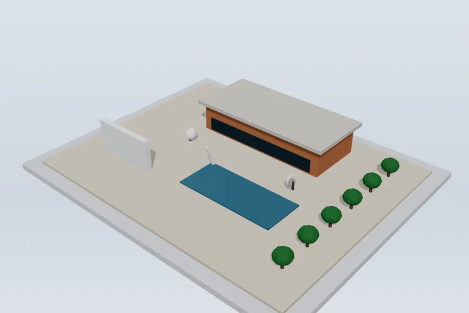

# Parque de los Deseos y Casa de la Música

> **Ficha G5-07 para C5-02 (Codex)** · ID: `parque_deseos` · Categoría: `plaza-parque`

*Maqueta 3D de estudio limpia (sin texto, sin logos ni marcas), generada con proporciones y paleta exactas de esta ficha para desbloquear C5-02 mientras se restablece la cuota de Nano Banana.*

## Datos geográficos y de Motor City (`mundo.mc4`)

| Campo | Valor |
|---|---|
| **Ubicación** | Aranjuez · Calle 71 × Carrera 52 (zona Norte Cultural) |
| **Coordenadas WGS84** | `6.268360, -75.565850` |
| **Coordenadas MC4 (metros)** | `x = 14845`, `y = 21190` |
| **Cota del terreno (`relieve`)** | `1469 m s. n. m.` |
| **Hito(s) en `mundo.mc4`** | Sin hito dedicado en `mundo.mc4` (reemplazar o superponer sobre huella ED1 local) |
| **Lugar MC4 asociado** | `planetario` |
| **OpenStreetMap** | Complejo multi-way / sin ID único verificado · consulta Overpass: `way["name"~"Parque de los Deseos|Casa de la Música"](6.267,-75.568,6.270,-75.564)` |

## Dimensiones y presupuesto de malla (C5-02)

| Parámetro | Valor |
|---|---|
| **Altura aproximada** | **12 m** (~2 pisos) |
| **Planta aproximada (ancho × fondo)** | **110 m × 95 m** |
| **Presupuesto LOD0 (cerca)** | ≤ **760 triángulos** |
| **Presupuesto LOD1 (lejos)** | ≤ **220 triángulos** |

## Materiales

- Arena compactada y losas de concreto gris cálido en la gran explanada abierta
- Concreto ocre y celosía de ladrillo/madera en la Casa de la Música (costado sur)
- Agua somera en espejo reflectante y fuentes interactivas
- Acero pintado blanco y piedra en reloj solar, teléfonos parabólicos y pantalla de cine al aire libre

## Paleta de referencia (HEX)

| Rol | HEX |
|---|---|
| `explanada` | `#D3C9B8` |
| `casa_musica` | `#B9784E` |
| `agua` | `#4A7F94` |
| `acero` | `#E2E4E6` |
| `luz_noche` | `#FFE3A3` |

## Rasgos que lo hacen reconocible

1. Gran plaza despejada sin obstrucciones diseñada para cine al aire libre, astronomía y encuentros comunitarios.
2. Casa de la Música al costado sur: volumen horizontal sobrio con pérgola y terraza escalonada.
3. Elementos interactivos icónicos: espejo de agua, reloj solar vertical, parabólicas acústicas y bosquecillo lateral de árboles.
4. Pared blanca de proyección y gradería suave integrada a la plaza frente al Planetario.

## Guía de modelado para Codex (`C5-02`)

- **Volumetría sugerida:** Explanada rectangular de 110×95 m en tono arena-gris; al sur, bloque de la Casa de la Música de 48×22×11 m con terraza escalonada; en la plaza, rectángulo de espejo de agua, dos parabólicas enfrentadas, reloj solar vertical (6 m) y franja de árboles al borde oriental.
- **Lectura nocturna:** Luminarias perimetrales suaves, espejo de agua con reflejos y luz cálida en la Casa de la Música.
- **Integración en `VistaTres`:** al cargar el sector de `(x=14845, y=21190)`, omitir los bloques genéricos ED1 dentro de la planta de `parque_deseos` (o los hitos locales) y anclar la base a la cota real del terreno (`M.altura(x, y)`) con faldón subterráneo de 2–4 m (12 m en ladera para Biblioteca España) para que nunca flote en pendiente.
