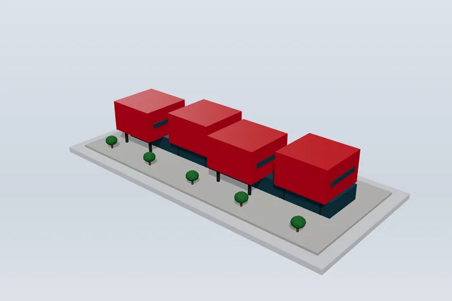

# Parque Explora

> **Ficha G5-07 para C5-02 (Codex)** · ID: `parque_explora` · Categoría: `museo-ciencia`

*Maqueta 3D de estudio limpia (sin texto, sin logos ni marcas), generada con proporciones y paleta exactas de esta ficha para desbloquear C5-02 mientras se restablece la cuota de Nano Banana.*

## Datos geográficos y de Motor City (`mundo.mc4`)

| Campo | Valor |
|---|---|
| **Ubicación** | Aranjuez · Carrera 52 # 73-75 (frente a estación Universidad) |
| **Coordenadas WGS84** | `6.270883, -75.565711` |
| **Coordenadas MC4 (metros)** | `x = 14861`, `y = 20911` |
| **Cota del terreno (`relieve`)** | `1461 m s. n. m.` |
| **Hito(s) en `mundo.mc4`** | `explora` (cubos, alto MC4 16 m, 7 pol.) |
| **Lugar MC4 asociado** | `explora` |
| **OpenStreetMap** | `way/141166140` (verificado) · consulta Overpass: `way["name"~"Parque Explora"](6.269,-75.568,6.273,-75.564)` |

## Dimensiones y presupuesto de malla (C5-02)

| Parámetro | Valor |
|---|---|
| **Altura aproximada** | **16 m** (~3 pisos) |
| **Planta aproximada (ancho × fondo)** | **83 m × 256 m** |
| **Presupuesto LOD0 (cerca)** | ≤ **760 triángulos** |
| **Presupuesto LOD1 (lejos)** | ≤ **220 triángulos** |

## Materiales

- Paneles metálicos y revestimiento rojo bermellón intenso en las cuatro cajas en voladizo
- Estructura metálica gris acero y pórticos vistos que elevan las cajas
- Vidrio claro en basamento del acuario y galerías longitudinales
- Concreto gris lavado en plazoleta pública y paseo de dinosaurios/experimentos

## Paleta de referencia (HEX)

| Rol | HEX |
|---|---|
| `cubos_rojos` | `#C9302C` |
| `estructura` | `#4C5258` |
| `basamento` | `#B8B6B0` |
| `vidrio` | `#456D7A` |
| `luz_noche` | `#FFE4A8` |

## Rasgos que lo hacen reconocible

1. Cuatro grandes cajas prismáticas de color rojo vibrante suspendidas y ligeramente desplazadas en hilera norte-sur.
2. Base parcialmente abierta y acristalada que crea sombra pública bajo los volúmenes elevados.
3. Larga fachada paralela a la carrera Carabobo y al viaducto del Metro entre estación Universidad y el Jardín Botánico.
4. Plazoleta abierta al costado occidental con módulos interactivos y pasarelas de acceso.

## Guía de modelado para Codex (`C5-02`)

- **Volumetría sugerida:** Basamento longitudinal de 240×38×5 m en concreto y vidrio oscuro; encima, 4 grandes prismas rojos de ~32×34×11 m ligeramente rotados o escalonados en planta (z=5..16 m) con ranuras acristaladas estrechas y columnas metálicas visibles en los voladizos.
- **Lectura nocturna:** Contraluz cálida bajo los voladizos de las cajas rojas y transparencia iluminada en el basamento del acuario.
- **Integración en `VistaTres`:** al cargar el sector de `(x=14861, y=20911)`, omitir los bloques genéricos ED1 dentro de la planta de `parque_explora` (o los hitos `explora`) y anclar la base a la cota real del terreno (`M.altura(x, y)`) con faldón subterráneo de 2–4 m (12 m en ladera para Biblioteca España) para que nunca flote en pendiente.
