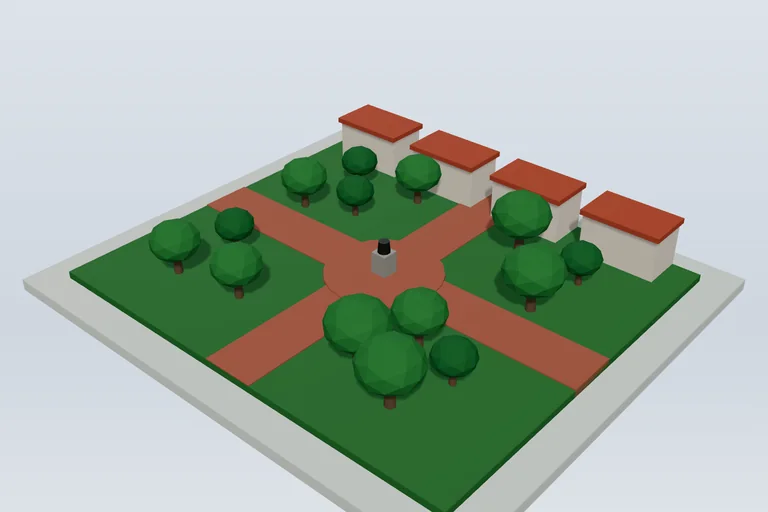

# Parque Lleras

> **Ficha G5-07 para C5-02 (Codex)** · ID: `parque_lleras` · Categoría: `plaza-parque`

*Maqueta 3D de estudio limpia (sin texto, sin logos ni marcas), generada con proporciones y paleta exactas de esta ficha para desbloquear C5-02 mientras se restablece la cuota de Nano Banana.*

## Datos geográficos y de Motor City (`mundo.mc4`)

| Campo | Valor |
|---|---|
| **Ubicación** | El Poblado · Carrera 38 × Calle 9 (cota ~1 550 m) |
| **Coordenadas WGS84** | `6.208780, -75.567740` |
| **Coordenadas MC4 (metros)** | `x = 14636`, `y = 27778` |
| **Cota del terreno (`relieve`)** | `1550 m s. n. m.` |
| **Hito(s) en `mundo.mc4`** | Sin hito dedicado en `mundo.mc4` (reemplazar o superponer sobre huella ED1 local) |
| **Lugar MC4 asociado** | `lleras` |
| **OpenStreetMap** | Complejo multi-way / sin ID único verificado · consulta Overpass: `way["leisure"="park"]["name"~"Parque Lleras"](6.207,-75.570,6.210,-75.566)` |

## Dimensiones y presupuesto de malla (C5-02)

| Parámetro | Valor |
|---|---|
| **Altura aproximada** | **14 m** (espacio abierto / parque) |
| **Planta aproximada (ancho × fondo)** | **85 m × 75 m** |
| **Presupuesto LOD0 (cerca)** | ≤ **760 triángulos** |
| **Presupuesto LOD1 (lejos)** | ≤ **210 triángulos** |

## Materiales

- Adoquín de ladrillo cocido y concreto gris en senderos diagonales escalonados
- Arboleda tropical muy frondosa (guayacanes, mangos, palmas y ficus) cubriendo casi todo el parque
- Piedra gris y bronce en el busto/pedestal central y graderías de la pendiente
- Borde urbano de casas-terraza bajas (2–3 pisos) con toldos y balcones de madera

## Paleta de referencia (HEX)

| Rol | HEX |
|---|---|
| `follaje` | `#2F6E36` |
| `adoquin` | `#A8624B` |
| `piedra` | `#9C9890` |
| `terrazas` | `#D9CFC0` |
| `luz_noche` | `#FFCC78` |

## Rasgos que lo hacen reconocible

1. Parque de manzana inclinada (pendiente oriente-occidente típica de El Poblado) con terrazas y escalinatas en ladrillo.
2. Denso dosel de árboles tropicales que genera una bóveda verde en medio de las calles comerciales de la Zona Rosa.
3. Plazoleta central circular con monumento/fuente y senderos en cruz que bajan hacia la carrera 40.
4. Ambiente nocturno cálido con guirnaldas de luz y terrazas iluminadas en el perímetro.

## Guía de modelado para Codex (`C5-02`)

- **Volumetría sugerida:** Plataforma ligeramente inclinada de 85×75 m con cuadrantes verdes, senderos en cruz de adoquín terracota, plazoleta central circular con pedestal de 4 m y 16–20 copas de árboles tropicales escalonadas (altura 8–14 m) + faroles bajos perimetrales.
- **Lectura nocturna:** Puntos cálidos ámbar entre las copas de los árboles y faroles bajos sobre los senderos en adoquín.
- **Integración en `VistaTres`:** al cargar el sector de `(x=14636, y=27778)`, omitir los bloques genéricos ED1 dentro de la planta de `parque_lleras` (o los hitos locales) y anclar la base a la cota real del terreno (`M.altura(x, y)`) con faldón subterráneo de 2–4 m (12 m en ladera para Biblioteca España) para que nunca flote en pendiente.
