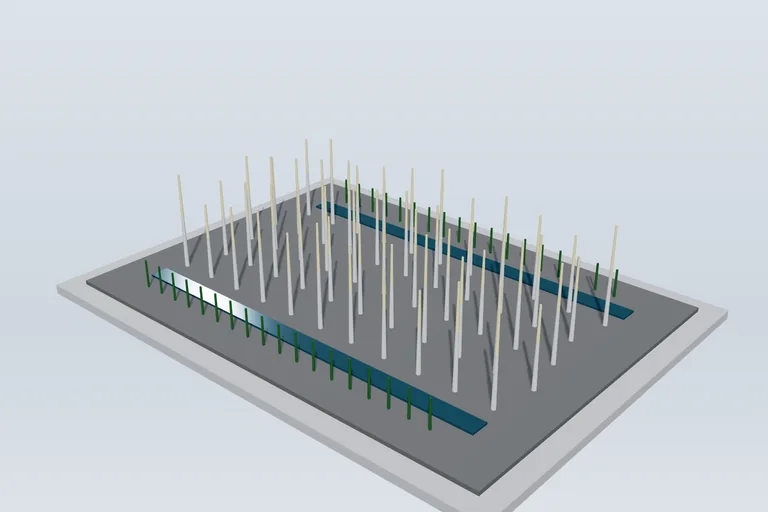

# Parque de las Luces · Plaza Cisneros

> **Ficha G5-07 para C5-02 (Codex)** · ID: `parque_luces` · Categoría: `plaza-parque`

*Maqueta 3D de estudio limpia (sin texto, sin logos ni marcas), generada con proporciones y paleta exactas de esta ficha para desbloquear C5-02 mientras se restablece la cuota de Nano Banana.*

## Datos geográficos y de Motor City (`mundo.mc4`)

| Campo | Valor |
|---|---|
| **Ubicación** | La Candelaria · Calle 44 × Carrera 52 (entre Biblioteca EPM y edificios Vásquez/Carré) |
| **Coordenadas WGS84** | `6.246047, -75.572301` |
| **Coordenadas MC4 (metros)** | `x = 14131`, `y = 23658` |
| **Cota del terreno (`relieve`)** | `1473 m s. n. m.` |
| **Hito(s) en `mundo.mc4`** | `luces` (luces, alto MC4 0 m, 1 pol.) |
| **Lugar MC4 asociado** | `luces` |
| **OpenStreetMap** | `way/32474547` (verificado) · consulta Overpass: `way["name"~"Plaza Cisneros|Parque de las Luces"](6.245,-75.574,6.247,-75.571)` |

## Dimensiones y presupuesto de malla (C5-02)

| Parámetro | Valor |
|---|---|
| **Altura aproximada** | **24 m** (espacio abierto / parque) |
| **Planta aproximada (ancho × fondo)** | **160 m × 120 m** |
| **Presupuesto LOD0 (cerca)** | ≤ **840 triángulos** |
| **Presupuesto LOD1 (lejos)** | ≤ **240 triángulos** |

## Materiales

- 300 postes luminosos esbeltos de acero y fibra traslúcida blanca de hasta 24 m de altura
- Pavimento continuo de piedra y concreto gris oscuro que hace resaltar la luz
- Franjas lineales de bambú verde y canales de agua someros
- Bancas largas de concreto prefabricado claro

## Paleta de referencia (HEX)

| Rol | HEX |
|---|---|
| `postes` | `#EAEFF2` |
| `pavimento` | `#7E8082` |
| `bambu` | `#3C753A` |
| `agua` | `#38687A` |
| `luz_noche` | `#FFF4C8` |

## Rasgos que lo hacen reconocible

1. «Bosque artificial» inconfundible de 300 postes verticales iluminados (18 a 24 m) dispuestos en grilla rítmica.
2. De noche transforma toda la manzana en una constelación vertical de luz blanca-cálida visible desde lejos.
3. Intercalado con islas de bambú y canales someros frente a los edificios republicanos Vásquez y Carré y la Biblioteca EPM.
4. Espacio completamente permeable para cruzar a pie o en bici entre San Juan y Carabobo.

## Guía de modelado para Codex (`C5-02`)

- **Volumetría sugerida:** Reemplazar hito `luces`: explanada de concreto gris de 160×120 m con 2 franjas de bambú y canales de agua; instanciar una matriz limpia de 60–90 postes esbeltos representativos (en LOD0 con `InstancedMesh`, alturas variadas 16–24 m) con puntera emisiva encendida al caer la tarde.
- **Lectura nocturna:** Emisión protagonista en toda la mitad superior de los postes verticales, con brillo blanco-dorado suave.
- **Integración en `VistaTres`:** al cargar el sector de `(x=14131, y=23658)`, omitir los bloques genéricos ED1 dentro de la planta de `parque_luces` (o los hitos `luces`) y anclar la base a la cota real del terreno (`M.altura(x, y)`) con faldón subterráneo de 2–4 m (12 m en ladera para Biblioteca España) para que nunca flote en pendiente.
