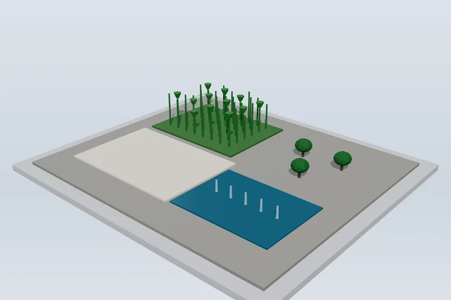

# Parque de los Pies Descalzos

> **Ficha G5-07 para C5-02 (Codex)** · ID: `pies_descalzos` · Categoría: `plaza-parque`

*Maqueta 3D de estudio limpia (sin texto, sin logos ni marcas), generada con proporciones y paleta exactas de esta ficha para desbloquear C5-02 mientras se restablece la cuota de Nano Banana.*

## Datos geográficos y de Motor City (`mundo.mc4`)

| Campo | Valor |
|---|---|
| **Ubicación** | La Alpujarra · Carrera 58 × Calle 42 (frente al Edificio EPM) |
| **Coordenadas WGS84** | `6.244676, -75.576876` |
| **Coordenadas MC4 (metros)** | `x = 13625`, `y = 23809` |
| **Cota del terreno (`relieve`)** | `1476 m s. n. m.` |
| **Hito(s) en `mundo.mc4`** | `pies` (pies, alto MC4 0 m, 1 pol.) |
| **Lugar MC4 asociado** | `pies` |
| **OpenStreetMap** | `way/32473520` (verificado) · consulta Overpass: `way["name"~"Pies Descalzos"](6.243,-75.578,6.246,-75.575)` |

## Dimensiones y presupuesto de malla (C5-02)

| Parámetro | Valor |
|---|---|
| **Altura aproximada** | **10 m** (espacio abierto / parque) |
| **Planta aproximada (ancho × fondo)** | **130 m × 120 m** |
| **Presupuesto LOD0 (cerca)** | ≤ **760 triángulos** |
| **Presupuesto LOD1 (lejos)** | ≤ **210 triángulos** |

## Materiales

- Arena blanca fina en el gran patio zen rectangular para caminar descalzo
- Bosque de bambú verde intenso en franja lineal de sombra
- Espejos de agua y fuentes de chorros verticales con bordes de piedra gris
- Piedra gris y senderos de adoquín intercalados con jardines bajos

## Paleta de referencia (HEX)

| Rol | HEX |
|---|---|
| `arena` | `#ECE4D3` |
| `agua` | `#3B7C96` |
| `bambu` | `#3D7E3B` |
| `piedra` | `#A4A29C` |
| `luz_noche` | `#B8ECFF` |

## Rasgos que lo hacen reconocible

1. Gran rectángulo luminoso de arena blanca clara rodeado de bancas de piedra para recorrido sensorial.
2. Bosque compacto de guaduas/bambúes verdes (8–10 m de alto) en uno de los cuadrantes.
3. Pozos y fuentes interactivas de agua azul-turquesa con chorros verticales donde juega la gente.
4. Articulación peatonal directa entre el Edificio Inteligente de EPM y el Museo del Agua.

## Guía de modelado para Codex (`C5-02`)

- **Volumetría sugerida:** Reemplazar el área de hito `pies`: plataforma de piedra gris de 130×120 m dividida en 4 zonas nítidas: gran caja de arena blanca (#ECE4D3), estanque azul con chorros, bosquecillo denso de tallos de bambú verde (8–10 m) y senderos de piedra.
- **Lectura nocturna:** Focos subacuáticos turquesa en las fuentes y luz cálida entre las cañas de bambú.
- **Integración en `VistaTres`:** al cargar el sector de `(x=13625, y=23809)`, omitir los bloques genéricos ED1 dentro de la planta de `pies_descalzos` (o los hitos `pies`) y anclar la base a la cota real del terreno (`M.altura(x, y)`) con faldón subterráneo de 2–4 m (12 m en ladera para Biblioteca España) para que nunca flote en pendiente.
