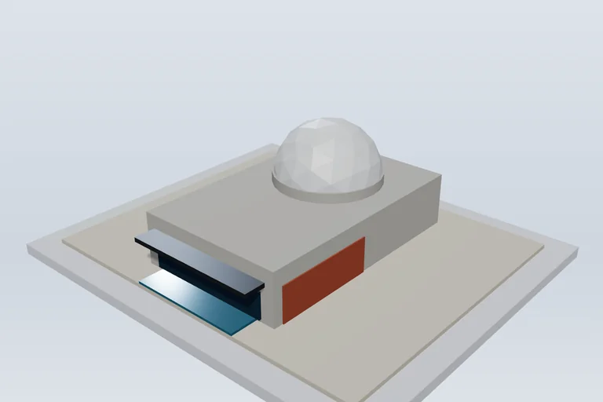

# Planetario de Medellín Jesús Emilio Ramírez

> **Ficha G5-07 para C5-02 (Codex)** · ID: `planetario` · Categoría: `museo-ciencia`

*Maqueta 3D de estudio limpia (sin texto, sin logos ni marcas), generada con proporciones y paleta exactas de esta ficha para desbloquear C5-02 mientras se restablece la cuota de Nano Banana.*

## Datos geográficos y de Motor City (`mundo.mc4`)

| Campo | Valor |
|---|---|
| **Ubicación** | Aranjuez · Carrera 52 # 71-117 (Parque de los Deseos) |
| **Coordenadas WGS84** | `6.268998, -75.566116` |
| **Coordenadas MC4 (metros)** | `x = 14816`, `y = 21120` |
| **Cota del terreno (`relieve`)** | `1466 m s. n. m.` |
| **Hito(s) en `mundo.mc4`** | `planetario` (cupula, alto MC4 10 m, 1 pol.) |
| **Lugar MC4 asociado** | `planetario` |
| **OpenStreetMap** | `way/93329440` (verificado) · consulta Overpass: `way["name"~"Planetario de Medellín"](6.267,-75.568,6.271,-75.564)` |

## Dimensiones y presupuesto de malla (C5-02)

| Parámetro | Valor |
|---|---|
| **Altura aproximada** | **16 m** (~3 pisos) |
| **Planta aproximada (ancho × fondo)** | **28 m × 59 m** |
| **Presupuesto LOD0 (cerca)** | ≤ **640 triángulos** |
| **Presupuesto LOD1 (lejos)** | ≤ **180 triángulos** |

## Materiales

- Paneles metálicos triangulados blanco-plateado en la cúpula geodésica del domo
- Ladrillo a la vista cálido y concreto gris en el bloque prismático de acceso y salas
- Vidrio azul-gris en vestíbulo frontal orientado al Parque de los Deseos
- Acero pintado grafito en pérgolas y escaleras exteriores

## Paleta de referencia (HEX)

| Rol | HEX |
|---|---|
| `cupula` | `#E6E9EC` |
| `ladrillo` | `#A95940` |
| `concreto` | `#B2B0AA` |
| `vidrio` | `#2E4A5C` |
| `luz_noche` | `#B8DCFF` |

## Rasgos que lo hacen reconocible

1. Cúpula semiesférica blanca-plateada de ~15 m de diámetro emergiendo claramente sobre el volumen principal.
2. Bloque rectangular moderno en ladrillo y concreto con terraza panorámica mirando hacia la explanada del Parque de los Deseos.
3. Acceso frontal acristalado con marquesina limpia frente a los espejos de agua de la plaza.
4. Escala contenida pero silueta geométrica (esfera + prisma) inmediata de identificar desde la calle 73.

## Guía de modelado para Codex (`C5-02`)

- **Volumetría sugerida:** Prisma base de 28×52×9 m en concreto y paños de ladrillo cálido; sobre el tercio norte, tambor corto y semiesfera geodésica (radio 8 m, tope en z=16,5 m) en blanco-plateado con sombreado facetado suave.
- **Lectura nocturna:** Proyección o baño azul-celeste suave sobre el domo blanco y vestíbulo cálido encendido.
- **Integración en `VistaTres`:** al cargar el sector de `(x=14816, y=21120)`, omitir los bloques genéricos ED1 dentro de la planta de `planetario` (o los hitos `planetario`) y anclar la base a la cota real del terreno (`M.altura(x, y)`) con faldón subterráneo de 2–4 m (12 m en ladera para Biblioteca España) para que nunca flote en pendiente.
