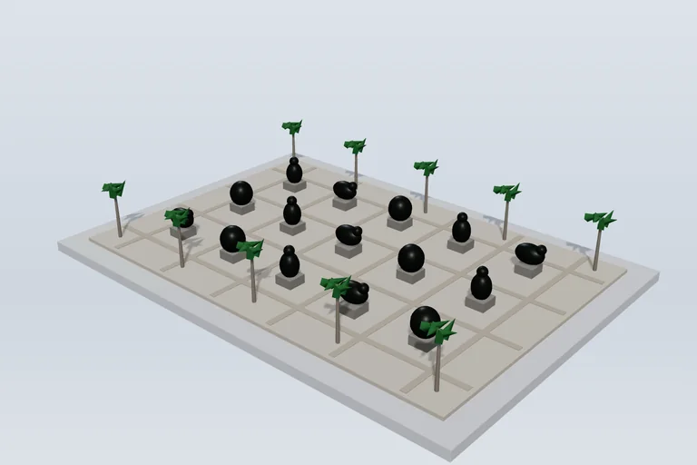

# Plaza Botero

> **Ficha G5-07 para C5-02 (Codex)** · ID: `plaza_botero` · Categoría: `plaza-parque`

*Maqueta 3D de estudio limpia (sin texto, sin logos ni marcas), generada con proporciones y paleta exactas de esta ficha para desbloquear C5-02 mientras se restablece la cuota de Nano Banana.*

## Datos geográficos y de Motor City (`mundo.mc4`)

| Campo | Valor |
|---|---|
| **Ubicación** | La Candelaria · Entre Museo de Antioquia y Palacio de la Cultura |
| **Coordenadas WGS84** | `6.251829, -75.568199` |
| **Coordenadas MC4 (metros)** | `x = 14585`, `y = 23018` |
| **Cota del terreno (`relieve`)** | `1487 m s. n. m.` |
| **Hito(s) en `mundo.mc4`** | `botero` (botero, alto MC4 0 m, 1 pol.) |
| **Lugar MC4 asociado** | `botero` |
| **OpenStreetMap** | `way/130423476` (verificado) · consulta Overpass: `way["name"~"Plaza Botero"](6.250,-75.570,6.254,-75.566)` |

## Dimensiones y presupuesto de malla (C5-02)

| Parámetro | Valor |
|---|---|
| **Altura aproximada** | **12 m** (espacio abierto / parque) |
| **Planta aproximada (ancho × fondo)** | **110 m × 70 m** |
| **Presupuesto LOD0 (cerca)** | ≤ **880 triángulos** |
| **Presupuesto LOD1 (lejos)** | ≤ **240 triángulos** |

## Materiales

- Adoquín y losas de granito gris cálido y terracota clara en el pavimento geométrico
- Bronce patinado negro-verdoso en las 23 esculturas monumentales de Fernando Botero
- Piedra gris pulida en pedestales prismáticos bajos y bancas perimetrales
- Palmas reales tropicales de tronco gris liso y follaje verde profundo

## Paleta de referencia (HEX)

| Rol | HEX |
|---|---|
| `pavimento` | `#C9C2B6` |
| `bronce` | `#2F3530` |
| `pedestal` | `#8E8B84` |
| `follaje` | `#3B6E3E` |
| `luz_noche` | `#FFD98E` |

## Rasgos que lo hacen reconocible

1. Explanada peatonal abierta de ~7 000 m² que articula el Museo de Antioquia (oeste) y el Palacio de la Cultura (este).
2. Grilla curada de 23 esculturas voluminosas de bronce oscuro sobre pedestales de piedra (1,2–1,5 m de alto).
3. Alineación simétrica de palmas reales altas (10–12 m) y jardineras geométricas que enmarcan las visuales.
4. Reja perimetral baja en los bordes hacia Carabobo y pasos peatonales directos al viaducto del Metro.

## Guía de modelado para Codex (`C5-02`)

- **Volumetría sugerida:** Plataforma pavimentada a ras de cota con patrón de bandas de granito; distribuir 12–16 volúmenes escultóricos simplificados (combinación de esferas y ovoides en bronce oscuro sobre prismas de 1,4 m) + 14 palmas reales ligeras en los bordes laterales.
- **Lectura nocturna:** Luminarias peatonales cálidas y focos rasantes sobre las esculturas de bronce.
- **Integración en `VistaTres`:** al cargar el sector de `(x=14585, y=23018)`, omitir los bloques genéricos ED1 dentro de la planta de `plaza_botero` (o los hitos `botero`) y anclar la base a la cota real del terreno (`M.altura(x, y)`) con faldón subterráneo de 2–4 m (12 m en ladera para Biblioteca España) para que nunca flote en pendiente.
