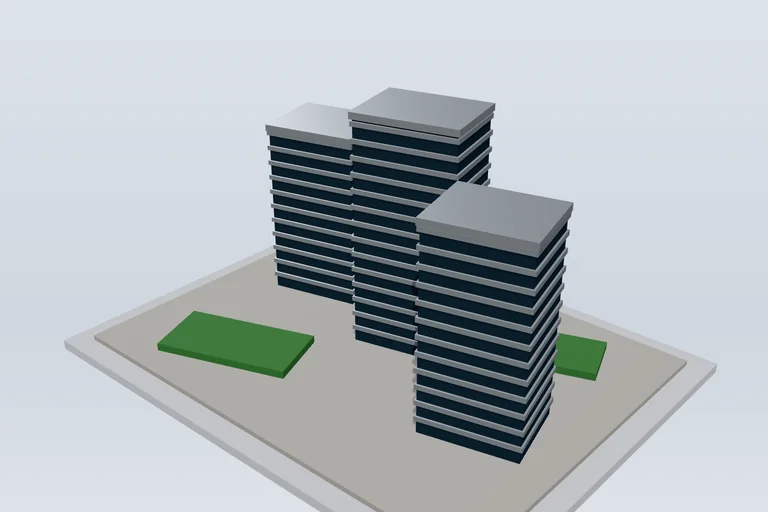

# Plaza de la Libertad

> **Ficha G5-07 para C5-02 (Codex)** · ID: `plaza_libertad` · Categoría: `institucional-moderno`

*Maqueta 3D de estudio limpia (sin texto, sin logos ni marcas), generada con proporciones y paleta exactas de esta ficha para desbloquear C5-02 mientras se restablece la cuota de Nano Banana.*

## Datos geográficos y de Motor City (`mundo.mc4`)

| Campo | Valor |
|---|---|
| **Ubicación** | La Alpujarra · Carrera 55 × Calle 42 (frente a La Alpujarra) |
| **Coordenadas WGS84** | `6.244210, -75.575450` |
| **Coordenadas MC4 (metros)** | `x = 13783`, `y = 23861` |
| **Cota del terreno (`relieve`)** | `1472 m s. n. m.` |
| **Hito(s) en `mundo.mc4`** | Sin hito dedicado en `mundo.mc4` (reemplazar o superponer sobre huella ED1 local) |
| **Lugar MC4 asociado** | `alpujarra` |
| **OpenStreetMap** | `way/218895104` (verificado) · consulta Overpass: `way["name"~"Plaza de la Libertad"](6.243,-75.577,6.246,-75.574)` |

## Dimensiones y presupuesto de malla (C5-02)

| Parámetro | Valor |
|---|---|
| **Altura aproximada** | **54 m** (~15 pisos) |
| **Planta aproximada (ancho × fondo)** | **125 m × 90 m** |
| **Presupuesto LOD0 (cerca)** | ≤ **780 triángulos** |
| **Presupuesto LOD1 (lejos)** | ≤ **220 triángulos** |

## Materiales

- Paneles metálicos y cortasol gris-plata y azul pizarra en las tres torres escalonadas
- Vidrio reflectante gris-azulado en muros cortina de doble piel
- Granito gris y franjas de madera/piedra clara en la gran plaza diagonal
- Acentos geométricos en acero blanco en marquesinas y taludes ajardinados

## Paleta de referencia (HEX)

| Rol | HEX |
|---|---|
| `torres` | `#C3C9CE` |
| `vidrio` | `#2E495A` |
| `plaza` | `#B8B4AC` |
| `verde` | `#4C8244` |
| `luz_noche` | `#D6ECFF` |

## Rasgos que lo hacen reconocible

1. Tres torres modernas esbeltas y asimétricas (entre 40 y 54 m) dispuestas en diagonal alrededor de una gran plaza abierta.
2. Revestimiento contemporáneo de lamas metálicas y muros cortina azul-gris que contrasta con el concreto ocre de La Alpujarra.
3. Gran plaza cívica peatonal con senderos en abanico, espejos de agua y taludes verdes que unen Alpujarra con Plaza Mayor.
4. Silueta escalonada muy limpia que completa el skyline institucional del centro cívico.

## Guía de modelado para Codex (`C5-02`)

- **Volumetría sugerida:** Plataforma cívica de 125×90 m con senderos diagonales; tres torres prismáticas limpias de planta rectangular (42 m, 48 m y 54 m) con revestimiento alternado de vidrio azulado y franjas de lamas metálicas gris-plata, más dos cuerpos bajos comerciales de 9 m.
- **Lectura nocturna:** Bandas verticales frías en las esquinas de las torres y luminarias modernas en el pavimento diagonal.
- **Integración en `VistaTres`:** al cargar el sector de `(x=13783, y=23861)`, omitir los bloques genéricos ED1 dentro de la planta de `plaza_libertad` (o los hitos locales) y anclar la base a la cota real del terreno (`M.altura(x, y)`) con faldón subterráneo de 2–4 m (12 m en ladera para Biblioteca España) para que nunca flote en pendiente.
