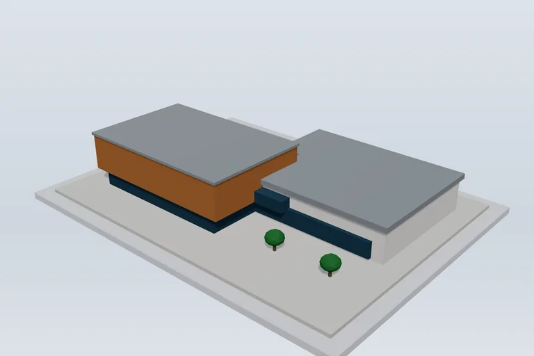

# Plaza Mayor Medellín (Centro de Convenciones)

> **Ficha G5-07 para C5-02 (Codex)** · ID: `plaza_mayor` · Categoría: `equipamiento-civico`

*Maqueta 3D de estudio limpia (sin texto, sin logos ni marcas), generada con proporciones y paleta exactas de esta ficha para desbloquear C5-02 mientras se restablece la cuota de Nano Banana.*

## Datos geográficos y de Motor City (`mundo.mc4`)

| Campo | Valor |
|---|---|
| **Ubicación** | La Alpujarra · Calle 41 # 55-80 (junto a Pies Descalzos y Teatro Metropolitano) |
| **Coordenadas WGS84** | `6.243220, -75.576180` |
| **Coordenadas MC4 (metros)** | `x = 13702`, `y = 23970` |
| **Cota del terreno (`relieve`)** | `1476 m s. n. m.` |
| **Hito(s) en `mundo.mc4`** | Sin hito dedicado en `mundo.mc4` (reemplazar o superponer sobre huella ED1 local) |
| **Lugar MC4 asociado** | `alpujarra` |
| **OpenStreetMap** | `way/786282461` (verificado) · consulta Overpass: `way["name"~"Plaza Mayor|Caja de Madera"](6.241,-75.578,6.245,-75.574)` |

## Dimensiones y presupuesto de malla (C5-02)

| Parámetro | Valor |
|---|---|
| **Altura aproximada** | **18 m** (~3 pisos) |
| **Planta aproximada (ancho × fondo)** | **140 m × 115 m** |
| **Presupuesto LOD0 (cerca)** | ≤ **760 triángulos** |
| **Presupuesto LOD1 (lejos)** | ≤ **220 triángulos** |

## Materiales

- Celosía exterior de listones de madera cálida en la icónica «Caja de Madera»
- Vidrio claro y estructura metálica blanca-gris en el vestíbulo y pabellones de exposiciones
- Concreto arquitectónico gris claro en plazas escalonadas y cubierta curva del Palacio de Exposiciones
- Acero gris en marquesinas y puente peatonal de conexión

## Paleta de referencia (HEX)

| Rol | HEX |
|---|---|
| `madera` | `#B87A44` |
| `concreto` | `#C9C7C1` |
| `vidrio` | `#385869` |
| `techo` | `#8C9296` |
| `luz_noche` | `#FFDF9E` |

## Rasgos que lo hacen reconocible

1. La «Caja de Madera»: gran volumen prismático elevado y revestido en listones cálidos de madera sobre base acristalada.
2. Gran plazoleta pública escalonada que conecta el Centro de Convenciones con el Parque de los Pies Descalzos.
3. Pabellones amplios de exposición de gran luz con cubiertas metálicas onduladas/planas adyacentes.
4. Transparencia peatonal en planta baja que deja ver el interior iluminado en eventos nocturnos.

## Guía de modelado para Codex (`C5-02`)

- **Volumetría sugerida:** Base de plazoleta de 140×115 m; volumen protagonista «Caja de Madera» de 62×38×17 m (primer piso acristalado z=0..5 m, cuerpo superior revestido en madera listonada cálida z=5..17 m) + pabellón ferial contiguo de 72×52×12 m con cubierta gris clara.
- **Lectura nocturna:** Resplandor dorado cálido filtrándose por la celosía de madera y reflejándose en la plazoleta.
- **Integración en `VistaTres`:** al cargar el sector de `(x=13702, y=23970)`, omitir los bloques genéricos ED1 dentro de la planta de `plaza_mayor` (o los hitos locales) y anclar la base a la cota real del terreno (`M.altura(x, y)`) con faldón subterráneo de 2–4 m (12 m en ladera para Biblioteca España) para que nunca flote en pendiente.
