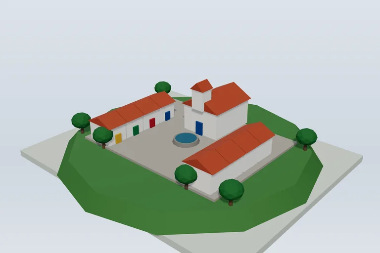

# Pueblito Paisa · Cerro Nutibara

> **Ficha G5-07 para C5-02 (Codex)** · ID: `pueblito_paisa` · Categoría: `patrimonio-mirador`

*Maqueta 3D de estudio limpia (sin texto, sin logos ni marcas), generada con proporciones y paleta exactas de esta ficha para desbloquear C5-02 mientras se restablece la cuota de Nano Banana.*

## Datos geográficos y de Motor City (`mundo.mc4`)

| Campo | Valor |
|---|---|
| **Ubicación** | Belén · Cima del Cerro Nutibara (cota ~1 547 m) |
| **Coordenadas WGS84** | `6.236150, -75.579880` |
| **Coordenadas MC4 (metros)** | `x = 13293`, `y = 24752` |
| **Cota del terreno (`relieve`)** | `1547 m s. n. m.` |
| **Hito(s) en `mundo.mc4`** | Sin hito dedicado en `mundo.mc4` (reemplazar o superponer sobre huella ED1 local) |
| **Lugar MC4 asociado** | `cerro` |
| **OpenStreetMap** | `way/765380123` (verificado) · consulta Overpass: `way["name"~"Pueblito Paisa"](6.234,-75.582,6.238,-75.578)` |

## Dimensiones y presupuesto de malla (C5-02)

| Parámetro | Valor |
|---|---|
| **Altura aproximada** | **14 m** (~2 pisos) |
| **Planta aproximada (ancho × fondo)** | **70 m × 55 m** |
| **Presupuesto LOD0 (cerca)** | ≤ **840 triángulos** |
| **Presupuesto LOD1 (lejos)** | ≤ **240 triángulos** |

## Materiales

- Muros de bahareque/tapia pintados en blanco cal impecable
- Carpintería tradicional antioqueña en madera pintada de colores vivos (azul cobalto, rojo carmín, verde esmeralda, amarillo)
- Cubiertas inclinadas de teja de barro cocido terracota con amplios aleros
- Empedrado rústico gris en la placita central con fuente de piedra

## Paleta de referencia (HEX)

| Rol | HEX |
|---|---|
| `fachada` | `#F6F4EE` |
| `techo` | `#B75534` |
| `carpinteria_azul` | `#245896` |
| `carpinteria_rojo` | `#B6342F` |
| `luz_noche` | `#FFD68A` |

## Rasgos que lo hacen reconocible

1. Réplica de pueblo tradicional antioqueño coronando la cumbre del Cerro Nutibara con vista 360° al valle.
2. Capilla blanca con espadaña/torre central única y tejado a dos aguas cerrando la cabecera de la plaza.
3. Casas perimetrales de 1 y 2 pisos con balcones corridos, zócalos y puertas de colores primarios muy vivos.
4. Fuente circular de piedra en el centro de la plaza empedrada y mirador arbolado en todo el perímetro.

## Guía de modelado para Codex (`C5-02`)

- **Volumetría sugerida:** Plataforma mirador nivelada sobre la cumbre (cota 1547 m) con plaza empedrada de 34×26 m y fuente central; en un extremo la capilla blanca de 12×20×9 m con torre frontal hasta z=14 m; en los otros tres lados, hileras de casas blancas de 5–7 m con tejados de barro en voladizo y acentos de color en puertas/ventanas.
- **Lectura nocturna:** Faroles coloniales cálidos alrededor de la placita y luz suave en la torre blanca de la capilla, visible desde el fondo del valle.
- **Integración en `VistaTres`:** al cargar el sector de `(x=13293, y=24752)`, omitir los bloques genéricos ED1 dentro de la planta de `pueblito_paisa` (o los hitos locales) y anclar la base a la cota real del terreno (`M.altura(x, y)`) con faldón subterráneo de 2–4 m (12 m en ladera para Biblioteca España) para que nunca flote en pendiente.
