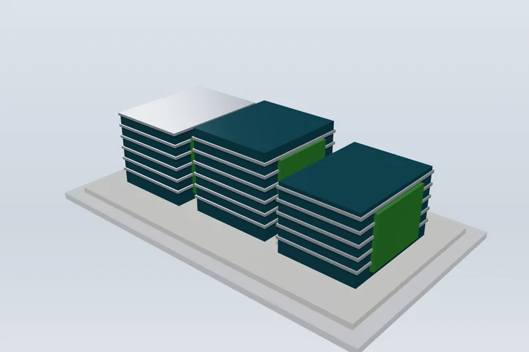

# Complejo Ruta N

> **Ficha G5-07 para C5-02 (Codex)** · ID: `ruta_n` · Categoría: `innovacion-moderno`

*Maqueta 3D de estudio limpia (sin texto, sin logos ni marcas), generada con proporciones y paleta exactas de esta ficha para desbloquear C5-02 mientras se restablece la cuota de Nano Banana.*

## Datos geográficos y de Motor City (`mundo.mc4`)

| Campo | Valor |
|---|---|
| **Ubicación** | Aranjuez · Calle 67 # 52-20 (Carabobo Norte) |
| **Coordenadas WGS84** | `6.265150, -75.566810` |
| **Coordenadas MC4 (metros)** | `x = 14739`, `y = 21545` |
| **Cota del terreno (`relieve`)** | `1468 m s. n. m.` |
| **Hito(s) en `mundo.mc4`** | Sin hito dedicado en `mundo.mc4` (reemplazar o superponer sobre huella ED1 local) |
| **Lugar MC4 asociado** | `planetario` |
| **OpenStreetMap** | `way/572983883` (verificado) · consulta Overpass: `way["name"~"Ruta N"](6.263,-75.569,6.267,-75.565)` |

## Dimensiones y presupuesto de malla (C5-02)

| Parámetro | Valor |
|---|---|
| **Altura aproximada** | **28 m** (~7 pisos) |
| **Planta aproximada (ancho × fondo)** | **130 m × 65 m** |
| **Presupuesto LOD0 (cerca)** | ≤ **780 triángulos** |
| **Presupuesto LOD1 (lejos)** | ≤ **220 triángulos** |

## Materiales

- Fachada acristalada de alto desempeño en tonos verde-azulado y aluminio plateado
- Jardines verticales vivos (muros verdes) y terrazas ajardinadas bioclimáticas
- Parasoles metálicos verticales en naranja-terracota suave y aluminio gris
- Concreto arquitectónico claro en la plaza escalonada interior y puentes entre torres

## Paleta de referencia (HEX)

| Rol | HEX |
|---|---|
| `vidrio` | `#356470` |
| `aluminio` | `#CFD5D9` |
| `muro_verde` | `#45823B` |
| `acento` | `#D97B38` |
| `luz_noche` | `#CCF0FF` |

## Rasgos que lo hacen reconocible

1. Tres torres corporativas contemporáneas de 6–7 pisos conectadas por pasarelas aéreas y un gran patio bioclimático central.
2. Muros verdes verticales y terrazas plantadas que suavizan el vidrio y el aluminio.
3. Volumen en voladizo y quiebrasoles rítmicos orientados a lo largo de la calle 67 (Barranquilla) y Carabobo.
4. Cubiertas ajardinadas con claraboyas y paneles solares visibles desde altura.

## Guía de modelado para Codex (`C5-02`)

- **Volumetría sugerida:** Zócalo abierto de 130×65×4 m con patio escalonado; sobre él, 3 bloques rectangulares escalonados de 24–28 m en vidrio verde-azulado y marcos de aluminio claro, unidos por dos puentes acristalados en el piso 4 y paños de jardín vertical verde en sus testeros.
- **Lectura nocturna:** Oficinas blanco-neutro luminosas y puentes conectores encendidos sobre el patio central.
- **Integración en `VistaTres`:** al cargar el sector de `(x=14739, y=21545)`, omitir los bloques genéricos ED1 dentro de la planta de `ruta_n` (o los hitos locales) y anclar la base a la cota real del terreno (`M.altura(x, y)`) con faldón subterráneo de 2–4 m (12 m en ladera para Biblioteca España) para que nunca flote en pendiente.
