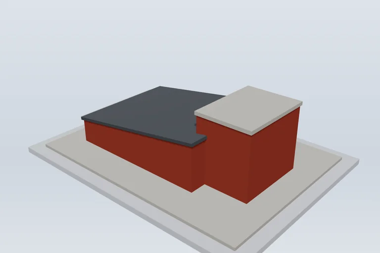

# Teatro Metropolitano José Gutiérrez Gómez

> **Ficha G5-07 para C5-02 (Codex)** · ID: `teatro_metropolitano` · Categoría: `equipamiento-cultural`

*Maqueta 3D de estudio limpia (sin texto, sin logos ni marcas), generada con proporciones y paleta exactas de esta ficha para desbloquear C5-02 mientras se restablece la cuota de Nano Banana.*

## Datos geográficos y de Motor City (`mundo.mc4`)

| Campo | Valor |
|---|---|
| **Ubicación** | La Alpujarra · Calle 41 # 57-30 (junto a Pies Descalzos) |
| **Coordenadas WGS84** | `6.243179, -75.577582` |
| **Coordenadas MC4 (metros)** | `x = 13547`, `y = 23975` |
| **Cota del terreno (`relieve`)** | `1477 m s. n. m.` |
| **Hito(s) en `mundo.mc4`** | `teatro` (ladrillo, alto MC4 24 m, 1 pol.) |
| **Lugar MC4 asociado** | `alpujarra` |
| **OpenStreetMap** | `way/32473064` (verificado) · consulta Overpass: `way["name"~"Teatro Metropolitano"](6.242,-75.579,6.245,-75.576)` |

## Dimensiones y presupuesto de malla (C5-02)

| Parámetro | Valor |
|---|---|
| **Altura aproximada** | **24 m** (~4 pisos) |
| **Planta aproximada (ancho × fondo)** | **92 m × 68 m** |
| **Presupuesto LOD0 (cerca)** | ≤ **720 triángulos** |
| **Presupuesto LOD1 (lejos)** | ≤ **210 triángulos** |

## Materiales

- Ladrillo a la vista rojo-terracota característico de la arquitectura antioqueña contemporánea
- Concreto arquitectónico gris claro en vigas, aleros y escalinatas de acceso
- Vidrio ahumado en vestíbulo panorámico orientado hacia la plazoleta norte
- Cubierta inclinada escalonada en lámina gris oscura sobre la sala sinfónica

## Paleta de referencia (HEX)

| Rol | HEX |
|---|---|
| `ladrillo` | `#A94F38` |
| `concreto` | `#C4C0B8` |
| `techo` | `#5B5E62` |
| `vidrio` | `#293740` |
| `luz_noche` | `#FFE09A` |

## Rasgos que lo hacen reconocible

1. Volumen rotundo en ladrillo rojo a la vista con cubierta inclinada en cuña que sigue la pendiente acústica de la gran sala.
2. Alta torre de tramoya (caja escénica) de ~24 m elevándose con claridad sobre el cuerpo principal.
3. Plazoleta peatonal amplia con escalinatas y rampas que enlazan con Plaza Mayor y el Edificio EPM.
4. Pórtico frontal sombreado por profundos voladizos de ladrillo y concreto.

## Guía de modelado para Codex (`C5-02`)

- **Volumetría sugerida:** Reemplazar el hito `teatro`: cuerpo de vestíbulo y sala de 64×46 m cuya cubierta sube en rampa desde z=10 m (frente) hasta z=18 m, seguido por la caja escénica prismática de 26×32×24 m en ladrillo terracota con remates de concreto gris.
- **Lectura nocturna:** Vestíbulo acristalado cálido y reflectores suaves bañando los grandes paños de ladrillo rojo.
- **Integración en `VistaTres`:** al cargar el sector de `(x=13547, y=23975)`, omitir los bloques genéricos ED1 dentro de la planta de `teatro_metropolitano` (o los hitos `teatro`) y anclar la base a la cota real del terreno (`M.altura(x, y)`) con faldón subterráneo de 2–4 m (12 m en ladera para Biblioteca España) para que nunca flote en pendiente.
