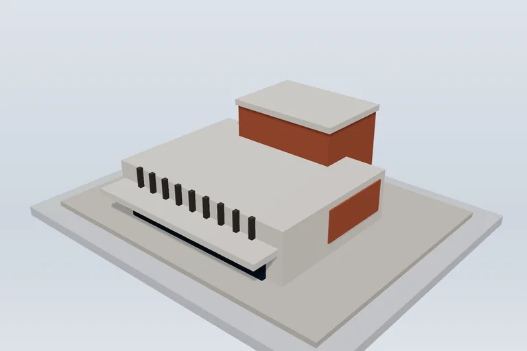

# Teatro Pablo Tobón Uribe

> **Ficha G5-07 para C5-02 (Codex)** · ID: `teatro_pablo_tobon` · Categoría: `equipamiento-cultural`

*Maqueta 3D de estudio limpia (sin texto, sin logos ni marcas), generada con proporciones y paleta exactas de esta ficha para desbloquear C5-02 mientras se restablece la cuota de Nano Banana.*

## Datos geográficos y de Motor City (`mundo.mc4`)

| Campo | Valor |
|---|---|
| **Ubicación** | La Candelaria · Avenida La Playa (Carrera 40 # 51-24) |
| **Coordenadas WGS84** | `6.247459, -75.559109` |
| **Coordenadas MC4 (metros)** | `x = 15591`, `y = 23502` |
| **Cota del terreno (`relieve`)** | `1511 m s. n. m.` |
| **Hito(s) en `mundo.mc4`** | `pablotobon` (republicano, alto MC4 14 m, 1 pol.) |
| **Lugar MC4 asociado** | `playa` |
| **OpenStreetMap** | `way/109028606` (verificado) · consulta Overpass: `way["name"~"Teatro Pablo Tobón"](6.246,-75.561,6.249,-75.557)` |

## Dimensiones y presupuesto de malla (C5-02)

| Parámetro | Valor |
|---|---|
| **Altura aproximada** | **16 m** (~4 pisos) |
| **Planta aproximada (ancho × fondo)** | **65 m × 48 m** |
| **Presupuesto LOD0 (cerca)** | ≤ **660 triángulos** |
| **Presupuesto LOD1 (lejos)** | ≤ **190 triángulos** |

## Materiales

- Ladrillo a la vista cálido y piedra crema en fachada moderna de mediados del siglo XX
- Concreto pintado marfil en marquesina volada y celosías geométricas frontales
- Vidrio claro en vestíbulo curvo/recto de doble altura hacia la plazoleta de La Playa
- Metal oscuro en carpintería y caja escénica posterior

## Paleta de referencia (HEX)

| Rol | HEX |
|---|---|
| `ladrillo` | `#B36446` |
| `concreto` | `#E3DDD2` |
| `vidrio` | `#2E4352` |
| `acento` | `#4A4643` |
| `luz_noche` | `#FFE099` |

## Rasgos que lo hacen reconocible

1. Fachada modernista icónica de la avenida La Playa con amplia marquesina volada y vestíbulo acristalado.
2. Plazoleta frontal abierta con escalinata ancha donde se reúne la vida cultural y bohemia del centro.
3. Caja escénica más alta (16 m) en la parte posterior del auditorio, contrastando con el frente más bajo (11 m).
4. Combinación sobria de ladrillo cálido, paños crema y celosía geométrica de concreto.

## Guía de modelado para Codex (`C5-02`)

- **Volumetría sugerida:** Plazoleta delantera con escalinata; bloque de vestíbulo y sala de 42×36×11 m con marquesina frontal volada de 4 m y paño acristalado, rematado atrás por la torre escénica prismática de 22×28×16 m en ladrillo y concreto marfil.
- **Lectura nocturna:** Marquesina frontal cálidamente iluminada y vestíbulo transparente con brillo dorado hacia La Playa.
- **Integración en `VistaTres`:** al cargar el sector de `(x=15591, y=23502)`, omitir los bloques genéricos ED1 dentro de la planta de `teatro_pablo_tobon` (o los hitos `pablotobon`) y anclar la base a la cota real del terreno (`M.altura(x, y)`) con faldón subterráneo de 2–4 m (12 m en ladera para Biblioteca España) para que nunca flote en pendiente.
