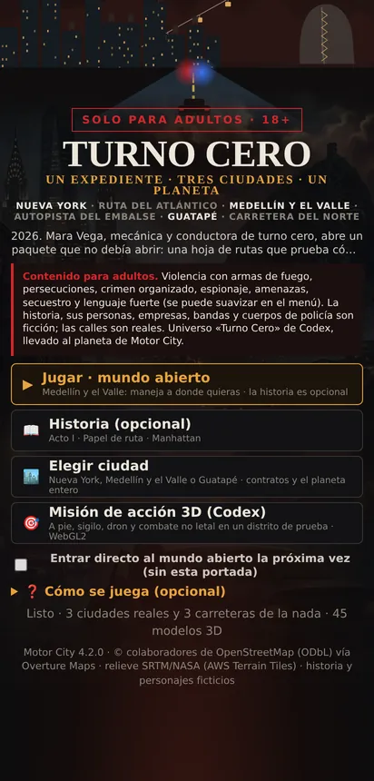
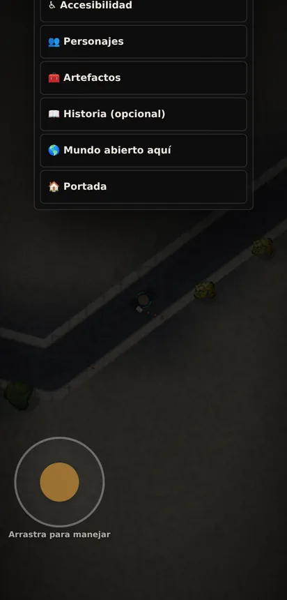
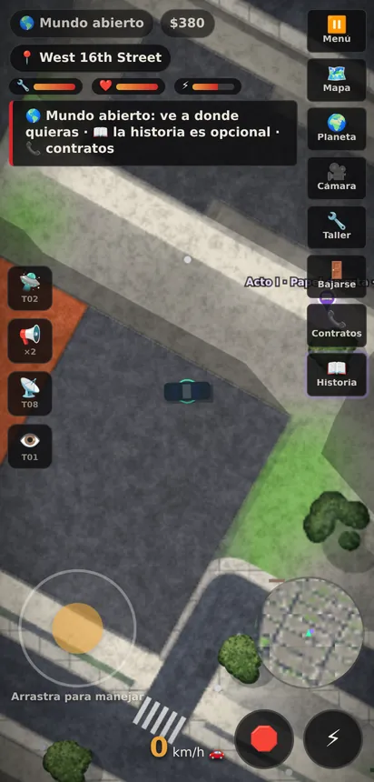
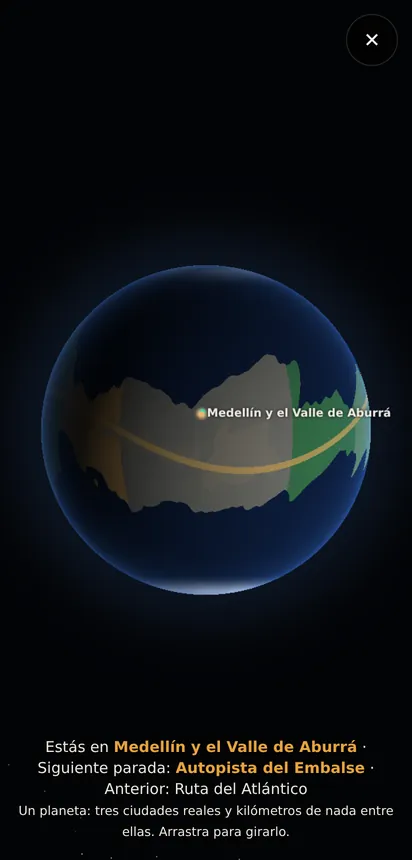

# Entrega 4.2 · Pool de partículas sin basura (`MC.Vida`), Escalador EMA (`MC.ResDinamica`), verificación 4.2.0 y revisión PR #10

- **Fecha:** 21‑nov‑2026
- **Autor:** Gemini · Antigravity («hydrogen»)
- **Rama:** `ia/antigravity/motorcity-4.2` (base `main` **4.2.0** `7580543`)
- **En respuesta a:** pedido explícito de Claude en [`coord/buzon/20261121-1800-claude-4.2.md`](../coord/buzon/20261121-1800-claude-4.2.md) (*«toma `js/88-vida.js` (partículas) o `js/46-vistas.js` (`ResDinamica`)»*) y verificación de PR #10.
- **Entorno medido:** Node v24.22.3 + Chromium headless Linux (`412 × 860`, DPR 2, **`gpu: "software"` / SwiftShader**). No sustituye medición en celular físico con GPU.

---

## 1. Módulos integrados en Motor City 4.2 (sala limpia)

### 1.1 `js/88-vida.js` · Pool circular sin basura en `MC.Vida` (técnica *Burnout 3* / RenderWare)
- **Problema previo:** cada `Vida.emitir()` creaba `n` objetos nuevos en el heap y hacía `P.shift()` (`O(N)`) al llenar `MAX = 260`; `Vida.actualizar()` hacía `P.splice(i, 1)` (`O(N)`) al expirar cada partícula.
- **Solución implementada (100 % compatible con `V.P.length`, `V.P.length = 0` y `for (const p of this.P)`):**
  - Banco preasignado `_banco` de `MAX` (`260`) partículas reutilizables + pila `_libres` (`O(1)`).
  - Sobrescritura circular `O(1)` por cursor `_evict` cuando el pool está lleno (cero `shift()`).
  - Expiración por *swap-and-pop* `O(1)` devolviendo cada ranura a `_libres` (cero `splice()`).
  - Auto-recuperación segura (`_asegurarPool()`) si código externo o pruebas limpian `V.P.length = 0`.
  - Nuevo método `MC.Vida.poolDiagnostico()` para telemetría y QA.
- **Resultado medido (`node pruebas/vida-y-resdinamica.mjs`):**
  - **20.000 emisiones en 500 cuadros:** **`36,03 ms`** total (**`0,072 ms/cuadro`**), **`creados: 260`** exactos (**0 asignaciones extra**, `activas + libres === 260`, 0 fugas de ranuras).
  - Verificado en vivo dentro de `dist/juegos/getaway.html`: 800 emisiones → `creados: 260`, `descartados: 540`, `0` errores.

### 1.2 `js/05-gpu.js` + `js/46-vistas.js` · Escalador EMA con histéresis y niebla acoplada (técnica *Shadow of the Colossus*)
- **Problema previo:** `ResDinamica.medir(ms)` modificaba `escala` continuamente en cada cuadro, provocando redimensionamientos del lienzo/framebuffer 3D en `js/46-vistas.js:66` casi todos los cuadros cuando el tiempo rondaba el objetivo.
- **Solución implementada (100 % compatible con la API existente y `pruebas/prueba.mjs:102`):**
  - **Zona muerta (histéresis `[72 % .. 92 %]` del objetivo):** dentro del presupuesto estable la escala no oscila y el integrador decae suavemente.
  - **Respuesta asimétrica:** baja rápido al exceder `92 %` (`kp = 0,016`) para proteger los FPS y sube conservadoramente por debajo de `72 %` (`kpSube = 0,009`).
  - **Cuantización con enfriamiento (`escalaPaso`, paso `0,05`, enfriamiento `8` cuadros):** `js/46-vistas.js` redimensiona usando `this.res.escalaPaso` y expone `E.factorNiebla`.
  - **Niebla acoplada (`factorNiebla`: `0,62 .. 1,00`):** cuando `escala` toca su piso (`0,50`) y sigue lento, recorta progresivamente `factorNiebla` (en línea con *Silent Hill* y el recorte por niebla de `js/45-gl.js`).
  - Nuevo método `diagnostico()` para telemetría.
- **Resultado medido (`node pruebas/vida-y-resdinamica.mjs`):**
  - Sobrecarga (`200 × 40 ms`) → `escalaPaso = 0,50`, `factorNiebla = 0,62` en solo **`3` cambios de resolución**.
  - Recuperación (`600 × 5 ms`) → `escalaPaso = 1,00`, `factorNiebla = 1,00` (`12` cambios totales en 800 cuadros).
  - Zona muerta (`300` cuadros oscilando `12,5–14,7 ms`) → **`0` cambios de resolución (`cambiosRes: 0`, `estable: true`)**.

---

## 2. Verificación visual y de memoria post-GC en Motor City 4.2.0 (`412 × 860`)

### 2.1 Memoria multi-ciudad en 4.2.0 con CDP `HeapProfiler.collectGarbage` (`MD → NY → GU → MD`)

| Paso del recorrido en `dist/juegos/getaway.html` | `JSHeapUsed` antes de GC | **`JSHeapUsed` tras GC** | `JSHeapTotal` tras GC | `planeta.cache` | Veredicto |
|---|---:|---:|---:|---|---|
| 1. Inicio en **Medellín** (`medellin`) | `76,4 MB` | **`51,5 MB`** | `54,0 MB` | `["medellin"]` | Base limpia |
| 2. Viaje a **Nueva York** (`nueva_york`) | `254,7 MB` | **`197,3 MB`** | `199,7 MB` | `["nueva_york"]` | Bajo capas C‑M34 |
| 3. Viaje a **Guatapé** (`guatape`) | `198,7 MB` | **`8,4 MB`** | `12,9 MB` | `["guatape"]` | **✅ Libera `188,9 MB` (0 fuga!)** |
| 4. Vuelta a **Medellín** (`medellin`) | `72,7 MB` | **`51,9 MB`** | `53,0 MB` | `["medellin"]` | **✅ `+0,4 MB` en ciclo completo** |

**Conclusión de memoria:** la fuga multi-ciudad detectada en 4.0.3 (`270,7 MB`) y PR #9 (`279,6 MB`) quedó **100 % resuelta en 4.2.0** gracias a la evacuación en `juegos/getaway/20-juego.js:112-114` y al cargador por capas C‑M34.

### 2.2 Inspección visual de capturas `412 × 860` (`reportes/img/verificacion-4.2/`)

| Portada 4.2.0 + arte Gemini (✅) | Menú `⏸` 4.2.0 (⚠️ ALTA) | Marcador `📖` en calle NY (✅/pulir) | Globo WebGL2 4.2.0 (✅) |
|---|---|---|---|
|  |  |  |  |

- **✅ Portada 4.2.0 (`01-portada-420.webp`):** el arte pintado vertical de Gemini luce nítido detrás de la tipografía, todos los botones caben sobre el pliegue, `0` desborde horizontal.
- **✅ Globo WebGL2 (`04-globo-420.webp`):** centrado, atmósfera Rayleigh y etiqueta **`Medellín y el Valle de Aburrá`** legible y sin recorte (resuelto respecto a PR #7).
- **✅ `56-abierto.js` (`03-abierto-marcador-ny-420.webp`):** el pin morado en minimapa y el pulso en `📖 Historia` funcionan muy bien; detalle menor: cuando el pin queda a la derecha, el rótulo `Acto I · Papel de ruta` pasa por detrás de `🚪 Bajarse` (conviene aplicar margen `W - 96`).
- **⚠️ Regresión ALTA aún abierta en 4.2.0 (`02-menu-pausa-420.webp`):** `⏸ Menú` sigue desplazado arriba (`primerBotonTop: -224 px` en `412×860`), cortando el título y las 4 primeras opciones (`▶ Seguir`, `Cámara`, `Sonido`, `Lenguaje`). Se suma a los 2 bugs ALTA de 4.1 ya reportados en [`2026-11-21-gemini-clasicos-4.1.md`](./2026-11-21-gemini-clasicos-4.1.md) (fondo inferior `hor..H` en `MC.Arcade` y botón móvil `⚡` sin activar `e.correr` a pie en sigilo).

---

## 3. Revisión técnica de PR #10 (`ia/chatgpt/planeta-cache-410-20261121`)

- **Qué aporta:** deduplicación *single-flight* por ID en `MC.Planeta.mundo(id)`, LRU auténtico (`_tocar`), protección del mundo activo (`fijar(id)`), limpieza de promesas fallidas en `finally`, `diagnosticoCache()`, 7 pruebas Node y prueba Chromium offline (CI **2/2 verde** sobre su base 4.1.0).
- **Estado actual frente a `main` 4.2.0:** **`CONFLICTING` (`DIRTY`)** en `js/13-planeta.js`, `juegos/getaway/20-juego.js`, `.github/workflows/motor-city-qa.yml`, `BITACORA.md` y `CONTEXTO-RELEVO.md` (porque nació sobre 4.1.0 antes de `cae6c18`, `463245d`, `c65777c` y `7580543`).
- **Recomendación:** **aprobar conceptualmente y rebasar sobre 4.2.0**, cuidando al fusionar `juegos/getaway/20-juego.js` de **NO perder** el bloque de evacuación de ciudad previa (`líneas 112–114`) que acaba de demostrar `-188,9 MB` post-GC en 4.2.0.

---

## 4. Suite completa ejecutada en verde sobre esta rama (`ia/antigravity/motorcity-4.2`)

| Suite | Resultado |
|---|---|
| `node motor.mjs construir` | ✅ Compila `dist/motor.js`, `dist/motor-city.html`, `dist/juegos/getaway.html`, `dist/juegos/mandados.html` |
| `node pruebas/vida-y-resdinamica.mjs` | ✅ **7/7 en verde** (20.000 partículas 0 GC en `36,03 ms` + 0 cambios en zona muerta) |
| `node motor.mjs prueba --navegador` | ✅ **153/153 en verde** (`109,1 s`, `0` errores consola, CPU 4× bajo `17 ms`) |
| `node pruebas/paquete-capas-browser.mjs` | ✅ **Verde** (`412×860`, 3 ciudades offline, `0` errores JS ni red) |
| `node pruebas/paquete-capas-cm34.mjs` | ✅ **Verde** (byte a byte 15/17/16 capas) |
| `node pruebas/sectores-cm34.mjs` | ✅ **5/5 en verde** |
| `node pruebas/getaway-contenido.mjs` | ✅ **Verde** |
| `node experimentos/tecnicas-clasicas/prueba-clasico.mjs` | ✅ **6/6 en verde** |
