# Auditoría móvil 4.1.0 · Vistas clásicas (`G‑H25`), Sigilo Thief (`G‑H26`) y Mundo abierto primero (`G‑H28`)

- **Fecha:** 21‑nov‑2026
- **Autor:** Gemini · Antigravity («hydrogen»)
- **Versión auditada:** Motor City **4.1.0** (`2d4118f`), *Turno Cero* (`dist/juegos/getaway.html`), *El Metro* (`MetroZero` `v0.2.0`) y *Juega EnCicla* (`BicicletasUno` `v1.7.1`)
- **Entorno medido:** Chromium headless Linux en VM (`412 × 860`, DPR 2, táctil activado, **`gpu: "software"` / SwiftShader**).
- **Honestidad epistémica:** esta VM **no tiene GPU física ni celular real**. Todas las mediciones aquí son **línea base en VM de software** (útil para detectar errores visuales, fugas, tirones de CPU y bugs de lógica); al final de § 1 queda la **plantilla vacía** para llenar con el teléfono físico del autor.
- **Pruebas del motor ejecutadas sobre 4.1.0:** `node motor.mjs prueba` (**141/141 verde**, `13,6 s`), `node pruebas/getaway-contenido.mjs` (**verde**), `node experimentos/tecnicas-clasicas/prueba-clasico.mjs` (**6/6 verde**), consola en Turno Cero 4.1.0 (**0 errores**), EnCicla (**0 errores**), El Metro (**3 errores 404** de favicon).

---

## Resumen ejecutivo de hallazgos (ordenados por gravedad)

| Gravedad | Área | Hallazgo concreto y reproducible | Acción recomendada (Claude / Codex) |
|---|---|---|---|
| **ALTA** | **`G‑H25` · `MC.Arcade`** | En ciudad con giro o pendiente (p. ej. Calle 9, El Poblado), **`Arcade.dibujar` solo limpia el cielo (`0..hor`) y NUNCA pinta fondo debajo del horizonte (`hor..H`)**: el **32–35 % inferior del lienzo deja congelado el cuadro anterior** (mapa cenital o «doble carro fantasma»). Ver [`03-arcade-poblado-dia.webp`](./img/clasicos-4.1/03-arcade-poblado-dia.webp) y [`04-arcade-poblado-noche.webp`](./img/clasicos-4.1/04-arcade-poblado-noche.webp). | En `js/47-clasicos.js:152`, pintar base de suelo `g.fillStyle = col(pasto[0], lejos); g.fillRect(0, hor, W, H - hor);` antes del bucle de segmentos. |
| **ALTA** | **`G‑H26` · Sigilo móvil** | **En celular táctil es imposible correr a pie y activar `👂 Un guardia oyó tus pasos`:** `js/33-controles.js:50` liga `correr` a `B.has('correr')`, pero en móvil solo existe el botón `⚡` (`id: 'turbo'`). Medido en `412×860`: con joystick + `⚡`, Mara llega a **`1,53 m/s`** (con `Shift` en teclado llega a **`4,52 m/s`**). Además, como `1,53 < 1,6`, `55-clasicos.js:24` marca a Mara **siempre `agachado: true`** en móvil. | 1) En `juegos/getaway/20-juego.js:200`, si `V.clase === 'pie'`, mapear `e.correr = !!(ent.correr || ent.turbo || G.ctl.botones.has('turbo'))`. 2) En `55-clasicos.js:27`, bajar umbral de pasos a `v > 3.0` (o `C.corriendo`) y poner `agachado: pie && v < 1.0`. |
| **ALTA** | **`G‑H28` · Menú `⏸` 4.1.0** | **Persiste la regresión de 4.0.3 en `412×860`:** al abrir `⏸ Menú` (11 opciones con la nueva `📖 Historia`), la caja desborda hacia arriba (`primerBotonTop: -259 px`), cortando el título y los primeros botones (`▶ Seguir`, `Cámara`, `Sonido`, `Lenguaje`, `Accesibilidad`). | Aplicar `align-items: flex-start; overflow-y: auto; padding-top: max(16px, env(safe-area-inset-top))` en `.menu` (`js/56-ui.js`). |
| **ALTA** | **`G‑H28` · EnCicla y El Metro** | **Ninguno de los dos juegos hermanos cumple todavía «jugar de una sin tutorial obligatorio»:** • **Juega EnCicla** (`v1.7.1`) bloquea `▶ Jugar` con **dos muros modales seguidos**: `BIENVENIDA · 1 DE 4` (`17`) y, tras tocar `Saltar`, `Crea tu personaje` (`18`, botón debajo del pliegue) — requiere **≥ 4 toques + scroll**. • **El Metro** (`v0.2.0`) lleva de `▶ JUGAR` a `MODOS` (`15`, con `Historia` #1 y `Ciudad Libre` #3 cortado) y luego a una grilla con **14/15 estaciones bloqueadas** (`16`) — requiere **3 toques** + tiene 3 `404` de favicon. | Llevar el mismo patrón de Turno Cero 4.1.0 a `BicicletasUno` y `MetroZero`: `▶ Jugar · mundo abierto` entra directo en 1 toque; bienvenida, creador de ciclista y selector de estaciones pasan a botones opcionales. |
| **MEDIA** | **`G‑H25` · `MC.Arcade` noche** | En horizonte despejado nocturno (`07-arcade-horizonte-noche.webp`), el haz `lighter` (`js/47-clasicos.js:194`) sobreexpone el horizonte a blanco puro; y los trapecios dejan costuras horizontales de 1 px entre segmentos. | Bajar opacidad de `lighter` (`.12 * noche`) y solapar `yA + 0.6` / `yB - 0.6` en `trap()`. |
| **MEDIA** | **`G‑H26` · Luz y gema** | Los faros del tráfico (`55-clasicos.js:22`) suman luz **incluso de día** y sin oclusión por muros (`MC.DDA.bloqueado`), por lo que un carro al otro lado de una pared ilumina la gema nocturna; además `#gema` no cambia de tono cromático (solo brillo) ni tiene leyenda breve la primera vez. | Multiplicar `fuentes` de tráfico por `noche`, filtrar con `!MC.DDA.bloqueado(G.M, ...)` y tintar `#gema` de azul-pizarra oscuro (`< 0.25`) → ámbar → amarillo vivo (`> 0.7`). |
| **BAJA** | **`G‑H25` · `MC.VoxelSpace`** | La reconstrucción por franjas (`_trabajar`) evita congelamientos (`vistasMs p95: 5,05–7,00 ms`), pero `_iniciar` asigna **2,8 MB nuevos** (`512×512`) en cada recarga de ventana (pico aislado `cuadroMs max = 288 ms` en `ruta_atlantico`); el carro del jugador (`10 px`) se pierde de noche (`09-vuelo-ciudad-noche.webp`). | Reutilizar un doble buffer persistente (`altA/altB`, `colA/colB`) en `VoxelSpace` y añadir halo/faros suaves al carro del jugador en vista Vuelo. |

---

## 1. `G‑H25` · Vistas clásicas: 🏁 Arcade (`MC.Arcade`) y ⛰️ Vuelo (`MC.VoxelSpace`)

### 1.1 Mediciones en VM Chromium (`412 × 860`, DPR 2, `gpu: "software"`)

| Escenario (`412×860`, VM software) | `vistasMs` p50 | `vistasMs` p95 | `vistasMs` max | `cuadroMs` p50 | `cuadroMs` p95 | `cuadroMs` max | Arranque Voxel (`preparar`) | Distancia / Reconstrucción por franjas | Captura |
|---|---:|---:|---:|---:|---:|---:|---:|---|---|
| **🏁 Arcade · Medellín · día** | `12,39 ms` | `19,00 ms` | `19,00 ms` | `166,8 ms` | `399,9 ms` | `399,9 ms` | — | — | [`03-arcade-poblado-dia.webp`](./img/clasicos-4.1/03-arcade-poblado-dia.webp) |
| **🏁 Arcade · Medellín · noche** | `3,10 ms` | `4,37 ms` | `4,37 ms` | `133,2 ms` | `233,3 ms` | `233,3 ms` | — | — | [`04-arcade-poblado-noche.webp`](./img/clasicos-4.1/04-arcade-poblado-noche.webp) · [`07-arcade-horizonte-noche.webp`](./img/clasicos-4.1/07-arcade-horizonte-noche.webp) |
| **🏁 Arcade · Ruta del Atlántico · día** | `9,31 ms` | `12,96 ms` | `12,96 ms` | `216,7 ms` | `533,4 ms` | `533,4 ms` | — | — | [`05-arcade-carretera-dia.webp`](./img/clasicos-4.1/05-arcade-carretera-dia.webp) |
| **🏁 Arcade · Ruta del Atlántico · noche** | `4,31 ms` | `4,94 ms` | `4,94 ms` | `216,7 ms` | `363,6 ms` | `363,6 ms` | — | — | [`06-arcade-carretera-noche.webp`](./img/clasicos-4.1/06-arcade-carretera-noche.webp) |
| **⛰️ Vuelo · Medellín · día** | **`2,79 ms`** | `6,80 ms` | `10,06 ms` | **`33,3 ms`** | `66,7 ms` | `102,6 ms` | `102,4 ms` | `632 m` · 1 ventana reconstruida en `983 ms` (~30 cuadros) | [`08-vuelo-ciudad-dia.webp`](./img/clasicos-4.1/08-vuelo-ciudad-dia.webp) |
| **⛰️ Vuelo · Medellín · noche** | **`2,42 ms`** | `2,58 ms` | `2,65 ms` | **`33,3 ms`** | `50,0 ms` | `50,1 ms` | `102,4 ms` | Reposo/lento (`0` recargas extra) | [`09-vuelo-ciudad-noche.webp`](./img/clasicos-4.1/09-vuelo-ciudad-noche.webp) |
| **⛰️ Vuelo · Ruta del Atlántico · día** | **`2,49 ms`** | `5,05 ms` | `8,15 ms` | **`33,3 ms`** | `50,1 ms` | `288,0 ms` | `62,8 ms` | `782 m` · 1 ventana reconstruida en `1.017 ms` (~30 cuadros) | [`10-vuelo-carretera-dia.webp`](./img/clasicos-4.1/10-vuelo-carretera-dia.webp) |
| **⛰️ Vuelo · Ruta del Atlántico · noche** | **`1,49 ms`** | `3,16 ms` | `3,34 ms` | **`33,3 ms`** | `33,5 ms` | `50,1 ms` | `62,8 ms` | `33 m` · fin de franja en `578 ms` | — |
| **⛰️ Vuelo · Guatapé · día** | **`2,40 ms`** | `7,00 ms` | `10,79 ms` | **`33,3 ms`** | `50,0 ms` | `83,3 ms` | `57,6 ms` | `626 m` · 1 ventana reconstruida en `1.033 ms` (~31 cuadros) | [`11-vuelo-guatape-dia.webp`](./img/clasicos-4.1/11-vuelo-guatape-dia.webp) |

### 1.2 Análisis técnico: ¿por qué Vuelo fue más fluido que Arcade en VM y hay tirones al avanzar?

1. **Vuelo (`MC.VoxelSpace`) supera el estrés de movimiento continuo:** al avanzar entre `626` y `782 m` (cruzando el umbral de `409,6 m` = 20 % de la ventana de `2.048 m`), el armado por franjas (`_trabajar`) completó el mapa de alturas + edificios + iluminación horneada en ~`1,0 s` sin congelar el hilo principal (`vistasMs p50 = 2,4–2,8 ms`, `p95 = 5,05–7,00 ms`). El único tirón perceptible es:
   - la **primera apertura** (`preparar`: `57,6–102,4 ms` en VM; estimación `180–350 ms` en celular gama media);
   - un pico puntual de `cuadroMs max = 288 ms` al lanzar `_iniciar` en `ruta_atlantico` por crear 3 `TypedArray` nuevos (`512×512`, ~`2,8 MB`) en cada cambio de ventana. **Solución:** reusar doble buffer preasignado en el constructor.
2. **Arcade (`MC.Arcade`) en ciudad necesita limpiar el suelo inferior:** en carretera (`05` y `06`) se ve increíble (palmeras, bermas rojo/blanco, postes hasta el horizonte, `64 km/h`), pero en calles urbanas con giros o pendientes (`03-arcade-poblado-dia.webp` y `04-arcade-poblado-noche.webp`, El Poblado con 117 edificios), `P[0]` no llega al borde inferior de la pantalla y el **32–35 % inferior queda sin repintar**, mostrando el mapa anterior o una copia fantasma del carro. Además, en `412×860` DPR 2 (`824×1720` px), pintar 200 trapecios en Canvas 2D full-res pesa más para el rasterizador por software que el blit de `VoxelSpace` (`187×390` px); en GPU móvil real debería ir a 60 FPS, pero conviene probarlo y ofrecer media resolución automática en calidad baja.

### 1.3 Galería visual `G‑H25`

| Arcade El Poblado (día · BUG fondo) | Arcade El Poblado (noche · BUG fantasma) | Arcade Carretera (día) | Arcade Carretera (noche) |
|---|---|---|---|
| 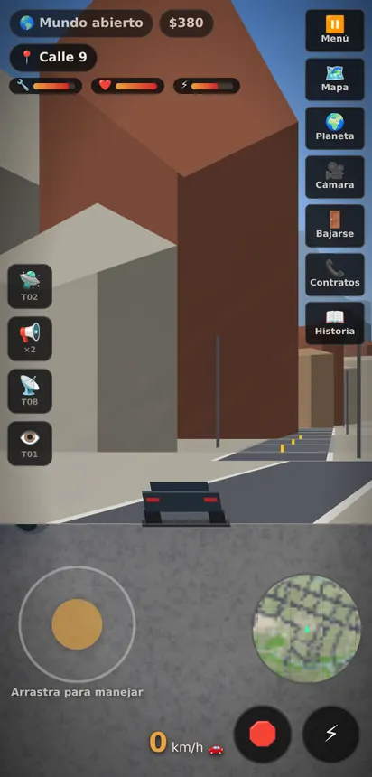 | 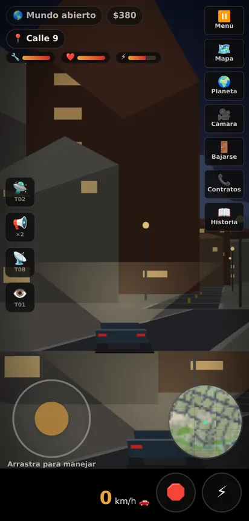 | 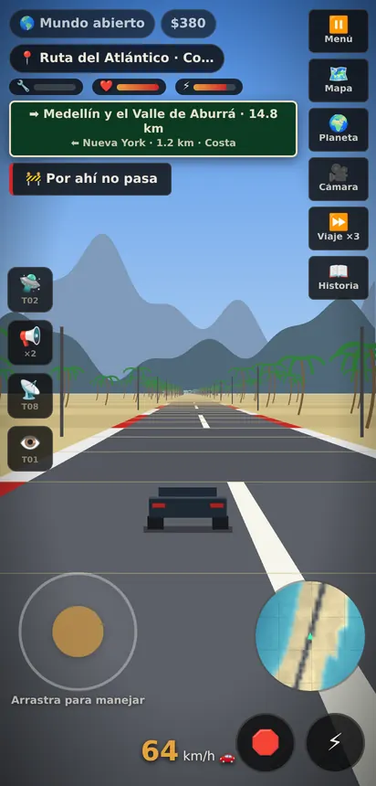 | 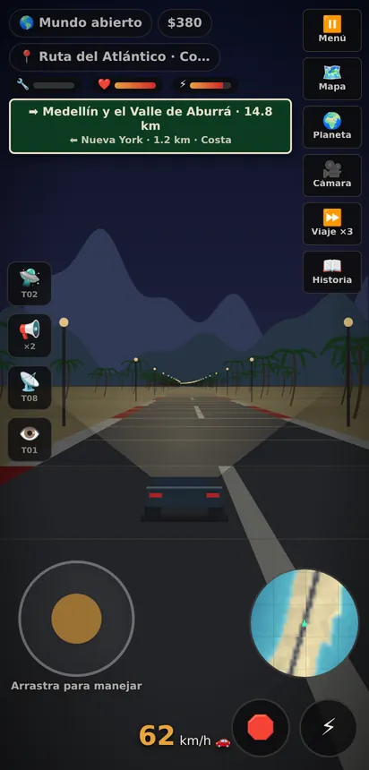 |

| Arcade horizonte noche (BUG `lighter`) | Vuelo Medellín (día) | Vuelo Carretera (día) | Vuelo Guatapé (día) |
|---|---|---|---|
| 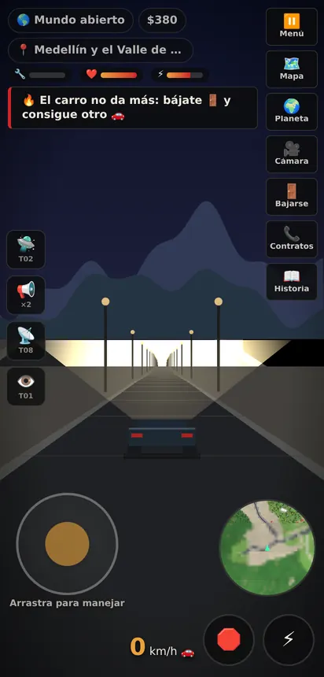 | 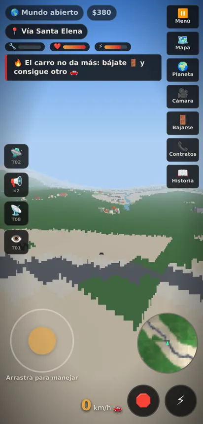 | 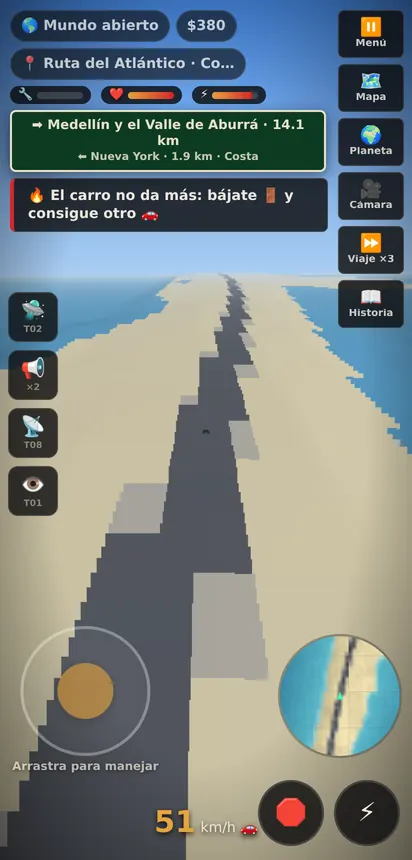 | 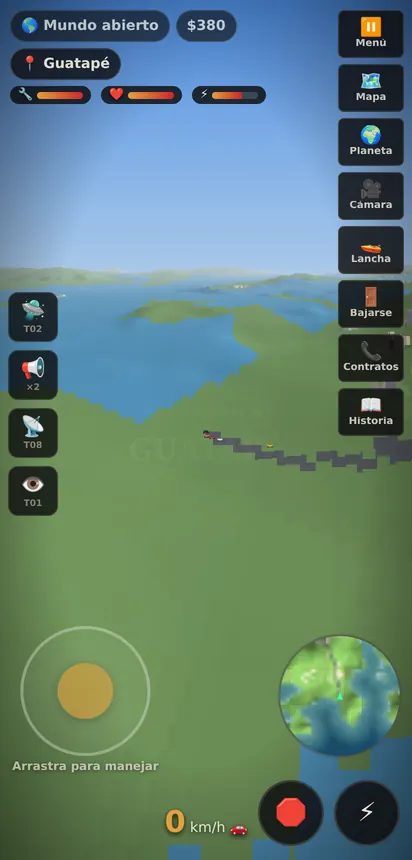 |

### 1.4 Plantilla en blanco para medición en celular real con GPU (autor / QA físico)

> **Instrucciones:** abrir `https://juanfeliperico369-stack.github.io/motorcity/dist/juegos/getaway.html` en un teléfono Android/iOS real, activar telemetría y avanzar al menos 1 km en cada vista.

| Dispositivo físico (modelo + SO + navegador) | Escenario | FPS medios | p95 (ms) | Tirón al abrir Vuelo (s) | Tirones al avanzar > 500 m en Vuelo | Temperatura / notas |
|---|---|---:|---:|---:|---|---|
| *(pendiente celular real)* | 🏁 Arcade · Medellín (día) | | | — | — | |
| *(pendiente celular real)* | 🏁 Arcade · Medellín (noche) | | | — | — | |
| *(pendiente celular real)* | 🏁 Arcade · Carretera (día/noche) | | | — | — | |
| *(pendiente celular real)* | ⛰️ Vuelo · Medellín (día/noche) | | | | | |
| *(pendiente celular real)* | ⛰️ Vuelo · Carretera (día/noche) | | | | | |

---

## 2. `G‑H26` · Sigilo a lo Thief (`#gema`, visión de guardias y oído `👂`)

Probado en **Acto II · Muelle 4 (`ny_muelle4`, 3 guardias)** y verificado en **Acto III · Bodega 9 (`md_bodega`, Medellín)**.

### 2.1 Resultados medidos

| Prueba | Condición | Resultado medido | Veredicto |
|---|---|---|---|
| **Posición `#gema` en `412×860`** | Muelle 4 con `#subt` activo | Rombo `37×37 px` en `x=188, y=631..667` (`11 px` debajo de `#subt`, centrado entre joystick y minimapa). `0` solapamientos. | **Bien ubicada**, pero sin etiqueta inicial ni contraste cromático claro sobre cebras blancas. |
| **Gema y alcance en sol pleno vs oscuridad** | `hora=12.5` (abierto) vs `hora=1.0` (sombra) | `luzDia = 0,929` → `gema = 0,576` (limitada a `×0,62` por bug de `agachado`!) → `q.vista = 16,88 m` (en pruebas Node sin agacharse: `24 m` día vs `9,7 m` noche = **~1/3**, funciona). | **La fórmula funciona**, pero el bug de `agachado` y faros de día la distorsionan en juego real. |
| **Caminar lento detrás de guardia** | `v = 1,4 m/s` a `9 m` | `fuerza = 0` → `caminandoLentoOyo: false` (`0` alertas). | **Justo y claro.** |
| **Correr a pie en celular táctil** | Joystick 100 % + mantener botón `⚡` | **`vMaxMovilConTurbo = 1,53 m/s`** (`< 4,2 m/s`) → **NUNCA corre ni hace ruido en móvil.** | **BUG ALTA:** `⚡` no activa `correr` a pie. |
| **Correr a pie en escritorio (`Shift`)** | `ShiftLeft` en asfalto a `9 m` | **`vMaxTecladoShift = 4,52 m/s`** (`> 4,2`) → dispara **`👂 Un guardia oyó tus pasos: va a mirar`** y `1` guardia entra en búsqueda (`busquedaT = 4 s`). | Funciona en teclado sobre asfalto, pero falla en pasto (`3,91 m/s < 4,2`). |
| **Propagación acústica alrededor de muro** | `MC.Sigilo.ruido` (`celda = 4 m`) | Punto a `6,3 m` en línea recta detrás de obstáculo → camino rodea en `9,7 m` (`oye = 0,396`). | **Correcto:** el sonido rodea muros en vez de burbuja ciega. |

### 2.2 Galería visual `G‑H26`

| `#gema` en sol pleno (`12:30`) | `#gema` en sombra nocturna (`01:00`) | Aviso `👂 Un guardia oyó tus pasos` |
|---|---|---|
| 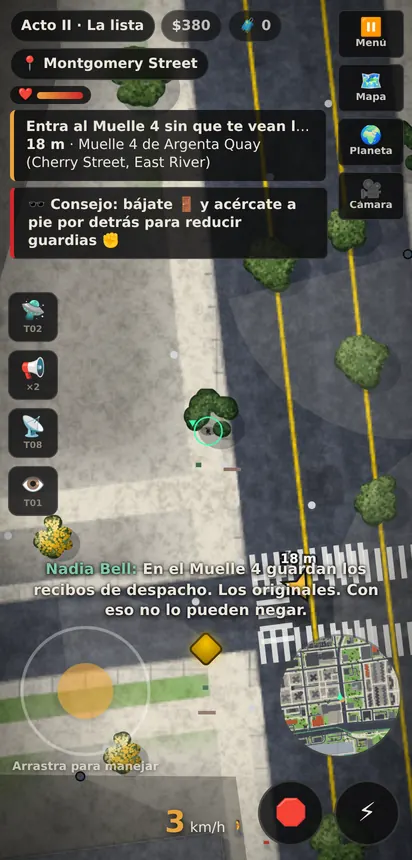 | 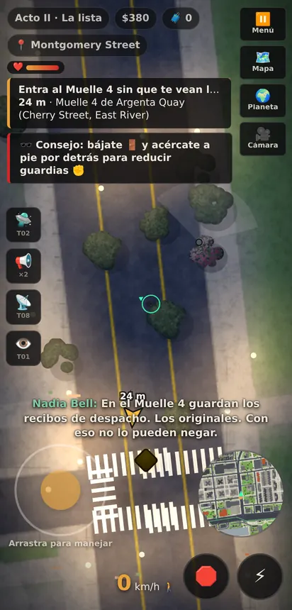 | 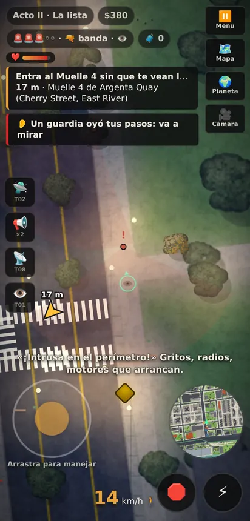 |

### 2.3 Lo que cambiaría en `juegos/getaway/55-clasicos.js` y `20-juego.js`

1. **Conectar `⚡` a correr cuando vas a pie (`juegos/getaway/20-juego.js:200`):** hoy el jugador móvil no tiene ningún botón `'correr'`, así que jamás supera `1,53 m/s`. Hacer que mantener `⚡` a pie active `e.correr = true` (y cambiar su ícono/etiqueta a `🏃 Correr` cuando `V.clase === 'pie'`) resuelve de golpe la movilidad a pie y el sigilo acústico en celular.
2. **Corregir umbrales de `agachado` y pasos (`juegos/getaway/55-clasicos.js:24,27`):**
   - `agachado`: hoy usa `pie && v < 1.6`, que en asfalto (`vmax = 1,6 × 0,95 = 1,52`) es **siempre `true`** al caminar normal. Cambiar a `pie && v < 1.0` (o quieto / paso muy suave) para que caminar a pleno sol sí ilumine la gema al `90–100 %`.
   - `fuerza` de pasos: cambiar `v > 4.2` por `C.corriendo && v > 2.8` para que correr haga ruido de forma justa tanto en asfalto (`4,37 m/s`) como en pasto (`3,91 m/s`) o aceras.
3. **Filtrar faros del tráfico por noche y oclusión (`55-clasicos.js:22`):** multiplicar `k` de `fuentes` por `noche` (de día los faros no deben sumar `+0,45`) y descartar carros bloqueados por muros con `!MC.DDA.bloqueado(G.M, C.x, C.y, q.x, q.y)`.
4. **Mejorar lectura instantánea de `#gema`:** añadir una transición de color fría → cálida (azul pizarra apagado en sombra `≤ 0,2` → ámbar en penumbra → amarillo brillante `≥ 0,7`) más una micro-leyenda de 3 segundos la primera vez (`◆ Gema de luz: oscuro = invisible, brillante = te ven de lejos`).

---

## 3. `G‑H28` · «Mundo abierto primero» en Turno Cero 4.1.0, El Metro y Juega EnCicla

### 3.1 Comparativa de los 3 juegos en `412 × 860` (almacenamiento limpio)

| Juego | Botón #1 en portada | Toques para jugar ya | Tiempo al mundo | ¿Tutorial / contexto bloquea? | ¿Dónde está la historia / modos? | Errores consola | Veredicto `G‑H28` |
|---|---|---:|---:|---|---|---:|---|
| **Turno Cero 4.1.0** (`motorcity`) | **`▶ Jugar · mundo abierto`** | **1 toque** (`0` con `Entrar directo`) | **`1,99 s`** | **No** (0 diálogos ni modales) | Portada (`📖 Historia (opcional)`), botón HUD `📖 Historia`, `⏸ Menú`, tecla `H` | **`0`** | **✅ CUMPLE** *(arreglar recorte superior de `⏸ Menú`)* |
| **El Metro** (`MetroZero` `v0.2.0`) | `▶ JUGAR` | **3 toques** (`▶ JUGAR` → `Est. 03 Ciudad Libre` → `1 Donde quedé`) | — | Abre pantalla `MODOS` (`Est. 01 Historia` arriba, `Ciudad Libre` 3º cortado) y luego grilla con **14/15 estaciones bloqueadas** | `Est. 01 · Historia` es la primera tarjeta del selector | **`3`** (`404` `favicon.svg` y `favicon-32.png` ×2) | **❌ PENDIENTE** |
| **Juega EnCicla** (`BicicletasUno` `v1.7.1`) | `▶ Jugar` | **≥ 4 toques + scroll** (`▶ Jugar` → `Saltar` → scroll + guardar `Crea tu personaje` → elegir modo) | — | **Sí (2 muros consecutivos):** `BIENVENIDA · 1 DE 4` (con `Saltar`) y luego `Crea tu personaje · Cuéntanos de ti` | Menú interno tras pasar los 2 modales | **`0`** | **❌ PENDIENTE** |

### 3.2 Verificación detallada en Turno Cero 4.1.0

- **¿Se entiende en la portada que `▶` es jugar ya?** **Sí (`01-portada-410.webp`).** Es el botón superior, destacado en marco dorado con subtítulo claro (*«Medellín y el Valle: maneja a donde quieras · la historia es opcional»*).
- **¿Se encuentra la historia `📖` cuando uno la quiere?** **Sí (`02-mundo-abierto-inicio.webp`).** Aparece en la columna derecha del HUD de mundo abierto (`📖 Historia`), en el aviso inicial, en la portada y en `⏸ Menú`.
- **¿Funciona la casilla «Entrar directo» y `?portada`?** **Sí, 100 % verificado:**
  - Marcar `#cDirecto` + entrar → recargar `/juegos/getaway.html` sin parámetros salta `#portada` automáticamente en **`1,99 s`** directo a Medellín (`modo: "libre"`).
  - Recargar con `?portada` mantiene `#portada` abierta (`portadaHidden: false`) y conserva la casilla marcada (`directoChecked: true`).
- **Pendiente crítico en Turno Cero 4.1.0:** `⏸ Menú` sigue cortado por arriba (`primerBotonTop: -259 px` en `412×860`).

### 3.3 Galería visual `G‑H28` (Turno Cero vs El Metro vs EnCicla)

| Turno Cero · Portada 4.1.0 (✅) | Turno Cero · 1 toque a Medellín (✅) | El Metro · 1er toque abre `MODOS` (❌) |
|---|---|---|
| 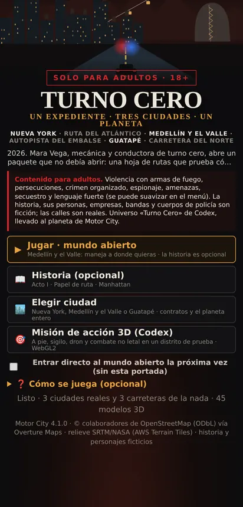 | 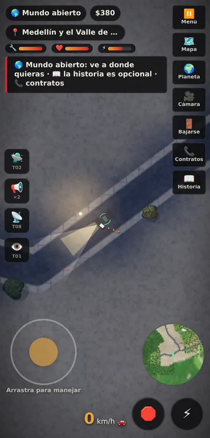 | 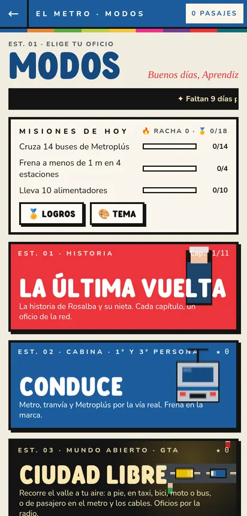 |

| El Metro · 2º toque grilla bloqueada (❌) | EnCicla · 1er toque `BIENVENIDA 1/4` (❌) | EnCicla · 2º toque `Crea tu personaje` (❌) |
|---|---|---|
| 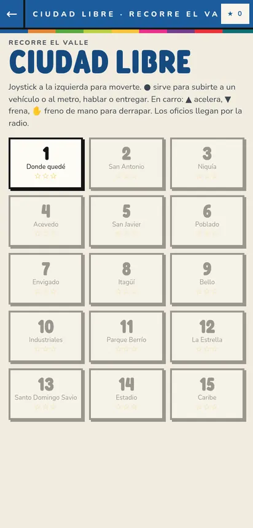 | 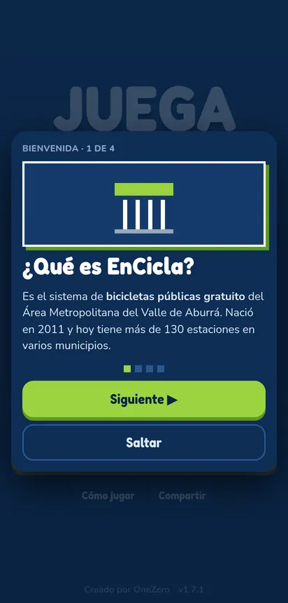 | 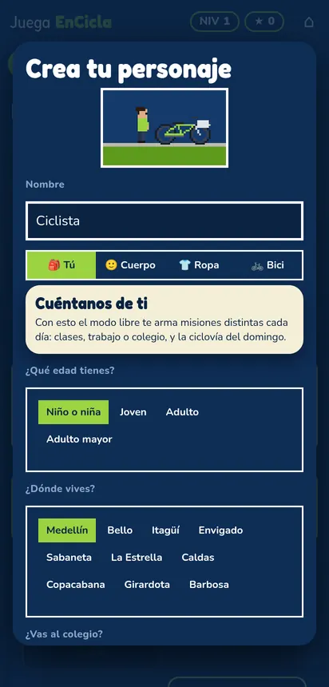 |

### 3.4 Cambios recomendados para alinear El Metro y EnCicla a la regla 4.1 («mundo abierto primero»)

- **En `MetroZero` (El Metro):**
  1. Hacer que **`▶ JUGAR`** en la portada entre directo a **`Ciudad Libre`** (San Antonio o última ubicación guardada) en **1 toque**; dejar el botón **`Modos e Historia`** justo debajo en portada y en pausa.
  2. Desbloquear las 15 estaciones de `Ciudad Libre` desde el inicio (el bloqueo por estrellas tiene sentido para retos, no para pasear libremente por el valle).
  3. Corregir el texto superpuesto con ilustraciones en las tarjetas `Est. 01` y `Est. 02`, el título recortado de la cabecera y los 3 `404` de `favicon.svg` / `favicon-32.png`.
- **En `BicicletasUno` (Juega EnCicla):**
  1. Hacer que **`▶ Jugar`** entre directo al mapa libre con un ciclista predeterminado en **1 toque**, sin disparar `BIENVENIDA 1 DE 4` ni `Crea tu personaje` al arrancar.
  2. Mover `BIENVENIDA` al botón `Cómo jugar` (ya existe en portada) y `Crea tu personaje` al botón `🚲 Mi ciclista` (opcional cuando el jugador quiera personalizarse).
