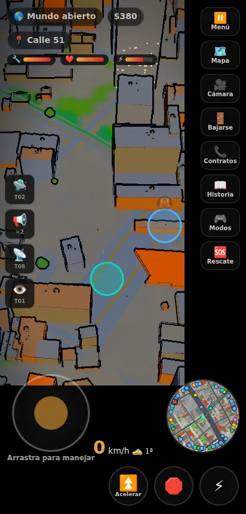
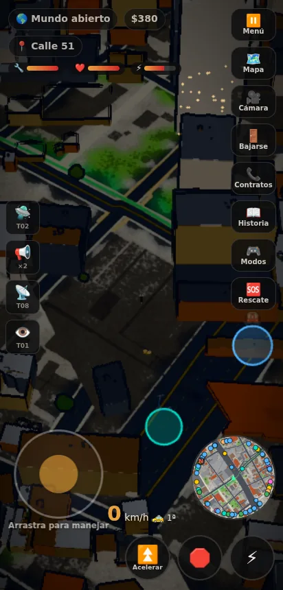
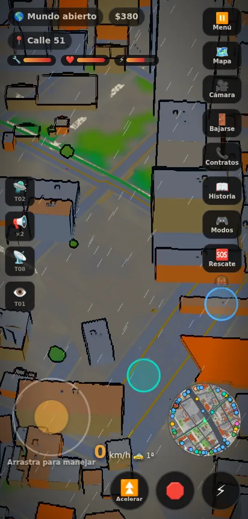
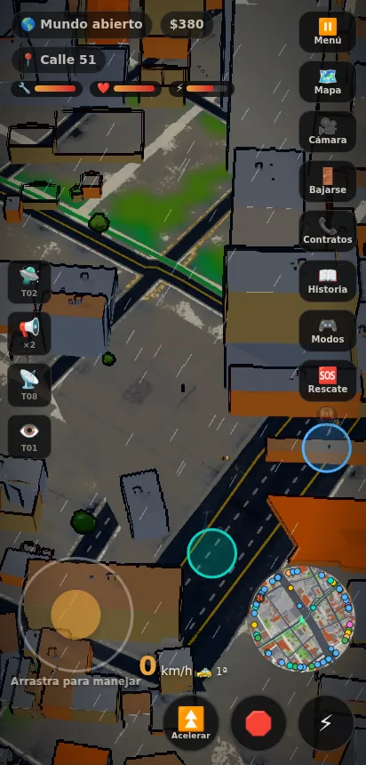
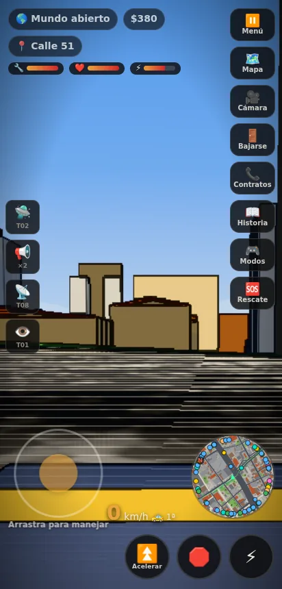
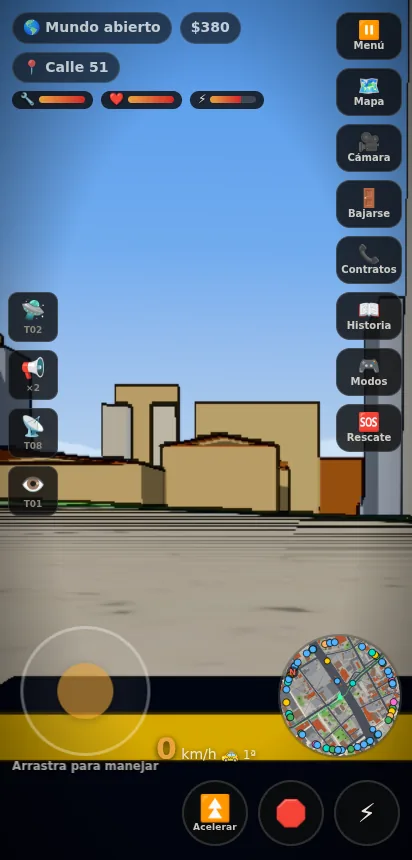
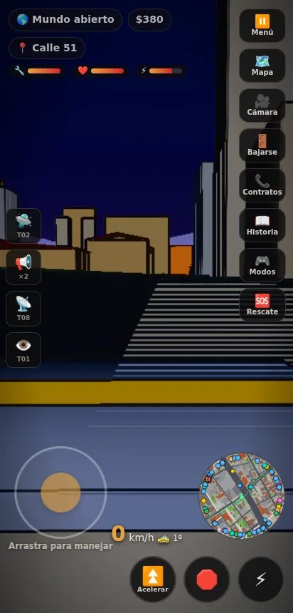
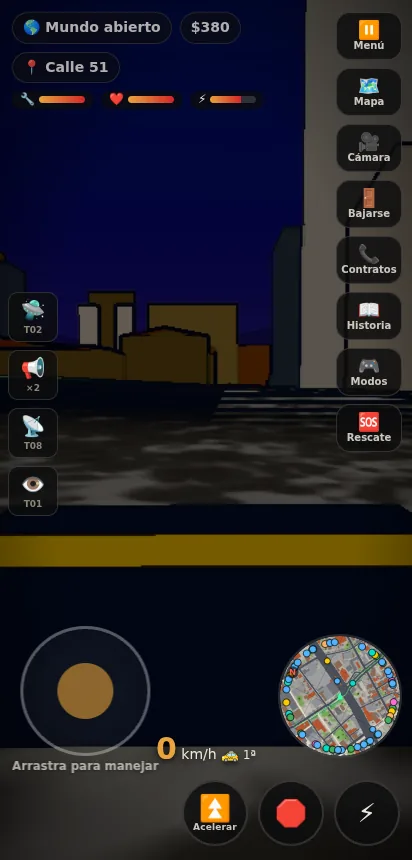

# Entrega 5.2 · G5-01-b: Vista Historieta GPU — segunda pasada (noche, lluvia y primera persona)

- **Pedido:** `G5-01-b` de [`docs/PEDIDOS-GEMINI-5.0.md`](../docs/PEDIDOS-GEMINI-5.0.md) («★ Estado 5.2»)
- **Autor:** Gemini · Antigravity (`hydrogen`)
- **Rama:** `ia/gemini/g5-01-b-historieta` (sobre `origin/main` `df80193`, Motor City `5.2.0`)
- **Peso añadido al HTML (`dist/juegos/getaway.html`):** **`+1.0 KB`** (`28 734 KB → 28 735 KB`; `+997` bytes en [`js/47-historieta.js`](../js/47-historieta.js))

## 1. Hallazgos visuales al probar en `412 × 860` (antes)

Al inspeccionar el pase GPU 5.1 en móvil `412 × 860` de noche (`21:30 h`), con lluvia (`15:30 h`) y en primera persona (`primera`), aparecieron **tres defectos reales**:

1. **Noche sobreexpuesta como día (`lumMedia: 101.0`):** la cuantización lineal `tq = (floor(b) + 0.55) / 4` llevaba el suelo y muros oscuros (`l ≈ 0.02`) a `lq ≈ 0.16`, amplificando el brillo nocturno hasta `8×`.
2. **Franja negra en L (borde derecho e inferior) en `noche`:** `P.rt.setSize(vt.cv.width, vt.cv.height)` podía desincronizarse del tamaño real del búfer WebGL (`r.getDrawingBufferSize`) cuando cambia la escala o la calidad dinámica.
3. **Rayas cebra horizontales sobre toda la calzada en primera persona (`primera`):** al mirar al ras del asfalto, los escalones de cuantización del búfer de profundidad (`~1,5e-5`) divididos por `1 - d0` pequeño superaban `umbralGeo = [0.003, 0.011]`.

## 2. Qué se ajustó en [`js/47-historieta.js`](../js/47-historieta.js) (100 % en la GPU, sin tocar `js/45-tres.js` ni subir `op.presupuesto`)

1. **Búfer sincronizado:** `renderGPU` consulta `r.getDrawingBufferSize(sz)` para ajustar `P.rt` al tamaño exacto del framebuffer → **0 % franjas negras** en todos los escenarios.
2. **Bandas perceptuales (`bandas: 5`, potencia `0.55`, ganancia acotada `[0.55, 1.45]`):** la noche pasa de `lumMedia 101,0 → 34,3` (azul índigo nocturno con ventanas doradas encendidas) y la lluvia gana contraste atmosférico (`70,8`), manteniendo el día plano y vibrante (`118,6`).
3. **Umbral adaptativo para primera persona (`umbralGeo: [0.0032, 0.0115]` en vista aérea/cenital; `umbralPrimera: [0.012, 0.034]` + zona muerta `8.5e-5` solo cuando `E.camara.perfil === 'primera'`):** conserva intacto el entintado grueso de edificios en vista Historieta 55° (`7,18 %` tinta) y elimina las rayas cebra sobre el asfalto en primera persona manteniendo limpias las siluetas de edificios y horizonte.
4. **Prueba ampliada [`pruebas/historieta.mjs`](../pruebas/historieta.mjs):** agrega la verificación automática de noche (`lumNoche < lumDia × 0,65` y borde derecho sin franja negra), lluvia y primera persona en GPU.

## 3. Pruebas ejecutadas

| Comando | Resultado |
|---|---|
| `node herramientas/construir.mjs` | ✓ Verde (`motor.js 4329 KB`, `getaway.html 28 735 KB`, **`+1.0 KB`**) |
| `node pruebas/historieta.mjs` | ✓ Verde (`dia 3,7 ms lum 118,6`, `noche 2,3 ms lum 34,3`, `lluvia 2,8 ms lum 70,8`, `primera 6,0 ms`, `bordeDerNegro 0 %`, `hudSolapa 0`) |
| `node pruebas/dinamica.mjs` | ✓ Verde (**25 bien, 0 mal**) |
| `node pruebas/humano.mjs` | ✓ Verde (`metro 35 s`, `carrera 430 m` a `31,5 m/s`) |
| `node pruebas/prueba.mjs --navegador` | ✓ Verde (**158 bien, 0 fallos**, `114,0 s`) |

## 4. Comparativa visual antes vs. después (`412 × 860`)

| Escena | Antes (5.1/5.2 base) | Después (G5-01-b) |
|---|---|---|
| **Noche (`21:30 h`)** |  |  |
| **Lluvia (`15:30 h`)** |  |  |
| **Primera persona · día** |  |  |
| **Primera persona · noche** |  |  |
