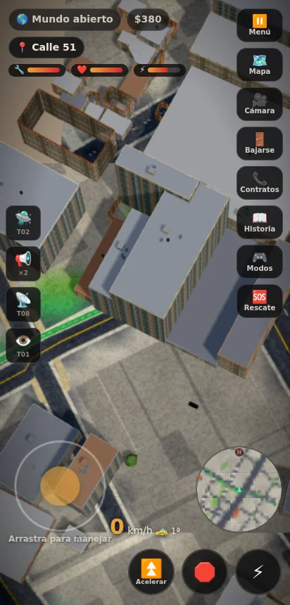
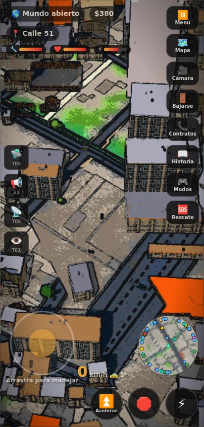
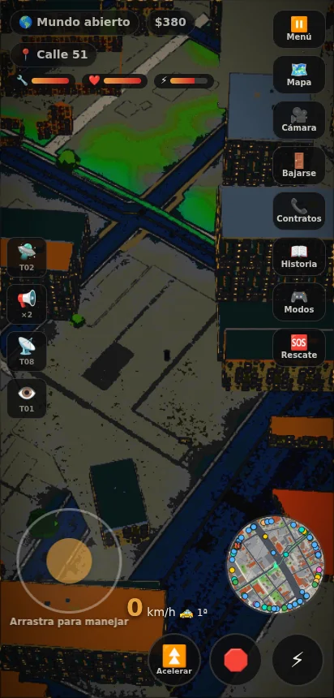
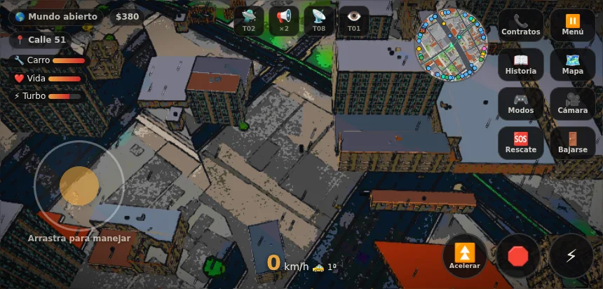

# Entrega 5.0 · G5-01: Vista «Historieta» (Chinatown Wars)

- **Fecha:** 2026-11-23
- **Autor:** Gemini · Antigravity (`hydrogen`)
- **Rama:** `ia/gemini/g5-01-historieta`
- **Pedido:** `G5-01` en [`docs/PEDIDOS-GEMINI-5.0.md`](../docs/PEDIDOS-GEMINI-5.0.md) y [`docs/PLAN-5.0.md`](../docs/PLAN-5.0.md)
- **Impacto en peso del HTML (`dist/juegos/getaway.html`):** `+3.1 KB` (`27909 KB` → `27910 KB` compilado; módulo [`js/47-historieta.js`](../js/47-historieta.js) de `6.9 KB` en fuente).

---

## 1. Qué se implementó (sala limpia)

1. **Perfil de cámara `historieta` en [`js/34-camara.js`](../js/34-camara.js):**
   - `CAM_PERFIL.historieta = { fijo: true, pitch: .96, pitchCerca: .88, fov: .68, giraRumbo: true, dist: 0, alto: 0, alejaVel: .45 }`.
   - Ángulo desde arriba a **`0.96 rad` (`55°`)**, que permite leer al mismo tiempo la vía, el tráfico y las fachadas 3D de los edificios.
   - En `Camara.prototype._aereo(dt, o)`, cuando `P.giraRumbo` está activo (o cuando `MC.opciones.graficos === 'historieta'` sobre vistas aéreas `cenital` / `oblicua`), `this.yaw` sigue suavemente el rumbo del vehículo (`-(o.a + Math.PI / 2)`) mediante el resorte angular `resorteAng(this.yaw, yr, this._vy, .28, dt)`, respetando el gesto manual del dedo (`this.mira`, `this._fija`).
2. **Opción `'historieta'` en `⚙️ Flexibilidad → 🖼️ Gráficos` ([`js/37-flexibilidad.js`](../js/37-flexibilidad.js)):**
   - Se añadió `['historieta', 'historieta: colores planos y contorno negro (Chinatown Wars)']` a `Flex.DEF`.
   - Al alternar entre `'auto'`, `'realistas'` e `'historieta'` en caliente, `Flex.aplicar` conserva la instancia de `VistaTres` y sus regiones 3D ya construidas (solo reinicia el contexto WebGL al pasar hacia o desde `'clasicos'`).
3. **Módulo aditivo [`js/47-historieta.js`](../js/47-historieta.js) (`MC.Historieta`, sin tocar [`js/45-tres.js`](../js/45-tres.js)):**
   - **Casco invertido 3D (`THREE.BackSide`):** añade un segundo mesh `vt._cascoDyn` sobre la geometría dinámica de `VistaTres` con `THREE.MeshBasicMaterial({ color: 0x0c0e14, side: THREE.BackSide, polygonOffset: true })` que expande la silueta horizontal (`transformed.xz += normal.xz * 0.18`) con sesgo de profundidad en espacio de vista (`mvPosition.z -= 0.95`) para dibujar el borde exterior del vehículo sin oscurecer caras superiores con bobinado horario (CW).
   - **Pase de colores planos (cel-shading) y contorno negro (`#0c0e14`):** procesa la salida en un búfer `willReadFrequently` acotado a `360 px` de lado menor, cuantizando la luminancia en 4 bandas planas con saturación de historieta (`×1.25`) y detector de bordes Sobel/Roberts en tinta negra (`#0c0e14`) legible en pantallas móviles de `412 × 860`.

---

## 2. Verificación y capturas comparativas (`pruebas/historieta.mjs`)

- **Comando:** `node pruebas/historieta.mjs`
- **Resultado:**
  - `camInfo`: `pitchGrados: 55`, `giraRumbo: true`, convergencia de rumbo `yaw0: -1.571` → `yaw1: -3.141` (`difFinal: 0`).
  - `resHist`: `tieneOpcion: true`, `graficos: "historieta"`, `angCamGrados: 55` en el bucle real sobre La Playa (Calle 51, Centro de Medellín), `regiones3D: 12`, `cascoTres: true`, `pctContorno: 36.08%`, `pctTintaLienzo: 17.85%`, `hudSolapa: 0`, `red: 0`.
  - `vuelta`: cambio en caliente de regreso a `'realistas'` apaga el efecto y oculta el casco 3D (`activo: false, cascoVis: false`).

### Capturas en La Playa (Calle 51, Centro de Medellín)

| Antes (`realistas`, `412 × 860`) | Después (`historieta` día, `412 × 860`) | Después (`historieta` noche, `412 × 860`) | Después (`historieta` horizontal, `860 × 412`) |
|---|---|---|---|
|  |  |  |  |
