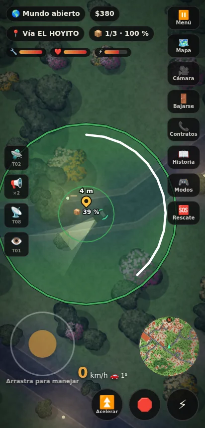
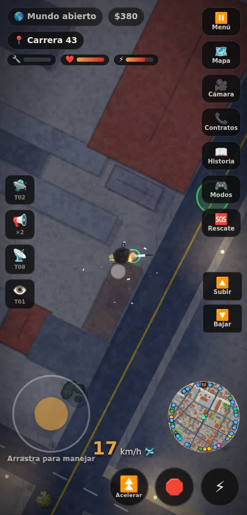

# Entrega 5.0 · G5-02: Anillos de recoger y entregar (Mandados y EnCicla) y controles de vuelo

- **Fecha:** 2026-11-23
- **Autor:** Gemini · Antigravity (`hydrogen`)
- **Rama:** `ia/gemini/g5-02-anillos`
- **Pedido:** `G5-02` en [`docs/PEDIDOS-GEMINI-5.0.md`](../docs/PEDIDOS-GEMINI-5.0.md) y [`docs/PLAN-5.0.md`](../docs/PLAN-5.0.md)
- **Impacto en peso del HTML (`dist/juegos/getaway.html`):** `+9.4 KB` (`27903 KB` → `27913 KB` compilado; módulo aditivo [`juegos/getaway/61-anillos.js`](../juegos/getaway/61-anillos.js)).

---

## 1. Qué se implementó

1. **Anillos de recoger y entregar en `📦 Mandados`, `🚲 EnCicla` y `📞 Contratos` ([`juegos/getaway/61-anillos.js`](../juegos/getaway/61-anillos.js)):**
   - Proyecta el círculo de radio real (`22 m` en Mandados, `16 m / 14 m` en EnCicla, `18 m` en Contratos) sobre el asfalto mediante `G.vistas.aPantalla(G.E, x, y, z)` (`29` vértices proyectados), funcionando tanto en las cámaras 3D (`VistaTres`, `VistaGL`, `Raster`) como en 2D.
   - Incluye relleno translúcido en el pavimento, borde oscuro de alto contraste (`#0c0e14`), aro principal de color semántico (`#ffc23a` al recoger paquete, `#3fae5a` al entregar paquete o tomar cicla, `#2dd4bf` al devolver cicla), onda concéntrica interior animada y 4 postes de luz vertical (`z = 0.18..2.1 m`) para que el punto sea visible detrás del tráfico.
   - Al detenerse dentro del anillo (`dist < radio`), dibuja un arco radial blanco de progreso (`0 % → 100 %`) sincronizado con `m.esp`.
   - En [`juegos/getaway/60-modos.js`](../juegos/getaway/60-modos.js) (`pasoEnCicla`), se corrigió el reinicio de `m.esp = 0` al completar la fase 0 (tomar cicla) y al salir del radio de la estación.
2. **Controles táctiles de vuelo (`🔼 Subir` y `🔽 Bajar`) para `🚀 Jetpack`, `🛩️ Avioneta` y `✈️ Avión`:**
   - Se añadieron `'avioneta'` y `'avion'` al selector de vehículos de `🧪 Laboratorio del motor` en [`juegos/getaway/60-modos.js`](../juegos/getaway/60-modos.js).
   - `AnillosVuelo.iniciarUI()` crea el contenedor `.vuelo-ctl` con los botones táctiles `BOT.sube` (`#bSube`, `🔼 Subir`) y `BOT.baja` (`#bBaja`, `🔽 Bajar`, `≥ 48 × 48 px`), visibles únicamente cuando el jugador lleva una aeronave (`C.veh.clase === 'aire' || C.veh.vuela`) y ubicados fuera de la `zonaLibre()` en vertical (`412 × 860`) y horizontal (`860 × 412`).
   - `AnillosVuelo.aplicarEntrada(e, ent)` conecta `BOT.sube` y `BOT.baja` a `e.sube` y `e.baja`, evita que la tecla `Space` (`sube`) active el freno de mano del carro cuando se vuela, y aporta empuje automático de despegue por encima de `vmin` en `avioneta` y `avion` al mantener oprimido `🔼 Subir`.

---

## 2. Verificación y capturas (`pruebas/anillos.mjs`)

- **Comando:** `node pruebas/anillos.mjs`
- **Resultado:**
  - `enCarro`: `{ existeUI: true, ocultosEnCarro: true }`.
  - `mandados`: `recoger` (`radio: 22`, `dentro: true`, `progreso: 0.389`, `verticesProyectados: 29`, `color: "#ffc23a"`) y `entregar` (`radio: 22`, `dentro: true`, `progreso: 0.375`, `verticesProyectados: 29`, `color: "#3fae5a"`).
  - `encicla`: `recoger` (`radio: 16`, `dentro: true`, `progreso: 0.208`, `verticesProyectados: 29`, `color: "#3fae5a"`) y `entregar` (`radio: 14`, `dentro: true`, `progreso: 0.313`, `verticesProyectados: 29`, `color: "#2dd4bf"`).
  - `vuelo`: `tieneAvioneta: true`, `visibleJetpack: true`, `invadeZonaLibre: 0`, `hudSolapa: 0`, `zJetpackSube: 3.02 m` → `zJetpackBaja: 2.48 m`, `vAvioneta: 27.7 m/s`, `zAvionetaSube: 1.22 m` → `zAvionetaBaja: 0.34 m`.

| Anillo de entrega con arco de progreso (`412 × 860`) | Botones `🔼 Subir` y `🔽 Bajar` en vuelo (`412 × 860`) |
|---|---|
|  |  |
