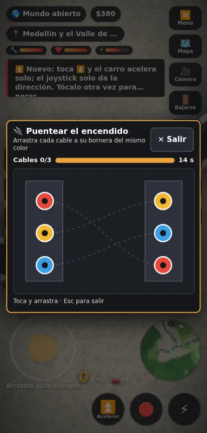
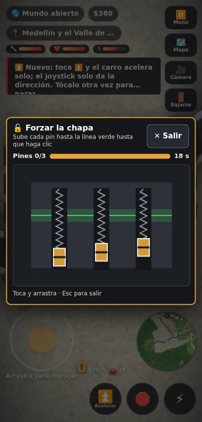
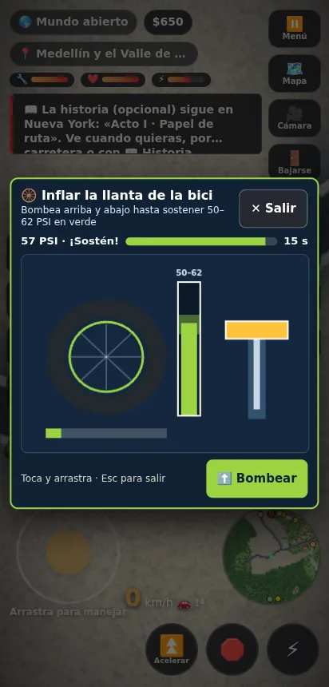
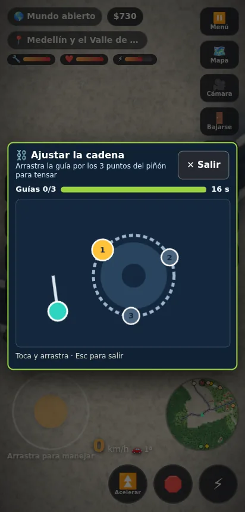
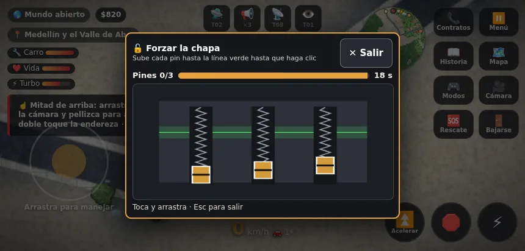

# Entrega 5.2 · G5-04: Minijuegos táctiles cortos (Chinatown Wars)

- **Pedido:** `G5-04` de [`docs/PEDIDOS-GEMINI-5.0.md`](../docs/PEDIDOS-GEMINI-5.0.md) («★ Estado 5.2»)
- **Autor:** Gemini · Antigravity (`hydrogen`)
- **Rama:** `ia/gemini/g5-04-minijuegos` (sobre `origin/main` `df80193`, Motor City `5.2.0`)
- **Peso añadido al HTML (`dist/juegos/getaway.html`):** **`+27.8 KB`** (`28 734 KB → 28 762 KB`, módulo 100 % aditivo [`juegos/getaway/64-minijuegos.js`](../juegos/getaway/64-minijuegos.js))

## 1. Qué se implementó

1. **Módulo aditivo [`juegos/getaway/64-minijuegos.js`](../juegos/getaway/64-minijuegos.js) (`G.Minijuegos`) sobre `G.ui` (0 líneas editadas en `60-modos.js`, `37-dinamica.js`, `45-tres.js` ni `25-ia.js`):**
   - **Turno Cero (18+ · paleta taller `#14161a` + ámbar `#e8a33c`):**
     - `🔌 puentear` (`15 s`): unir 3 pares de cables de color (rojo, ámbar, azul) arrastrando el dedo con chispas y clic sonoro (`+$120` y `+25 %` reparación del carro).
     - `🔓 chapa` (`18 s`): subir 3 pines con resorte helicoidal hasta alinearlos en la línea de corte verde (`+$150` y `+1` cebo).
   - **Familia / bici (todo público sin violencia · paleta EnCicla `#102235` + `#9bd341`):**
     - `🛞 llanta` (`16 s`): bombear la llanta de la bici deslizando la bomba (o con el botón accesible `⬆️ Bombear`) hasta sostener `50–62 PSI` en la banda verde sin pasarse (`+$80` y bici afinada `45 s`).
     - `⛓️ cadena` (`16 s`): arrastrar la guía tensora por los 3 puntos numerados del piñón para encarrilar la cadena (`+$90` y bici afinada `45 s`).
   - **Separación de tonos:** `G.Minijuegos.lista('familia')` devuelve únicamente los de bici sin violencia; `G.Minijuegos.lista('adulto')` los de Turno Cero 18+.
   - **Accesibilidad y seguridad táctil:** clase `.dialogo.mc-mini` reconocida por `MC.UI.verificar(G.ui)`, botón `✕ Salir` (`86 × 48 px`), cierre inmediato con tecla `Escape`, `touch-action: none`, `setPointerCapture`, `pointercancel` seguro, soporte de teclado completo y restauración garantizada de `G.pausa` (jamás bloquea).
   - **Integración aditiva en el menú:** se registra como entrada `🔧 Minijuegos táctiles` en `Modos.DEF` sin tocar `60-modos.js`.
2. **Prueba E2E [`pruebas/minijuegos.mjs`](../pruebas/minijuegos.mjs) + 5 capturas WebP (`113,8 KB` total en `reportes/img/gemini-g5-04/`):**
   - Verifica los 4 minijuegos de punta a punta con `PointerEvent` táctil en `412 × 860` y `860 × 412`, salida limpia por `✕ Salir` y `Escape`, recompensas, cero peticiones externas y cero errores.

## 2. Pruebas ejecutadas

| Comando | Resultado |
|---|---|
| `node herramientas/construir.mjs` | ✓ Verde (`getaway.html 28 762 KB`, **`+27.8 KB`**) |
| `node pruebas/minijuegos.mjs` | ✓ Verde (`4/4` ganados táctilmente, `btn 86×48 px`, `uiMalos: 0`, `cabeEn860x412: true`, `escCerrado: true`, `red: 0`) |
| `node pruebas/dinamica.mjs` | ✓ Verde (**25 bien, 0 mal**) |
| `node pruebas/historieta.mjs` | ✓ Verde (`gpu: true`, `5,2 ms`, `hudSolapa: 0`) |
| `node pruebas/humano.mjs` | ✓ Verde (`metro 35 s`, `carrera 430 m` a `31,6 m/s`) |
| `node pruebas/prueba.mjs --navegador` | ✓ Verde (**158 bien, 0 fallos**, `112,9 s`) |

## 3. Capturas (`412 × 860` y `860 × 412`)

| `🔌 Puentear` (`412×860`) | `🔓 Chapa` (`412×860`) | `🛞 Llanta bici` (`412×860`) | `⛓️ Cadena bici` (`412×860`) |
|---|---|---|---|
|  |  |  |  |

