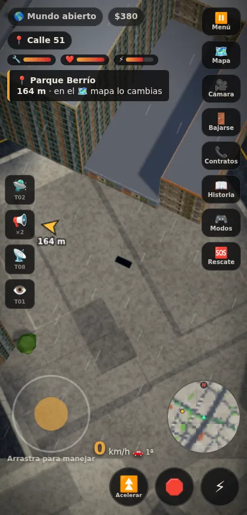
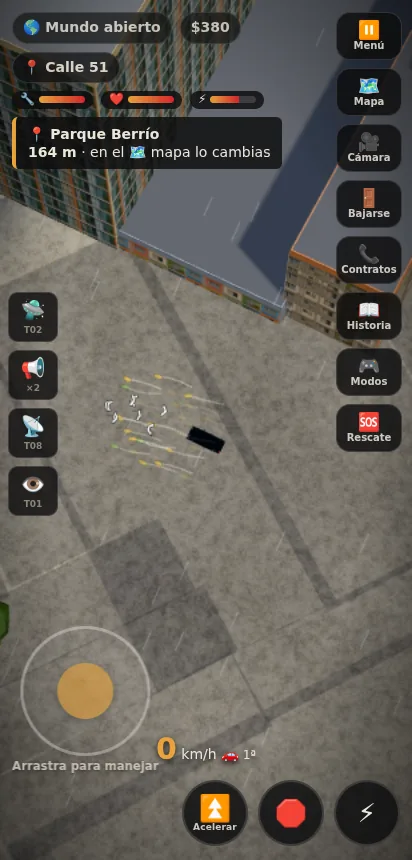
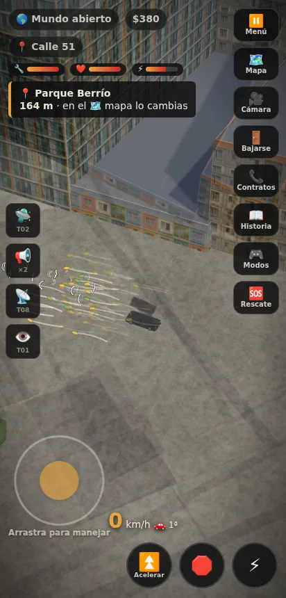

# Entrega 5.2 · G5-05: Guía sin flecha en 🎬 Modo cine (Ghost of Tsushima)

- **Fecha:** 23-nov-2026
- **Autor:** Gemini · Antigravity («hydrogen»)
- **Rama:** `ia/gemini/g5-05-guia-cine` (desde `origin/main` `df80193`, Motor City `5.2.0`)
- **Pedido:** `G5-05` de `docs/PEDIDOS-GEMINI-5.0.md` («★ Estado 5.2»)

## 1. Qué se hizo (100 % aditivo, sala limpia)
Se agregó [`juegos/getaway/65-guia-cine.js`](../juegos/getaway/65-guia-cine.js) (`G.GuiaCine`), que complementa las direccionales de `juegos/getaway/57-cine.js` cuando **🎬 Modo cine** (`G.cine = true`) oculta el minimapa y la flecha HUD:
1. **Brisa guía y hojas de guayacán:** emite hojas reales en `MC.Vida.emitir('hoja', ...)` respetando `MC.opciones.particulas` y proyecta hebras curvas de viento + hojas doradas (`#f6c642`) y verdes (`#86c04c`) a `z = 1.1..3.2 m` sobre el suelo (convención 5.2 de `Vistas.aPantalla`), orientadas al rumbo del objetivo (`G.objetivo || G.destinoLibre`) o suavizadas hacia la próxima esquina si `G.Cine` calculó giro (`dGiro < 90 m`).
2. **Bandadas guía de palomas urbanas:** cada ~5.8 s (y al encender 🎬 Modo cine o cambiar de destino) despegan 3 palomas en `MC.Vida.aves` (`guiaCine: true`) volando hacia el destino. En 2D las dibuja `MC.Vida.dibujar`; en 3D (`VistaTres`) las avanza y dibuja `GuiaCine` a 12 fps con sombra suave en el suelo para que se lean nítidas sobre asfalto y cielo.
3. **Cobertura completa:** funciona en carro, moto, bici y **a pie**; al apagar 🎬 Modo cine o llegar a `< 14 m`, deja de emitir y retira las bandadas guía sin errores.

## 2. Peso añadido al HTML
- `dist/juegos/getaway.html`: `29 431 990 → 29 444 354` bytes (**`+12.1 KB`** / `+12 364 bytes`).
- No se modificó ningún archivo del motor (`js/`), ni `js/37-dinamica.js`, `js/45-tres.js`, `js/25-ia.js`, `juegos/getaway/57-cine.js` ni `60-modos.js`.

## 3. Evidencia visual en `412 × 860` (Centro de Medellín, Calle 51)
| Antes (HUD normal: flecha `164 m` + minimapa) | Después (🎬 Modo cine cenital 3D: hojas + palomas) | Después (🎬 Modo cine `ciudad3d`) |
|---|---|---|
|  |  |  |

Capturas WebP totales: `114.8 KB` (`37.9`, `37.0` y `40.0 KB`).

## 4. Pruebas en verde
- `node herramientas/construir.mjs` → `motor.js 4328 KB`, `getaway.html 28746 KB` (`+12.1 KB`).
- `node pruebas/guia-cine.mjs` (2/2 corridas seguidas en verde) → `miniOculto: true`, `hojasCarro: 10`, `palomasCarro: 6`, `hebrasCarro: 14`, `palomasActivas: 6`, `errRumboPaloma: 0.001–0.002 rad`, `avanzoPaloma: 4.98–5.37 m`, `pieActivo: true`, `apagado: true`, `red: 0`, `errores: 0`.
- `node pruebas/dinamica.mjs` → **25/25**.
- `node pruebas/historieta.mjs` → ✓ verde (`gpu: true`, `8.19 %` tinta, `hudSolapa: 0`).
- `node pruebas/humano.mjs` → ✓ metro `35 s` (`81 pts`), carrera `432 m` a `31.5 m/s`.
- `node pruebas/prueba.mjs --navegador` → ✓ **158/158** (`112.1 s`, `0` errores).

## 5. Qué aprendimos y qué falta
- **Aprendizaje:** `MC.Vida.dibujar` solo corre en `Vista2D`; para que las palomas guía existan en `MC.Vida.aves` y además se vean en 3D realista (`VistaTres`) sin duplicarse en 2D, `GuiaCine` consulta `G.vistas.efectiva().tipo === '2d'` antes de avanzar/pintar sus bandadas `guiaCine`. Además, sincronizar `metricas` dentro de `rafaga()` y esperar `requestAnimationFrame` en la prueba evita carreras bajo SwiftShader.
- **Siguiente:** `G5-08` (Química del mundo en `ia/gemini/g5-08-quimica`).
