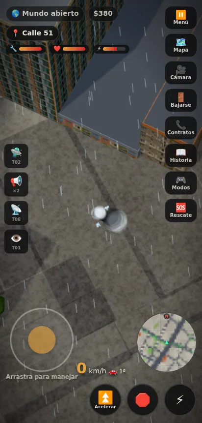

# Entrega 5.2 · G5-08: Química del mundo (Zelda: Breath of the Wild)

- **Fecha:** 23-nov-2026
- **Autor:** Gemini · Antigravity («hydrogen»)
- **Rama:** `ia/gemini/g5-08-quimica` (desde `origin/main` `df80193`, Motor City `5.2.0`)
- **Pedido:** `G5-08` de `docs/PEDIDOS-GEMINI-5.0.md` («★ Estado 5.2»)

## 1. Qué se hizo (sala limpia, aditivo + arreglo de cota 3D)
1. **Módulo aditivo del motor [`js/89-quimica-mundo.js`](../js/89-quimica-mundo.js) (`MC.QuimicaMundo`):** envuelve `MC.Efectos.actualizar` (corre en 3D y en 2D cada cuadro sin modificar `js/88-efectos.js` ni `js/88-vida.js`) y conecta `MC.Quim`, `MC.C` y `E.clima`:
   - **Lluvia apaga el fuego:** calcula la tasa térmica usando `Quim.masaMolar('H2O')` y `C.Lv` (`2.257e6 J/kg`); apaga los fuegos activos (`Efectos.fuegos`) antes de que estallen (`f.estalla = false`), suelta penachos de vapor H₂O (`#e3edf5` / `#edf4fa`) arrastrados por el viento y emite `MC.emit('quimica:apaga', ...)`.
   - **Charcos que salpican:** al pasar a pie, en bici, moto o carro (`v > 1.4 m/s`) sobre pavimento húmedo con charco determinista (`hayCharco`), dispara abanicos laterales de gotas desde ambos costados en 2D (`MC.Vida.emitir('agua')`) y en 3D (`MC.Efectos._p('agua')`) respetando `MC.opciones.particulas`, y emite `quimica:salpica`.
   - **Viento lleva el humo y las hojas:** aplica `E.clima.viento` (`{ v, dir }`) sobre `MC.Efectos.P` (`humo`) con cizalladura por altura `z` y sobre `MC.Vida.P` (`polvo`, `hoja`).
2. **Puente aditivo en Turno Cero [`juegos/getaway/69-quimica.js`](../juegos/getaway/69-quimica.js):** escucha `quimica:apaga` para limpiar `G.ardiendo = false` si la lluvia apagó el carro del jugador y mostrar el aviso `'🌧️ La lluvia apagó las llamas del carro (vapor H₂O)'`, sin tocar `juegos/getaway/20-juego.js`.
3. **Arreglo quirúrgico en [`js/46-vistas.js`](../js/46-vistas.js) (línea 81, 2 líneas):** `Vistas.dibujar` pasaba `z` sin sumar `M.cota(x, y)` al proyector `proy` de `MC.Efectos.dibujar` en vistas 3D; en Medellín (`cota ≈ 1500 m`) todas las partículas de `MC.Efectos` (fuegos, explosiones, chispas, humo, vapor y salpicaduras) se proyectaban 1,5 km bajo tierra. Sumar `cotaEf(x, y)` alinea `MC.Efectos` con la convención 5.2 de `Vistas.aPantalla` y los hace visibles sobre la calle real.

## 2. Peso añadido al HTML
- `dist/juegos/getaway.html`: `29 431 990 → 29 441 052` bytes (**`+8.8 KB`** / `+9 062 bytes`).
- No se tocaron `js/37-dinamica.js`, `js/45-tres.js`, `js/25-ia.js`, `js/88-efectos.js`, `js/88-vida.js` ni `juegos/getaway/20-juego.js`.

## 3. Evidencia visual en `412 × 860` (Centro de Medellín, Calle 51 bajo tormenta)

*(WebP `35.2 KB`: vapor blanco H₂O arrastrado por la ráfaga de tormenta `v = 9 m/s`, abanicos simétricos de gotas desde las ruedas en el charco y lluvia inclinada sobre la Calle 51 en 3D).*

## 4. Pruebas en verde
- `node herramientas/construir.mjs` → `motor.js 4336 KB (83 archivos)`, `getaway.html 28743 KB` (`+8.8 KB`).
- `node pruebas/quimica-mundo.mjs` → ✓ **7/7** (lluvia apaga fuego con `0` explosiones y `21` partículas de vapor H₂O; sin lluvia sigue encendido; viento `45°` desvía humo `vxMed 4.34`, `vyMed 4.33`, `dxMed 3.46 m`; charcos salpican `42` gotas 2D + `42` gotas 3D y `0` en seco; integración en Turno Cero `412×860` con `limpioArdiendo: true`, `humosDesviados: 27`, `red: 0`, `errs: 0`).
- `node pruebas/dinamica.mjs` → **25/25**.
- `node pruebas/historieta.mjs` → ✓ verde (`gpu: true`, `5 ms`, `hudSolapa: 0`).
- `node pruebas/humano.mjs` → ✓ metro `35 s` (`81 pts`), carrera `431 m` a `31.5 m/s`.
- `node pruebas/prueba.mjs --navegador` → ✓ **158/158** (`112.9 s`, `0` errores).

## 5. Qué aprendimos y qué falta
- **Hallazgo clave (gracias a revisar la captura):** `Vistas.aPantalla` ya sumaba `M.cota(x, y)` desde 5.2, pero la proyección `proy` que `js/46-vistas.js:81` entregaba a `MC.Efectos.dibujar` seguía sin sumarla; arreglar esas 2 líneas hace visibles en 3D sobre Medellín tanto el vapor y las salpicaduras de `G5-08` como todas las explosiones, chispas, fuegos y marcas de llanta existentes.
- **Siguiente:** `G5-09` (subtramas tipo RPG y crónicas en `juegos/getaway/62-mundo-vivo.js`), `G5-10` (mejora visual de 2D, Arcade y Pixel), `G5-11` (Run por la ciclorruta) y `G5-13` (informe escala tipo ETS2).
