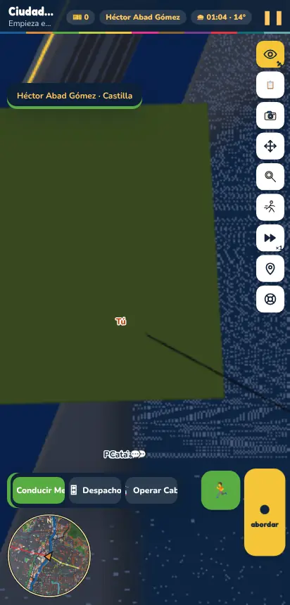
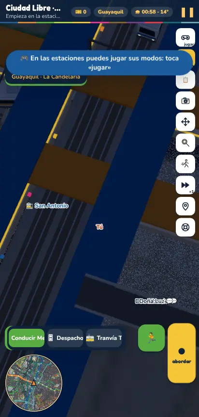
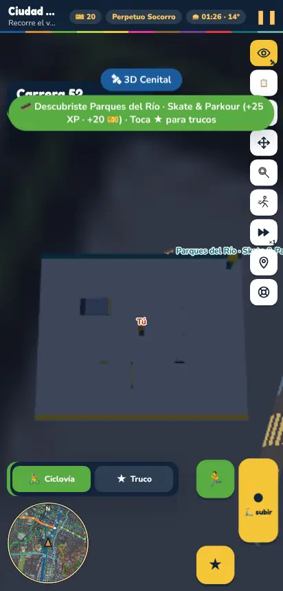
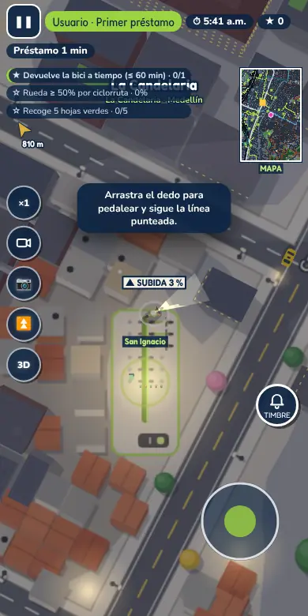

# Fase 0 / Lote 0 · Línea base y auditoría del renacimiento cenital

**Claude · 24‑nov‑2026.** Es el informe de evidencia. El mapa técnico y el plan de la Fase 1 están en `docs/AUDITORIA-FASE0-CENITAL.md`.

```text
LOTE: Fase 0 (master prompt) = Lote 0 (prompt de GPT-6) · Lectura y línea base, sin cambio de comportamiento

REPO / RAMA / COMMIT(S):
  motorcity     ccr-408a25e1-xz3rl6 · base 245bbb0 (= main) · aquí solo se suman documentos y evidencia
  MetroZero     sin cambios · leído en 7b7733a
  BicicletasUno sin cambios · leído en 1b3ce40

ESTADO: terminado (lectura y medición). Se detiene aquí: la Fase 1 espera el OK del autor (§ 7 de la auditoría).

QUÉ LEÍ:
  - Relevo y skills: CONTEXTO-RELEVO (§ 0 a 8), docs/PROMPT-RELEVO, docs/PROMPT-SKILLS, PLAN-5.0,
    coord/agentes/claude.json y los CLAUDE.md de los tres repositorios.
  - Motor City: js/47-clasicos.js (MC.Arcade), js/34-camara.js, js/41-vista2d.js, js/32-fisica.js,
    geo/territorio.py, juegos/getaway/55-clasicos.js, 60-modos.js y 90-inicio.js.
  - El Metro: src/js/10-map.js, 11-ciudad2.js, 11-edificios.js, 22-gl.js, 27-camara.js, 36-libre.js,
    el registro de modos, tools/build.mjs, tools/*_datos.*, motor-valle/ y docs/auditorias/.
  - EnCicla: src/js/20-map.js, 30-ride.js, 50-modes.js, 69-libre.js, 75-graficos.js, 76-altura.js,
    86-maqueta.js, 88-camara.js, 99d, 99o, 99w y 99x, tools/build.js, tests/run.js,
    tests/benchmark-2km-gpt6.mjs y motor-valle/ (fuente de verdad).
  - Lo compartido por el autor: el master prompt, la investigación técnica y el ZIP de GPT-6
    (informe y prompt maestro), guardados en docs/.

QUÉ FALLABA (evidencia reproducible):
  1. En los datos de El Metro, 120.187 de 638.303 edificios (18,8 %) pisan el corredor vial
     con la regla del propio juego, y 151.055 (23,7 %) con la del prompt.
     Se reproduce con: node reportes/fase0-cenital/medir-conflictos-elmetro.mjs ../MetroZero
  2. El anillo lejano 3D de El Metro (de 700 a 1.100 m) levanta cajas por casilla sin recortar:
     76.585 de 515.666 casillas tocan un corredor (es una estimación).
  3. En la 3D cenital de El Metro, el techo de la estación tapa al jugador al empezar
     (capturas de Acevedo y San Antonio): falta el «occluder fade».
  4. La compuerta de EnCicla sigue en rojo: p95 de 103,7 ms en la Carrera 43A y 61,2 ms en Las Palmas
     (la meta es menos de 50).

CAUSA RAÍZ:
  - Comprobado: ningún motor sanea los datos.
      El Metro recorta en tiempo real (11-edificios.js, recorta).
      EnCicla inventa lotes (75-graficos.js, lotes).
      Motor City tolera 1 m en la colisión (32-fisica.js, línea 46).
  - Hipótesis: el 73 % de las huellas sale de modelos de satélite (Google 52,6 % y Microsoft 20,6 %),
    con corrimientos de 1 a 3 m frente a los ejes de OSM. Además, el 95 % se guarda como rectángulo
    orientado, que invade más que la casa real. La Fase 1 lo confirma con los polígonos de origen.

CAMBIO: ninguno en código ni datos. Se suman:
  docs/AUDITORIA-FASE0-CENITAL.md                     el mapa técnico, las correcciones al prompt y el plan de la Fase 1
  docs/investigacion_tecnica_motor_valle.md           la especificación (el prompt pide guardarla en docs/)
  docs/referencias/renacimiento-cenital-2026/         el master prompt y la entrega de GPT-6 (en .md)
  reportes/fase0-cenital/                             la herramienta de medición, conflictos-elmetro.json y linea-base.json
  reportes/img/claude-fase0/                          4 capturas a 412 × 860 (WebP)
  y el relevo: BITACORA.md, CONTEXTO-RELEVO § 8, coord/ y docs/PROMPT-RELEVO.md.

PRUEBAS (comando · código de salida · resultado):
  motorcity:     node herramientas/construir.mjs · 0 · 2 s
                 node pruebas/prueba.mjs --navegador · 0 · 158 bien · 106 s
  MetroZero:     node tools/build.mjs · 0 · 8.749 KB
                 node tools/test.mjs 100 · 0 · 287.221 pasos, 0 errores · 106 s
  BicicletasUno: node tools/build.js · 0 · 5.641 KB
                 node tests/run.js · 0 · 170 bien · 166 s
                 node tests/benchmark-2km-gpt6.mjs --cpu=4 · 0 · META AÚN NO DEMOSTRADA
                 (la prueba sale con 0 sin --assert; con --assert, publicar.yml no publica)
  Skills:        node motor.mjs skills --integrar --agente claude-code · 0 · «4) Verificación: ✓ todo en orden»
  Las capturas: node tools/test.mjs 2 --shots … (El Metro) y node tests/run.js --shots --n=4 (EnCicla).

DATOS: no se integró ninguno nuevo. Solo se leyeron los ya presentes:
  Overture/OSM (ODbL), Google Open Buildings (CC BY 4.0 / ODbL), Microsoft ML Buildings (ODbL),
  las capas oficiales de Medellín y SRTM.
  El catastro nuevo (R3) y el MDT LiDAR CC BY-SA (R5) siguen esperando la decisión del autor.

RENDIMIENTO: la línea base está en reportes/fase0-cenital/linea-base.json. La máquina es una VM de 4 núcleos
  con Chromium de Playwright y WebGL por software: no es un celular. No se afirma ninguna mejora.

REGRESIONES: no. Los tres repositorios siguen en verde, y en los juegos no se cambió nada.
  Al compilar, EnCicla reescribe dist/ENCICLA-TODO.md con la fecha nueva; se restauró.

REVERTIR: basta con borrar los archivos nuevos. Nada depende de ellos.

PENDIENTES:
  P0 · el autor   las 5 decisiones del § 7 de la auditoría (anchos, trozos, oficios de EnCicla,
                  modos protegidos de El Metro y fuente de datos).
  P0 · Claude     la Fase 1 en motor-valle/ (sanear.py, rasante.py y las pruebas de geometría), tras el OK.
  P1 · el autor   probar en un celular real (la VM no tiene GPU).
```

## Capturas «antes» (412 × 860)

| El Metro · 3D Cenital en Acevedo | El Metro · 3D Cenital en San Antonio | El Metro · Parques del Río | EnCicla · Usuario en San Ignacio |
|---|---|---|---|
|  |  |  |  |
| Un techo tapa por completo al jugador («Tú») | La cubierta de la estación tapa al jugador | — | Los lotes inventados en La Candelaria |

## Los cinco videos de referencia
Identificados por oEmbed de YouTube, sin verlos cuadro a cuadro:
- `EH3h5B9TiyQ` → *Reckless Getaway 2*;
- `0skAS5QIYrE` → *Super Arcade Racing*;
- `cRaZkqIRA3A` → *GTA Chinatown Wars*;
- `NH9dXqeyBfU` → *GTA 2*;
- `SqGbFtBU4Fs` → *GTA 1*.
