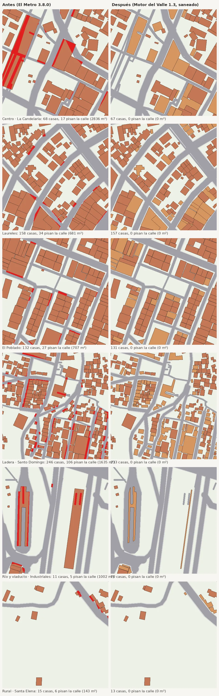
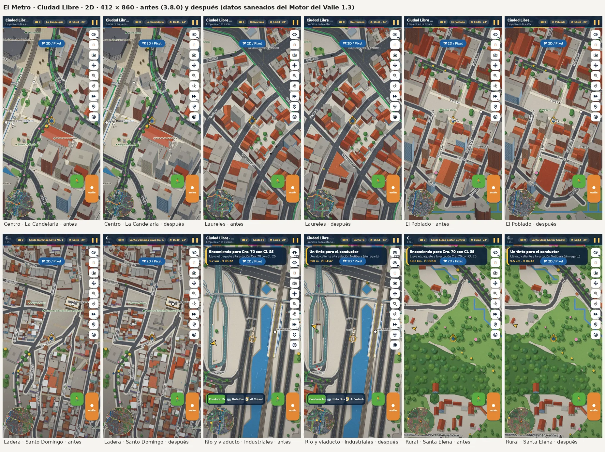
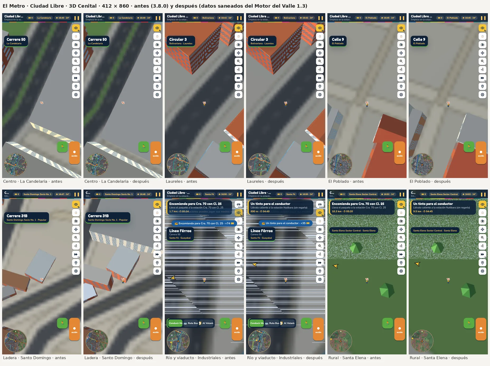

# Fase 1 · Saneamiento GIS del Valle («ley de soberanía vial») · Motor del Valle 1.3.0

**Claude · 24‑nov‑2026.** Informe de lote de la Fase 1 del renacimiento cenital, con las decisiones del autor (regla A, trozos de 160 m, rehacer desde las fuentes originales y la prueba de craqueo). **Se detiene aquí y pide el OK para la Fase 2.**

```text
LOTE: Fase 1 · saneamiento GIS en motor-valle/ (solo datos; no se tocó ningún render)

REPO / RAMA / COMMIT(S): rama ccr-4f6eeea5-yulqk1 en los tres repositorios (base = main de hoy: motorcity 024cd7a,
  BicicletasUno 6518ada, MetroZero 7b7733a). Nada en main: espera el OK del autor.
  BicicletasUno  motor-valle/ 1.2.0 → 1.3.0 (la fuente de verdad) y src/data/edificios.bin, edificios.json y vias-cota.bin (sin conectar)
  MetroZero      motor-valle/ 1.3.0 (sincronizado), tools/ y src/data/edificios.js (v2) y vias.js (v2)
  motorcity      solo este informe, la evidencia (reportes/fase1-cenital/, reportes/img/claude-fase1/) y el relevo

ESTADO: terminado y en verde. Se detiene a pedir el OK de la Fase 2.

QUÉ LEÍ: CONTEXTO-RELEVO (§ 0, § 5 fila 18, § 7 y § 8), docs/PROMPT-RELEVO, docs/VISION-Y-MISION, docs/AUDITORIA-FASE0-CENITAL
  (entera), el master prompt, la investigación técnica (§ 4) y el informe de GPT-6 (§ 5: conflictos con jerarquía de fuentes),
  reportes/2026-11-24-claude-fase0-cenital, motor-valle/MOTOR.md, todo geo/ (build, fetch, oficial, alturas, pasos), y en El Metro
  tools/edificios_datos.py, vias_datos.mjs, rutas_calles.mjs, mapa_ajustes.mjs, osm_comparar.py, src/js/10-map.js, 11-ciudad2.js,
  11-edificios.js (recorta, segsCelda, libre), 11-hitos.js, 12-red.js y 36-libre.js; en EnCicla src/js/20-map.js (parseVias, inflateRaw)
  y tools/build.js. Skills: motor-city-territorio, motor-city-desarrollo, motor-city-qa-playwright, el-metro-desarrollo y medellin-fiel.

QUÉ FALLABA (medido antes de cambiar nada):
  1. 120.187 de 638.303 edificios de El Metro pisaban la vía con la regla A (herramienta de la Fase 0).
  2. El recorte en tiempo real de El Metro, en TODAS las regiones con casas (4.734): recortaba 107.546 edificios y QUITABA 17.190
     (no 12.267: la Fase 0 contó solo los que tienen el centro en la vía; el resto son los que el recorte no alcanza a despejar).
  3. Las vías que dibujan los dos juegos están redondeadas a 2,5 m y simplificadas: se corren de su eje real 0,5 m en la mediana,
     1,1 m en el p90 y hasta ~3 m (medido contra los ejes de Overture).
  4. Con los polígonos de origen y los ejes precisos, 113.915 casas (17,8 %) tocan el corredor A; los polígonos de OSM (dibujados a
     mano) lo tocan más que las huellas de satélite (29,2 % contra 14,5 % y 12,5 %): en las laderas, el ancho de clase (7 m para una
     calle sin dato oficial) más 1,3 m de andén es más ancho que la calle real, y las fachadas de OSM están al borde del asfalto.

CAUSA RAÍZ: ningún motor saneaba los datos (El Metro recortaba al cargar, EnCicla inventa lotes, Motor City tolera 1 m), y el corredor
  se medía contra ejes redondeados. Comprobado con los polígonos de origen: no son solo los rectángulos guardados; es el andén de
  1,3 m frente a fachadas reales sin andén y el ancho de clase en las laderas.

CAMBIO: ver abajo («Qué se hizo»).

PRUEBAS (comando · código de salida · resultado):
  BicicletasUno  node motor-valle/motor.mjs sanear · 0 · saneamiento + rasante + pruebas/geometria.py «BIEN» (62 + 19 + 12 s)
                 python3 motor-valle/pruebas/geometria.py · 0 · BIEN: 0 solapes sin marca, 0 en el agua, 0 restos, 98,447 % del área
                 node tools/build.js · 0 · HTML IDÉNTICO byte a byte (md5 c4838f38…): los datos nuevos no entran al juego
                 node tests/run.js · 0 · 177 ✓ y 0 ✗ («TODAS LAS PRUEBAS PASARON»)
                 node tests/regresion-encicla.js · 0
                 node motor-valle/sincronizar.mjs ../MetroZero --verificar · 0 · «aquí 1.3.0 · allá 1.3.0 · los archivos son iguales»
  MetroZero      node tools/build.mjs · 0 · 9.353.904 bytes (antes 8.965.591)
                 node tools/prueba-recorte.mjs --todas · 0 · 4.731 regiones, 622.086 edificios: 0 recortados y 0 quitados
                 node ../BicicletasUno/motor-valle/pruebas/geometria.mjs --elmetro . · 0 · BIEN (0 solapes, 0 restos, 0 en el agua, peso)
                 node tools/test.mjs 100 · 0 · 100 partidas, 281.143 pasos, 0 errores, 0 errores de consola
                 python3 -I tools/osm_comparar.py (OSM de hoy, 3 cajas) · 0 · ver «Fidelidad»
  motorcity      node reportes/fase0-cenital/medir-conflictos-elmetro.mjs ../MetroZero · 0 · regla A: 5 tocan (todas < 0,3 m²), 0 con el centro
                 node pruebas/prueba.mjs --navegador · NO EJECUTADA: en motorcity no cambió código (solo documentos y evidencia)

DATOS (fuente y licencia): Overture Maps 2026-10-21.0 (OpenStreetMap ODbL; Google Open Buildings CC BY 4.0 / ODbL; Microsoft ML Buildings
  ODbL), rebajado hoy con node motor-valle/motor.mjs fuentes (210 MB, no va a git); capas oficiales de Medellín (malla vial 2026,
  manzanas, barrios, espacio público y lotes); relieve SRTM (NASA, AWS Terrain Tiles z13); en El Metro, la capa 3DConstruccciones del
  Catastro (ya la usaba para los pisos); para la auditoría, 3 cajas de api.openstreetmap.org (ODbL). El catastro nuevo (R3) y el LiDAR
  (R5) NO se integraron. zopfli (Apache 2.0) solo al compilar los datos de El Metro; el juego sigue sin librerías.

RENDIMIENTO: El Metro carga lo mismo (el recorte en tiempo real ya no recorta nada: 0 de 622.086). Peso: edificios.js 4.572.134 bytes
  (tope 4.600.000), vias.js 865.742 (antes 499.216: +366 KB de cota), HTML 9.353.904 (tope 9.500.000; quedan 146 KB). EnCicla: el HTML
  no cambió (la compuerta no se movió). VM de 4 núcleos sin GPU: no se afirma nada de un celular.

REGRESIONES: ninguna encontrada. El Metro: 100 partidas con 0 errores; las vistas de Ciudad Libre en las 6 zonas piloto se ven igual o
  mejor (capturas). EnCicla: el juego es el mismo byte a byte.

REVERTIR: git revert de los commits de la rama en cada repositorio. En El Metro basta con volver src/data/edificios.js y vias.js
  (el juego lee igual los v1); en EnCicla, borrar edificios.bin, edificios.json y vias-cota.bin; el Motor del Valle vuelve a la 1.2.0.

PENDIENTES: ver al final (decisiones para el autor y la Fase 2).
```

## Qué se hizo

### En el Motor del Valle 1.3.0 (`BicicletasUno/motor-valle/`, copiado a MetroZero)

| Archivo | Qué hace |
|---|---|
| `geo/fetch.py` | Dos fuentes nuevas: `huellas` (con el `id` de Overture y la fuente de cada casa) y `agua_niveles` (con `level` y las etiquetas de OSM: una quebrada tapada no recorta lo que está encima). |
| `geo/build.py` | Con `VIAS_M`, guarda los ejes de las vías **sin simplificar ni redondear** (`vias_m.bin`), en el mismo orden de `vias.bin`. No cambia nada más. |
| `geo/anchos.json` | La regla A activa (el real); B y C escritas y apagadas; transporte (Metroplús 5,5 m y tranvía 5 m); agua; casas confiables; higiene; zócalo; trozos de 160 m; biomas; y la opción `ancho_por_fachadas`, apagada (ver «Decisiones»). |
| `geo/niveles.py` | Los tramos en otro nivel (2.667 puentes, 118 túneles, 189 pasos inferiores y 112 elevados), ubicados sobre los ejes: 1.697 vías tienen alguno. |
| `geo/sanear.py` | La ley de soberanía vial, con shapely 2 y STRtree, en 62 s (ver abajo). |
| `geo/rasante.py` | La cota de las vías: 45.081 nodos, 377.495 nudos, 2.321 vías limitadas por el tope de su clase. Flujo `COTA` para cada juego. |
| `geo/huellas.py` | Las huellas saneadas para EnCicla (sin conectar). |
| `pruebas/geometria.py` y `pruebas/geometria.mjs` | La prueba exacta (verdad compartida) y la de los datos como los lee el juego. |
| `motor.mjs` | El subcomando `sanear` y su paso dentro de `encicla` y `elmetro`; `version` mide los archivos nuevos. |
| `MOTOR.md`, `capas/index.mjs`, `VERSION.json` | La 1.3.0, con los formatos nuevos y su historial. |

**La verdad compartida** (`node motor-valle/motor.mjs sanear`, determinista: dos corridas dan lo mismo):

| | Cifra |
|---|---|
| Huellas de Overture en la ventana | 693.553 |
| Casas en el mapa (≥ 12 m²) | 639.493, con 90,68 km² construidos |
| Tocan un corredor de capa 0 o el agua | 118.335 |
| Recortadas | 65.291 (Google 42.150, Microsoft 16.442, OSM 6.699); 34.750 vuelven a ser rectángulo (IoU ≥ 0,92) |
| **Casas confiables marcadas** (OSM contra calles menores; no se recortan) | **44.538**: 36.724 altas, 5.175 medias, 2.508 bajas y **131 críticas** (a menos de 30 m de una estación). Por vía: calle 37.869, escalas 5.066, peatonal 1.578 y ciclorruta 25 |
| **Desaparecen** | **9.864**: 7.668 restos de menos de 16 m² y 2.196 que estaban enteras en la calle o en el agua (hoy el juego quita 17.190) |
| Quedan | 629.788 casas y **89,27 km²: el 98,447 % del área construida** |
| Zócalo | desnivel del suelo bajo la casa: p50 1,34 m, p90 3,5 m |
| Biomas (trozos de 160 m) | rural_montana 72.418, ladera_ladrillo 5.155, residencial_verde 5.081, industrial_rio 257 y centro 249 |

### En El Metro (MetroZero; el juego no cambió de código)

| Archivo | Qué cambió |
|---|---|
| `tools/edificios_datos.py` | `--saneadas`: lee la verdad compartida y escribe **`edificios.js` v2** con una **guarda**: cada edificio, ya redondeado como lo lee el juego, queda fuera de los corredores que el juego despeja (vías, Metroplús y tranvía; con medio metro alrededor de los polígonos, que es lo que mira `recorta`), de las ciclorrutas (regla A del autor) y del agua, y sin el centro en la calle ni en un hito. Si no pasa, se recorta exacto (rectángulo primero) y lleva el **bit 128**. Al final va el flujo **`zb`** (4.766 edificios: los únicos cuyo suelo baja más de 4 m desde el centro; para los demás basta el zócalo de 6 m). Comprime con zopfli (el mismo deflate, 4 % más chico). Sin `--saneadas` sale lo mismo de antes (comprobado). |
| `tools/vias_datos.mjs` | `--cota`: las mismas 26.919 vías de hoy, intactas, y **al final el flujo `COTA`** (126.613 nudos). `--motor`: las vías con los ejes precisos (no se usó; ver «Decisiones»). |
| `tools/corredores.mjs` | Saca del propio juego los corredores del Metroplús y del tranvía (con sus esquinas redondeadas) y las huellas de los hitos, para la guarda. |
| `tools/prueba-recorte.mjs` | La prueba con Playwright que no cambia el juego: llama a `VC.region` y cuenta `b.cut === 1` y `b.rec === false` en 50 regiones (las 6 zonas piloto y 44 al azar con semilla fija) o en todas (`--todas`). |
| `src/data/edificios.js` | v2: 622.086 edificios, 45.428 polígonos (antes 30.088), 115.555 con el bit 128. **4.572.134 bytes** (antes 4.549.632; tope 4.600.000). |
| `src/data/vias.js` | v2: las vías de hoy + la cota (865.742 bytes). |

La guarda de El Metro: de 629.788 casas, 103.426 no pasaban al primer intento (el andén de 1,3 m y los ejes redondeados a 2,5 m del juego); se arreglaron 95.851 (38.761 eran casas confiables marcadas) y se quitaron 7.658 (4.038 confiables y 3.283 que ya venían recortadas; mediana de 22 m²), más 44 bajo los hitos.

### En EnCicla (BicicletasUno; el juego no cambió)
- `src/data/edificios.bin` (4.118.174 bytes) y `edificios.json`: 626.140 huellas saneadas en 45.379 trozos de 160 m, con la misma guarda contra las vías que dibuja EnCicla (75.719 arregladas, 3.648 quitadas), el zócalo, la marca de casa confiable y el bioma. **Sin conectar** (la Fase 3 decide con la compuerta).
- `src/data/vias-cota.bin` (356.930 bytes): la cota de las 35.746 vías de `vias.bin`, en su mismo orden. **Va aparte y no entra al HTML**: dentro de `vias.bin` le sumaba ~480 KB a un juego de familia con datos que todavía no se usan; `rasante.py --encicla … --pegar` la mete al final de `vias.bin` cuando se conecte.

## La prueba de craqueo (decisión 5)

| # | Prueba | Resultado |
|---|---|---|
| a | **Geometría exacta** (`geometria.py`, polígonos de origen, corredor rearmado aparte con 32 segmentos por cuarto) | ✅ **0 solapes sin marca**. Las 42.858 casas confiables marcadas que pisan una calle menor están todas en `geometry-conflicts.geojson` (por regla: no se recortan). |
| b | **Geometría en el juego** (`geometria.mjs`, El Metro decodificado como 11-edificios.js) | ✅ **0 edificios pisan** un corredor de capa 0 (vías con la regla A **y las ciclorrutas**, Metroplús y tranvía), 0 restos de menos de 12 m², 0 casas en el agua y el peso dentro del tope. Y el recorte del juego, en las 4.731 regiones: **0 recortados y 0 quitados**. |
| c | **Se conserva la ciudad** | ✅ **98,447 %** del área construida (tope: 97 %). Desaparecen **9.864** casas (7.668 restos de menos de 16 m² y 2.196 enteras en la calle o el agua), frente a las **17.190 que hoy quita el juego** (no 12.267: esa cifra era solo la del centro en la vía). ⚠️ En los datos de El Metro, por su andén de 1,3 m y sus ejes de 2,5 m, desaparecen 17.371 (lo mismo que quitaba en tiempo real); ver «Decisiones». |
| d | **Fidelidad contra OSM** (`osm-ventanas.mjs` + `osm_comparar.py`, mismas zonas) | ✅ **Nada baja:** las ventanas de casillas del juego son **idénticas** antes y después de la Fase 1 (`cmp`). Con el OSM de hoy: San Antonio 98,1 % · 100 % · 214 de 214; Niquía 83,5 % · 99,4 % · 65 de 65; Santo Domingo 99,5 % · 99,5 % · 181 de 181. Frente al 17‑nov (100 / 98 / 100 %) bajan los porcentajes de OSM en el juego porque **OSM cambió** desde entonces (se baja en vivo), no el juego: las calles con nombre siguen todas. |
| e | **Conflictos revisados** | ✅ `geometry-conflicts.geojson` con **44.538 casos**, su fuente, su vía y su severidad. En git van los puntos (`reportes/fase1-cenital/geometry-conflicts-puntos.geojson.gz`) y las 131 críticas con su polígono; el completo (22 MB) sale de `node motor-valle/motor.mjs sanear`. |
| f | **Capturas** en 6 zonas piloto | ✅ Lámina de datos (abajo) y capturas del juego a 412 × 860 en 3D Cenital y 2D. |

**La herramienta de la Fase 0** (`medir-conflictos-elmetro.mjs`) pasa de **120.187 edificios que pisan la vía a 5** (los 5, de menos de 0,3 m²: el rasterizado de 0,5 m de la herramienta), y de 12.267 con el centro en la vía a **0**.

### Antes y después (las mismas cifras de la Fase 0)

| Qué | Fase 0 (antes) | Fase 1 (después) |
|---|---|---|
| El Metro · `test.mjs 100` | 0 errores (287.221 pasos) | **0 errores** (281.143 pasos) |
| El Metro · HTML | 8.965.591 bytes (8.749 KB) | 9.353.904 bytes (9.128 KB); tope 9.500.000 |
| El Metro · `edificios.js` | 4.549.632 bytes | 4.572.134 bytes; tope 4.600.000 |
| EnCicla · `tests/run.js` | 170 bien (3.7.0) | 177 ✓, 0 ✗ (3.8.0, que ya estaba en `main`; la Fase 1 no cambia su HTML) |
| Compuerta de EnCicla | p95 103,7 y 61,2 ms (3.7.0, en rojo) | La 3.8.0 ya pasó en el servidor (37,4 y 31,9 ms, según su bitácora); la Fase 1 no la mueve (HTML idéntico) |
| Edificios de El Metro que pisan la vía, regla A | **120.187 de 638.303** (12.267 con el centro) | **5 de 621.069** (< 0,3 m² cada uno; 0 con el centro) |
| … con la regla B (no es la del autor) | 151.055 (24.983) | 109.257 (1.783) |
| Recorte en tiempo real de El Metro (todas las regiones) | 107.546 recortados y 17.190 quitados | **0 y 0** |
| Cajas de relleno del anillo lejano sobre vías | 76.585 de 515.666 | igual: es del render (Fase 2) |
| Huellas | Google 52,6 %, OSM 26,8 %, Microsoft 20,6 %; 30.088 polígonos | las mismas fuentes; 45.428 polígonos |
| Área de los edificios como los lee El Metro | 100,0 km² (los rectángulos mínimos inflaban las casas un 10 %) | 93,6 km² (la huella real es 90,7 km²) |

### Lo nuevo que se midió

| Hallazgo | Cifra |
|---|---|
| **Las vías de los juegos no están en su sitio exacto** | Redondeadas a 2,5 m: se corren 0,5 m (mediana), 1,1 m (p90) y hasta ~3 m del eje real. El formato de El Metro admite más precisión sin tocar código; el de EnCicla no. |
| **La rasante real se aparta del suelo de 80 m** de los dos juegos | p10 −7 m y p90 +7,4 m; el 82 % de los nudos, más de 1 m; la pendiente, 4,4 % en la mediana (13,4 % en el p90). El suelo de 80 m aplana las laderas: la Fase 2 debería ajustar el terreno a la rasante. |
| Pendientes de las vías (1 a 7) | p50 6,6 %, p90 19,7 %, p99 35 % (el tope de las calles). Quedan 127 tramos entre nudos (de 377.495) por encima del 60 %: nodos a 1–5 m con cotas distintas en cruces de ladera. |
| **Rehacer desde las fuentes da el mismo mapa**, salvo en los bordes | 0,96 % de las casillas de EnCicla (Caldas y Barbosa) y 51.493 de El Metro, por diferencias de la descarga; relieve, municipios, comunas, barrios y lotes, idénticos. **El mapa base no se regeneró** (no era de esta fase). |
| El ancho oficial de Medellín | `Ancho` es la calzada (mediana 6,9 m); `calzada_ve` es cuántas calzadas, no un ancho. La regla A no cuenta dos veces el andén. |

## Capturas

**Los datos, antes y después** (El Metro decodificado como lo lee el juego; en rojo, lo que pisa la calle):



**El juego, antes y después** (Ciudad Libre, 412 × 860). Se ven casi iguales a esta escala, como se esperaba: antes el juego tapaba el problema al cargar (recortaba 107.546 y quitaba 17.190); ahora llega limpio y no toca nada.

| 2D | 3D Cenital |
|---|---|
|  |  |

## Decisiones que necesito del autor (antes o durante la Fase 2)

1. **Las casas confiables en El Metro.** La verdad compartida conserva las 44.538 casas de OSM que chocan con calles menores (tu regla), pero el recorte en tiempo real de El Metro exige 1,3 m de andén en toda calle de carros. Para que el juego no recorte nada, su exportación las recorta (38.761) o las quita (4.038). Propuesta: en la Fase 2, con la bandera de Ciudad Libre y Bus, que el juego respete las marcadas («andén angosto») y re‑exportar sin recortarlas.
2. **¿Vías precisas en El Metro?** Su `vias.js` sigue con los ejes de 2,5 m (cero riesgo para buses y modos protegidos). Con ejes de 1 m y Douglas‑Peucker de 0,5 m cuesta unos +230 KB, y se salvarían unas 3.283 casas que hoy se quitan por ese redondeo. Con la cota adentro, el HTML quedaría cerca del tope de 9,5 MB.
3. **El ancho de las calles sin dato oficial** (opción `ancho_por_fachadas`, apagada). Angosta 4.079 calles menores hasta no pisar las fachadas de OSM, sin bajar de 4 m, y baja las marcadas de 42.979 a 34.132. No la encendí porque tu decisión dice «o su clase si no lo tiene».
4. **La cota en El Metro** va dentro de `vias.js` (+366 KB, como pedía el prompt). Si prefieres guardar ese espacio para la Fase 2, puede ir aparte, como en EnCicla.
5. **Refrescar el mapa base** con la descarga de hoy (cambian los bordes de Caldas y Barbosa).

## Para la Fase 2 (lo que deja listo esta fase)
- **Zócalos:** cada juego puede medir el suelo bajo las esquinas con su relieve. `zb` solo trae los 4.766 edificios en los que no alcanza el zócalo por defecto de 6 m bajo el suelo del centro.
- **Bandera por modo:** `edificios.js` v2 trae el bit 128 (recortada) y EnCicla trae la marca de casa confiable y el bioma por edificio. El índice de trozos de 160 m está en `salida/sanear/trozos.json`.
- **Presupuesto:** al HTML de El Metro le quedan 146 KB.
- **Pruebas que hay que mantener en verde:**
  - `tools/prueba-recorte.mjs --todas`, con 0 recortados y 0 quitados;
  - `pruebas/geometria.mjs --elmetro`.

  Si cambian los corredores del juego (vías, Metroplús o hitos), hay que repetir `tools/corredores.mjs` y `edificios_datos.py --saneadas`.
- **Terreno:** el terreno facetado debería salir de la rasante (±7 m frente al suelo de 80 m) y no al revés.
- **Sin dato de estructuras elevadas:** Overture no trae `min_height` en ninguna huella del Valle. Una cubierta de estación sobre la vía se recorta como una casa (se ve en la lámina, en el río y el viaducto).
