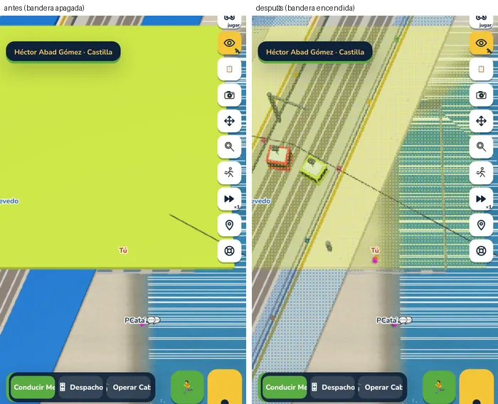
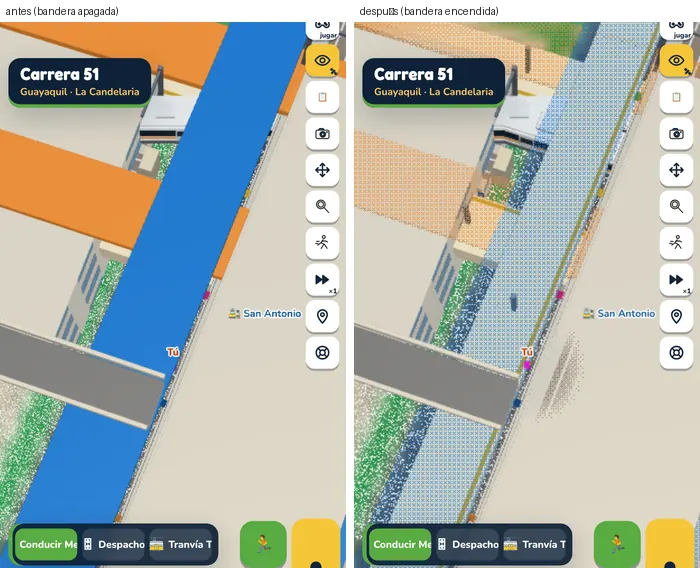
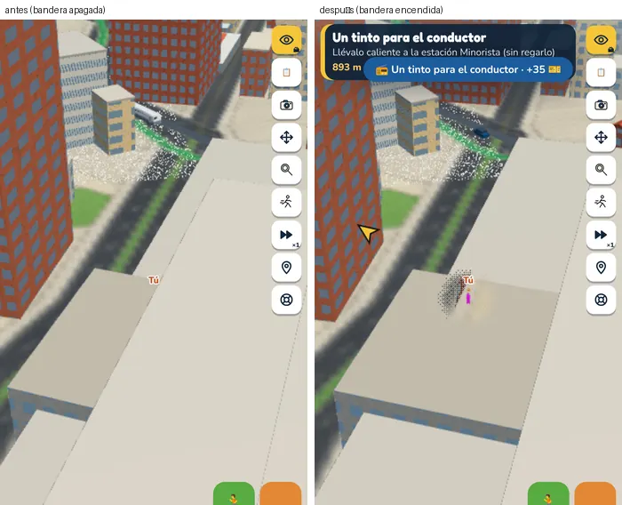
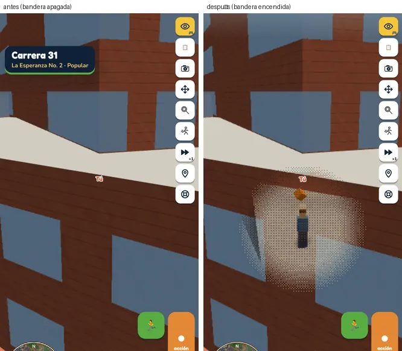
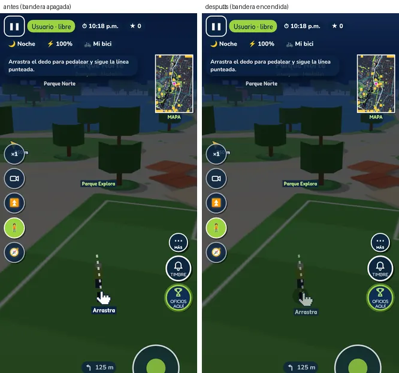

# Fase 2 · Render cenital con bandera (El Metro y EnCicla) y mundos saneados (Motor City 5.3.2)

**Claude · 24‑nov‑2026.** Informe de lote de la Fase 2 del renacimiento cenital, después del OK del autor a la Fase 1 («ok, aprobado, haz lo mejor, inicia»). Todo va **detrás de una bandera que en esta fase viene apagada**: los juegos se ven igual que hoy hasta que la Fase 3 la encienda.

```text
LOTE: Fase 2 · render cenital (El Metro: Ciudad Libre y Bus; EnCicla: modo libre) con bandera, y el saneamiento en Motor City

REPO / RAMA / COMMIT(S): rama ccr-4f6eeea5-yulqk1 en los tres repositorios (base = la de la Fase 1). Nada en main.
  MetroZero      src/js/97d-cenital.js (nuevo), src/js/22-gl.js (partido en funciones, sin cambiar lo que dibuja),
                 tools/prueba-cenital.mjs, tools/rendimiento-cenital.mjs y tools/prueba-rutas.mjs (nuevos), bitácora y skill
  BicicletasUno  src/js/99y-cenital.js (nuevo), tests/cenital-libre.mjs (nuevo), bitácora
  motorcity      5.3.1 → 5.3.2: geo/territorio.py (saneamiento), js/32-fisica.js (sin la tolerancia de 1 m), js/10-mundo.js
                 (via.nivel), los tres mundos regenerados (datos/*), pruebas/calles-libres.mjs (nueva, en motor-city-qa.yml),
                 este informe, las capturas (reportes/img/claude-fase2/) y el relevo

ESTADO: terminado y en verde (ver PRUEBAS). Con la bandera apagada, El Metro y EnCicla dibujan exactamente lo de antes.

QUÉ LEÍ: docs/PROMPT-RELEVO (§ 3 y § 4, Fase 2), docs/AUDITORIA-FASE0-CENITAL (§ 3.3, la tabla de motores y la línea base),
  el informe de la Fase 1, y en El Metro src/js/22-gl.js (entero), 22a-gpt6-eon-3d-batch.js, 36-libre.js (draw, draw3D, dyn3D,
  hud3D, cámara), 38-bus.js, 35-ciudad.js (car, ped, articulado), 11-edificios.js (edifDe, ocluir), 96d-rendimiento.js y 25-game.js;
  en EnCicla 99d-mundo3d.js, 99o-mundo3d-camaras.js, 30-ride.js (camara, render, renderTop0), 88-camara.js, 50-modes.js y la
  compuerta; en Motor City geo/territorio.py, herramientas/fusionar.mjs, precalcular-agua.mjs, pvs.mjs, js/10-mundo.js y
  js/32-fisica.js. Skills: el-metro-desarrollo, medellin-fiel, motor-city-desarrollo, motor-city-territorio y motor-city-qa-playwright.
```

## 1. El Metro · `src/js/97d-cenital.js` (Ciudad Libre y Bus)

La bandera vive **solo mientras dibujan Ciudad Libre o Bus** (envuelve `Libre.draw` y `Bus.draw`), así que Conducir, Volante, Carrera, Metrocable, el mapa y el álbum no pueden verla. Se enciende con `?cenital`, con Ajustes → «🛰 Cenital nuevo» (`Save.d.settings.cenital`, 1 o 0; sin el campo vale la predeterminada, que en esta fase es 0) o con `EM.cenital.forzar` en las pruebas. El guardado `elmetro.v1` no cambia.

| # | Lo pedido | Cómo quedó |
|---|---|---|
| 1 | *Occluder fade* | En 3D, un programa propio (el sombreado de siempre más un tramado 4 × 4) baja a **0,30** lo que tapa al jugador en un cono de la cámara hacia él: edificios, zócalos, árboles e hitos (`k` terminado en ,25). Los **techos de las estaciones** (metro, tranvía, cable y Metroplús, `k` + 0,4) se abren enteros si vas debajo (a menos de 30 m y más de 1,6 m sobre tu cabeza). **Los tableros de los puentes y del viaducto nunca se esconden** (`k` entero): donde algo te tapa se pinta **tu silueta** (prueba de profundidad `GREATER`, mezcla al 60 %). En 2D, el edificio que te tapa baja a 0,30 (la silueta del 2D ya existía). |
| 2 | Anillo lejano sin cajas de relleno | De 700 a 1.100 m, los **edificios reales simplificados** (los mismos de `edifReales`, hasta R2 = R). Con datos de edificios, **0 cajas de relleno**; sin datos, queda el relleno de siempre. |
| 3 | Zócalos | Con el relieve del juego en cada esquina: si el suelo baja más de 0,6 m desde el centro, cuatro muros siguen hasta `zBase = suelo del centro − max(6 m, lo que baja + 0,8)`, con el color del muro oscurecido. En la ventana de Santo Domingo, 15.357 casas llevan zócalo. |
| 4 | Terreno facetado | Normales planas con las derivadas de la pantalla (`OES_standard_derivatives`; si falta, el piso suave de siempre) y **bandas de cota de 12 m** con su línea, en lo rural y en las laderas altas (sobre 1.580 m y empinadas). En lo urbano plano queda el piso con sus calles. |
| 5 | Sombra de contacto | En 3D, una elipse de 8 lados, más oscura en el centro, bajo cada carro, bus, tranvía, persona, vehículo parqueado y bajo ti, **todas en un solo dibujo**, sobre la malla exacta del piso. En 2D, una elipse bajo cada carro, bus, articulado, persona y tabla (las que caen fuera de la pantalla no se pintan). |
| 6 | Bruma o *tilt-shift* | Bruma en el **12 % de arriba**, con el color de la neblina de la hora: una **capa CSS** entre los lienzos y la interfaz. Pintada en el lienzo, duplicaba la mediana del 2D en SwiftShader (16,7 → 33,3 ms); como capa no cuesta por cuadro. |
| 7 | Cámara con `1 − e^(−k·dt)` | En el 2D de Ciudad Libre y Bus, el paso de siempre se lleva exacto a `1 − e^(−k·dt)`. En las vistas 3D (cenital, 3.ª persona y panorámica) el ojo se movía **una fracción fija por cuadro** (0,18): ahora `1 − (1 − f)^(60·dt)`, igual a 60 cuadros por segundo y sin rezagarse a 20. Norte arriba, como ya estaba. |

**El render compartido no cambió lo que dibuja.** `22-gl.js` se partió en funciones (`edifCerca`, `arboles3D`, `hitos3D` y `puentes3D`) para poder envolverlas, y los techos de las estaciones llevan `k` + 0,4, que el sombreado de siempre pinta igual. La prueba lo comprueba byte a byte contra la compilación de antes: **las mallas de 4 ventanas y la red son idénticas** con la bandera apagada.









Más capturas (6 zonas piloto en 3D cenital, 2D y Bus): `reportes/img/claude-fase2/`.

## 2. EnCicla · `src/js/99y-cenital.js` (solo el modo libre)

La bandera mira `mode.free` (el paseo libre de Usuario). **Los 9 oficios, los turnos y los minijuegos no cambian**: la prueba lo comprueba con Balance en 3D. EnCicla ya tenía tres cosas, y se quedan: la sombra de contacto del 2D (la elipse de `blit`), la silueta del ciclista encima cuando algo lo tapa en la ciudad 3D del 2D, y la cámara 2D con `1 − e^(−k·dt)`. Lo nuevo, en el modo libre y con la bandera:

1. **3D (tercera persona):** tu silueta donde un edificio, el viaducto o un puente te tapa. Es una caja un poco más grande que tú, pintada solo con sus caras de adelante y solo donde algo está delante. El tablero no se esconde nunca.
2. **3D:** sombra de contacto (dos octágonos, el centro más oscuro) bajo cada carro, bus, bici, persona y bajo ti.
3. **Bruma** en el 12 % de arriba (2D y 3D), con el color del horizonte de la hora: una capa CSS justo después del lienzo, debajo del HUD.
4. **Cámara 3D:** el giro y la distancia con `1 − e^(−k·dt)` (antes `min(1, dt·k)`).

**No aplican en EnCicla:**
- el anillo lejano (es de El Metro);
- los zócalos y el terreno facetado: el piso 3D de EnCicla es plano y no hay ladera donde una casa flote.



## 3. Motor City 5.3.2 · los mundos saneados

- **`geo/territorio.py`** lleva la ley de soberanía vial del Motor del Valle 1.3 (regla A del autor):
  - a cada huella se le quita el corredor de cada vía a nivel: ancho / 2 + 1,3 m en las de carros y + 0,3 m en peatonales, escalas, senderos y ciclorrutas. Las aceras y cebras van dentro de su calle;
  - también se le quita el agua;
  - **las casas de OSM conservan el andén de las calles menores, pero no el asfalto**: en un juego ningún carro puede chocar con una casa pintada sobre la calle. El Motor del Valle las conserva enteras y El Metro las recorta en su exportación;
  - los restos de menos de 16 m² se van, salvo que conserven el 90 % y 12 m²;
  - **los puentes, túneles y vías cubiertas o interiores no despejan nada**: quedan marcados con su nivel en `VIASJ[5]`, que `js/10-mundo.js` lee como `via.nivel`.
- **Los tres mundos, regenerados**, con su agua (`precalcular-agua.mjs`) y su PVS (`pvs.mjs`):
  - Medellín, con `fusionar.mjs` a partir de las 622.086 huellas saneadas de El Metro;
  - Guatapé y Nueva York, desde Overture.
- **`js/32-fisica.js`:** la colisión con los edificios usa el mismo radio en la calle y fuera de ella. Antes, sobre la calle, solo chocaba si uno se metía más de 1 m en la huella.

| Mundo | Huellas | Tocan | Recortadas | Se van | OSM marcadas | Área que queda |
|---|---|---|---|---|---|---|
| Medellín | 639.457 → 622.086 | (Fase 1) | | | | 98,45 % |
| Guatapé | 2.661 | 524 | 430 | 93 | 48 | 94,7 % |
| Nueva York | 163.875 | 9.890 | 9.371 | 365 | 14.968 | 98,9 % |

En Guatapé, las 93 que se van son casi todas huellas automáticas de 28 m² de mediana (57 de Google y 38 de Microsoft, solo 2 de OSM) que caen sobre el embalse (35) o sobre la calle.

**Calles libres** (`pruebas/calles-libres.mjs`, nueva y en `motor-city-qa.yml`) recorre el eje de las calles de carros a nivel cada 2 m y pregunta lo mismo que la colisión sin tolerancia: ¿chocaría aquí un carro de radio 0,4 m con una casa?

| Mundo | Antes (mundo viejo) | Ahora |
|---|---|---|
| Medellín | 45.689 de 2.727.587 puntos (1,675 %) | **15 (0,001 %)** |
| Guatapé | 90 de 33.976 (0,265 %) | **0** |
| Nueva York | 25.729 de 1.887.050 (1,363 %; contaba túneles y puentes) | **1.234 de 1.665.682 (0,074 %)**, sin túneles, puentes ni vías cubiertas |

## 4. Pruebas

```text
PRUEBAS (comando · código de salida · resultado):
  MetroZero      node tools/build.mjs · 0 · 9.375.904 bytes (tope 9.500.000; +22 KB)
                 node tools/test.mjs 100 · 0 · bandera apagada: 0 errores (295.360 pasos); encendida (?cenital): 0 errores (295.334 pasos)
                 node tools/prueba-cenital.mjs --huella --contra (la compilación de antes) · 0 · BIEN:
                   jugador visible con la bandera: San Antonio 4 → 39 píxeles, Acevedo 0 → 28, Centro 0 → 21 (y en las 6 zonas);
                   0 ventanas con relleno; mallas idénticas con la bandera apagada (4 ventanas y la red); 0 errores
                 node tools/rendimiento-cenital.mjs 12 2 [--cpu 4] · 0 · el p95 no empeora (tabla abajo)
                 node tools/prueba-rutas.mjs · 0 · 19 rutas A*, 61.332 puntos, 0 tocan una casa (con los datos de antes de la Fase 1: 2.116)
  BicicletasUno  node tools/build.js · 0 · 5.678 KB
                 node tests/cenital-libre.mjs · 0 · BIEN: solo cambia el modo libre y solo con la bandera (Balance igual)
                 node tests/run.js · 0 · 177 ✓ y 0 ✗ con la bandera apagada y con la predeterminada encendida
                 node tests/regresion-encicla.js · 0 · en los dos casos
                 node tests/benchmark-2km-gpt6.mjs --cpu=4 (A/B/C limpio) · ver la tabla
  motorcity      node motor.mjs construir · 0
                 node pruebas/calles-libres.mjs · 0 · ver la tabla
                 node motor.mjs prueba --navegador · 0 · 158 bien, 0 mal
                 node pruebas/pvs.mjs · 0 · sin fugas grandes (Guatapé y Manhattan, con el PVS horneado otra vez)
                 toda la lista de motor-city-qa.yml (41 pasos) · 0 · salvo pruebas/medir.mjs, intermitente también en main (ver abajo)
```

**Pruebas que se ajustaron a los datos nuevos** (la física no cambió; cambió el escenario que cada prueba elegía en el mapa):
- `prueba.mjs` · manejo 4.5: el primer rectángulo grande cerca de Laureles daba a un patio, no a una calle. Ahora la prueba exige que el punto de partida sea calle. Con el mundo nuevo y sin tolerancia: roza y sigue 28,7 m a 9,5 m/s, de frente frena a 0 y se desatasca.
- `prueba.mjs` · el ruido rodea un edificio: en 150 m había un solo caso, y el mundo saneado lo cambió (en las manzanas cerradas, rodear pide más de 60 m). Ahora busca en 400 m: 3 casos; el primero, recta de 30 m y camino de 56 m.
- `dinamica.mjs` · el ladeo de la moto: el primer sitio abierto ahora es una avenida (agarre 1), no un andén (0,62). La moto gira más rápido y la teoría pide 50,5°, más que el tope del motor (0,78 rad ≈ 45°). Ahora compara con la teoría limitada a ese tope.
- `ciudad-viva.mjs` · el testigo y la ambulancia:
  - Con las casas recortadas, los peatones aparecen en otros lugares y llamó uno solo. Una llamada suma 8 de calor y el nivel 1 pide 15. La prueba ahora mira el calor.
  - **Mejora del juego:** si desde el primer punto al azar la ambulancia no tiene ruta, `Viva.despachar` (`juegos/getaway/66-ciudad-viva.js`) prueba otros. Antes, con un solo testigo, a veces no salía.
- `herramientas/precocinar-sectores.mjs` (R6‑b): acepta los flujos de más al final del ED1 v2 de El Metro (el zócalo).
- **`pruebas/medir.mjs` es intermitente desde antes:** en una copia limpia de `main` se agotó 1 de 3 veces. Hay una carrera en el arranque de `?medir`: a veces sale «Cannot read properties of undefined (reading '0')» y el bucle de la medición se corta. No es de esta fase; queda anotado para quien siga.

**Rendimiento de El Metro** (`tools/rendimiento-cenital.mjs`: San Antonio → Centro a 40 m/s, la misma escena de «📏 Medir mi celular», con el regulador fijo en «alta», SwiftShader, 412 × 860 × 2):

| Caso | p50 apagada | p50 encendida | p95 apagada | p95 encendida | peor apagada | peor encendida |
|---|---|---|---|---|---|---|
| 3D cenital | 66,6 ms | 66,7 ms | 83,4 ms | 83,4 ms | 550 ms | 550 ms |
| 2D | 16,7 ms | 16,7 ms | 33,4 ms | 33,4 ms | 150 ms | 50 ms |
| 3D cenital, CPU ×4 | 99,9 ms | 100 ms | 133,3 ms | 133,3 ms | 1.933 ms | 1.783 ms |
| 2D, CPU ×4 | 116,7 ms | 116,7 ms | 216,6 ms | 200 ms | 533 ms | 217 ms |

**Compuerta de EnCicla** (`tests/benchmark-2km-gpt6.mjs --cpu=4`, sin cambiarla). Se compiló cada variante y se corrieron 3 rondas intercaladas con la máquina libre (p95; la meta es menos de 50 ms):

| Variante | Carrera 43A | Avenida de Las Palmas |
|---|---|---|
| A · bandera apagada (la de hoy) | 38,0 / 38,4 / 38,0 · **media 38,1 ms** | 35,2 / 33,3 / 34,8 · **media 34,4 ms** |
| B · bandera encendida | 40,2 / 35,2 / 37,7 · **media 37,7 ms** | 32,2 / 33,9 / 33,2 · **media 33,1 ms** |
| C · encendida sin bruma | 38,6 / 39,5 / 41,2 · media 39,8 ms | 34,0 / 33,6 / 36,0 · media 34,5 ms |

**La bandera no empeora la compuerta**, y las tres variantes cumplen la meta. Una primera medición había dado unos 3 a 5 ms más con la bandera, pero corrió mientras se regeneraban y horneaban los mundos de Motor City (la CPU ocupada). Por eso se repitió con la máquina libre.

## 5. Decisiones

- **Decisión 7 (las casas confiables en El Metro):** se queda como en la Fase 1 (la exportación las recorta o quita). Así ningún modo recorta en tiempo real y la ciudad es la misma en todos los modos. Si el autor prefiere respetarlas en Ciudad Libre y Bus, hay que re‑exportar `edificios.js` con dos juegos de huellas (pesa más: al HTML le quedan 124 KB).
- **Decisiones 8 a 11** (vías precisas en El Metro, ancho por fachadas, la cota dentro de `vias.js` y refrescar el mapa base): se quedan como están; esta fase no las necesitó.
- **Nueva (para la Fase 3):** en EnCicla, cambiar los lotes inventados por las huellas reales de `edificios.bin` sumaría unos 5,5 MB al HTML (hoy 5,7 MB). Se mide con la compuerta antes de decidir.

## 6. Lo que sigue (Fase 3)
1. Encender la bandera: El Metro (`PREDETERMINADA = 1` en `97d-cenital.js`) y EnCicla (en `99y-cenital.js`, solo el modo libre).
2. EnCicla: los lotes inventados por las huellas reales, solo si la compuerta no empeora.
3. Regresión: El Metro con `--shots` (cabina, lateral, Metrocable, guía y Rosalba); EnCicla `tests/run.js` y `regresion-encicla.js`; la prueba de rutas A\* ya existe (`tools/prueba-rutas.mjs`).
4. Versiones: El Metro `00-core.js` y `versionCode` 36 → 37; EnCicla `00-core.js` y `versionCode` 30700 → siguiente.
5. Publicar solo con las pruebas en verde y el OK del autor.
