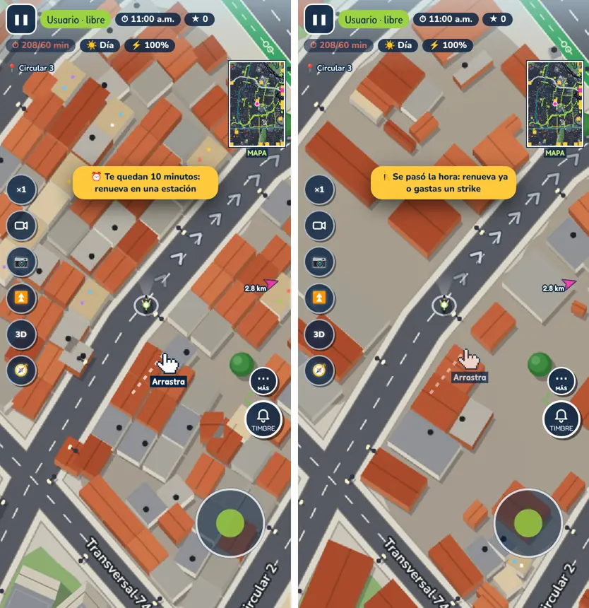
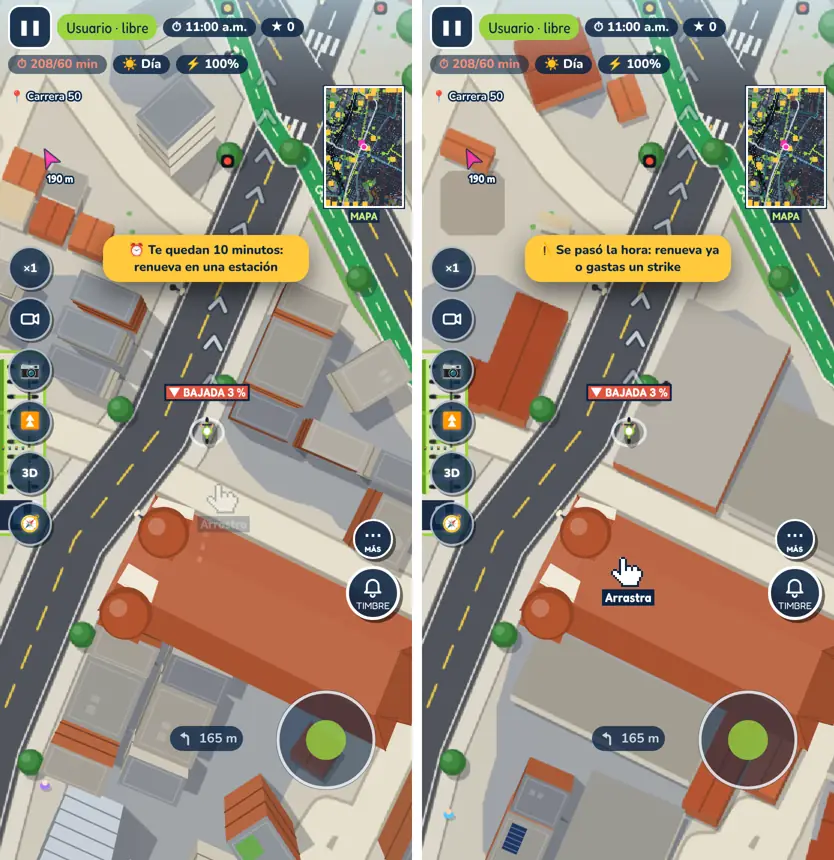
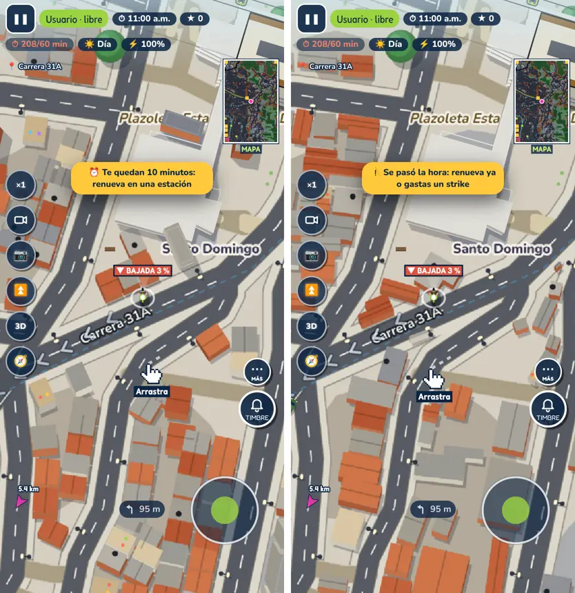

# Fase 3 · El cenital encendido (El Metro 3.9.0 y EnCicla 3.9.0) y las huellas reales en EnCicla (Motor del Valle 1.3.1)

**Claude · 25‑nov‑2026.** Informe de lote de la Fase 3 del renacimiento cenital. El autor pidió seguir con las fases siguientes («Retoma y continúa con las siguientes fases, ok, aprobado, haz lo mejor, inicia»; después, «Retoma, y continua» y «retoma y sigue»). La bandera del cenital queda **encendida** donde el autor lo decidió (decisión 3): en El Metro, solo en Ciudad Libre y Bus; en EnCicla, solo en el modo libre. Los demás modos dibujan lo mismo que antes. **Nada se publicó** y nada pasó a `main`.

```text
LOTE: Fase 3 · integración, regresión y versiones del renacimiento cenital

REPO / RAMA / COMMIT(S): rama ccr-4f6eeea5-yulqk1 en los tres repositorios. Nada en main.
  MetroZero      19faf6c  El Metro 3.9.0 (versionCode 37): PREDETERMINADA = 1 en 97d-cenital.js, tools/capturas-protegidos.mjs
                 74ac5ea  Motor del Valle 1.3.1 sincronizado (El Metro no cambia: mismo md5)
  BicicletasUno  8f725d8  EnCicla 3.9.0 (versionCode 30900): la bandera encendida en el modo libre, src/js/99z-huellas.js (las
                          huellas reales), Motor del Valle 1.3.1 (edificios-ligero.bin) y tools/build.js
  motorcity      este informe, las láminas (reportes/img/claude-fase3/) y el relevo

ESTADO: terminado y en verde (ver PRUEBAS). Publicar (APK y páginas) y pasar a main esperan el OK del autor.

QUÉ LEÍ: docs/PROMPT-RELEVO (§ 3 y § 4, Fase 3), el informe de la Fase 2, en EnCicla 75-graficos.js (lotes y su dibujo por
  trozos), 99d-mundo3d.js, 99o-mundo3d-camaras.js, 99v-rendimiento.js (la cola de lotes) y la compuerta; en el Motor del Valle
  geo/huellas.py, geo/sanear.py y pruebas/geometria.mjs; en El Metro 97d-cenital.js y las pruebas de la Fase 2.
```

## 1. El Metro 3.9.0 · el cenital nuevo encendido en Ciudad Libre y Bus

- `PREDETERMINADA = 1` en `src/js/97d-cenital.js`. Se apaga en Ajustes → «🛰 Cenital nuevo» (`Save.d.settings.cenital = 0`) o con `?cenital=0`. El guardado `elmetro.v1` no cambia: sin el campo, vale la predeterminada.
- Versión: `src/js/00-core.js` 3.9.0 y `android/gradle.properties` (`elmetro.versionName` 3.9.0, `elmetro.versionCode` 37).
- **Herramienta nueva, `tools/capturas-protegidos.mjs`:** captura en dos compilaciones los 13 modos que no deben cambiar y los compara píxel a píxel:
  - la cabina, la vista lateral y la tercera persona de Conducir;
  - el tranvía, el Volante y el viaje en Metrocable;
  - la Carrera, Despacho, Alimentadores, Metroplús y el Metrocable;
  - la guía de Ciudad Libre y la historia de Rosalba.

## 2. EnCicla 3.9.0 · el cenital encendido en el modo libre, con las huellas reales

### 2.1 La bandera
`PREDETERMINADA = 1` en `src/js/99y-cenital.js`: bruma, sombras de contacto, la silueta del ciclista y la cámara exponencial, **solo en el paseo libre**. Los 9 oficios, los turnos y los minijuegos siguen con el render de siempre (lo comprueba `tests/cenital-libre.mjs`).

### 2.2 Las huellas reales (`src/js/99z-huellas.js`, nuevo y aditivo)
Con la bandera, los **lotes inventados** del paseo libre se cambian por las **625.880 huellas saneadas** del Valle (OpenStreetMap, Microsoft y Google):
- **El mismo contrato que un lote:** 4 esquinas, altura, techo y fachadas. El 2D de los trozos (`75-graficos.js`) y el 3D (`99d-mundo3d.js`) las dibujan sin cambiar una línea. Con 1 o 2 pisos son casas con techo; con 3 o más, edificios. Los pisos son los de Overture; sin dato, se estiman como en los lotes.
- **Por regiones de 160 m**, las mismas de los trozos del mapa y de la caché de lotes. Cada región se arma una sola vez (caché de 160). Además, cada trozo pinta en su 2D las huellas de los vecinos que entran en él: cada trozo 2D es un lienzo aparte, y sin eso una casa en el borde quedaría cortada.
- **Los sitios reales** (`22-sitios.js`) se respetan: donde hay un sitio, no se pone la huella.
- **Al entrar o salir del modo libre** se vacían las cachés de lotes, de trozos 2D y de mallas 3D, para que lotes y huellas nunca se mezclen. La cola de lotes de `99v-rendimiento.js` (que guardaba el generador original) también se envuelve.

### 2.3 Los datos: Motor del Valle 1.3.1 (`edificios-ligero.bin`)
Los renderizadores compartidos de EnCicla dibujan rectángulos de 4 esquinas, pero el 17 % de las huellas son polígonos (recortados por la ley de soberanía vial, o irregulares). Si se dibujaba el rectángulo que los envuelve, volvían a pisar la calle.

La corrección va en los datos, no en el render (regla de la Fase 1). `geo/huellas.py --encicla` exporta ahora, además de `edificios.bin`, una **versión ligera** para el HTML:
- **Uno o dos rectángulos por huella, adentro de su polígono.** Se gira el polígono al ángulo que lee el juego y se rasteriza con celdas cuyas 4 esquinas caen adentro. Luego se busca el rectángulo de celdas más grande, con programación dinámica de alturas, izquierdas y derechas, y se comprueba exacto.
- **Un segundo rectángulo cuando vale la pena:** al menos 4 m² y el 10 % del polígono. Es el otro brazo de una L, por ejemplo. Crece hacia el primero para que se monten y no quede una raja. Va marcado como **«sigue al anterior»** (bit 16 del tipo), y el juego lo dibuja con el mismo aspecto.
- **Cuantizado como lo lee el juego:** centros y medias medidas cada 0,25 m (en `edificios.bin` son 0,5 m). De los 9 centros más cercanos en la rejilla, se toma el que deja el rectángulo más grande adentro.
- **Los rectángulos que ya eran rectángulos** se cuantizan igual de fino a partir de su medida sin redondear. Los 4.750 que así tocaban un corredor vuelven a sus medidas de 0,5 m, que ya habían pasado la guarda.
- **Comprobado contra los corredores de EnCicla:** sus vías con la regla A, el Metroplús, el tranvía y el agua. Resultado: **0 de 667.644 rectángulos los tocan**.
- **`tools/build.js` lo mete tal cual** (ya viene comprimido). Si falta, o si salió de otro `edificios.bin` (lo dice su huella sha1), el modo libre sigue con los lotes: nunca va con huellas viejas.
- **Los corredores quedan en una función.** `edificios.bin` sale idéntico byte a byte, y la exportación completa tarda 5,5 min.

| Versión ligera | Rectángulos | Área inscrita / polígono (mediana · p10) | Peso |
|---|---|---|---|
| Un rectángulo, medidas de 0,5 m (la de `edificios.bin`) | 625.770 | 0,62 · 0,41 | 2.672 KB |
| **Uno o dos rectángulos, cada 0,25 m (la que va)** | **667.644** (41.764 son segundos rectángulos) | **0,805 · 0,613** | **3.225 KB** |
| Uno o dos rectángulos, medidas cada 0,1 m | 667.644 | 0,841 · 0,658 | 3.480 KB |

Se eligió 0,25 m: en EnCicla 1 m son 1,6 px, así que 0,1 m y 0,25 m se ven igual, y la de 0,25 m pesa 255 KB menos. Quedan sin rectángulo 260 huellas más delgadas que 1 m.





*A la izquierda, los lotes inventados; a la derecha, las huellas reales (modo libre, 412 × 860, 11 a. m.).*
- En **Laureles**, las casas son más grandes y con antejardín, como el barrio.
- En el **Centro**, los edificios grandes y el templo (un sitio real) se respetan.
- En **Santo Domingo**, la ladera queda densa.
- En las tres zonas, ninguna casa queda sobre la calle ni cortada en el borde de un trozo.

### 2.4 El peso
El HTML pasa de **5.678 KB a 9.990 KB**. La versión ligera ocupa 4,3 MB en base64. Si el autor prefiere un HTML más liviano, la versión de 0,5 m y un rectángulo pesa 2,7 MB, pero tapa menos (0,62) y deja huecos entre las casas. Se cambia con las constantes de `huellas.py`: `QP` y `QD` para la precisión, y el umbral del segundo rectángulo en `inscritos`.

## 3. Pruebas

| Juego | Prueba | Resultado |
|---|---|---|
| El Metro | `node tools/build.mjs` | 9.375.904 bytes (tope 9.500.000) |
| El Metro | `node tools/test.mjs 100`, con la bandera encendida por defecto | **0 errores** (299.800 pasos, 0 errores de consola) |
| El Metro | `tools/capturas-protegidos.mjs` contra la compilación de antes de la Fase 2 | los 13 modos difieren entre 0 % y 0,56 %, salvo lo que se mueve solo (abajo) |
| El Metro | `tools/prueba-rutas.mjs`: las rutas A\* de `rutas_calles.js`, cada 2 m, con 1,25 m de margen | **0 de 61.332** puntos tocan una casa (con los datos de antes de la Fase 1 eran 2.116) |
| El Metro | después de sincronizar el Motor del Valle 1.3.1 | el mismo `dist/index.html` (md5 `be2155937f6b9bac0aa626f914000083`) |
| EnCicla | `node tools/build.js` | 9.990 KB |
| EnCicla | `node tests/run.js`, con la regresión | **177 ✓ y 0 ✗** |
| EnCicla | `node tests/cenital-libre.mjs` | **BIEN**: con la bandera, el modo libre tiene bruma, sombras, silueta y huellas reales en 9 de 9 y 20 de 20 trozos; Balance no cambia; sin la bandera, nada cambia |
| Motor del Valle | `node motor-valle/pruebas/geometria.mjs --encicla . --ligero` (como lo lee el juego) | **BIEN**: 0 de 667.644 rectángulos pisan un corredor (geometría exacta, 2 cm de tolerancia); 0 en el agua |
| Motor del Valle | `sincronizar.mjs ../MetroZero --verificar` | «los archivos son iguales» (1.3.1) |

**Lo que se mueve solo en los modos protegidos de El Metro:**
- el Volante difiere un 7,1 %, y dos corridas de la misma compilación ya difieren un 6,2 %;
- en la Carrera, el corredor avanzó un metro más («Cruce en 91 m» contra «90 m»), así que toda la escena se corre.

**Una prueba intermitente de EnCicla:** «mundo 3D único» falló una vez porque corrió al mismo tiempo que la prueba de geometría.
- Espera 700 ms a que la cámara 3D se acomode, y con la CPU ocupada no le alcanzan.
- Sola pasó 6 de 6, y la batería completa, corrida sola, dio 177 ✓.
- Queda anotado para quien la toque: esperar a que la cámara esté quieta, no un tiempo fijo.

**La compuerta de EnCicla** (`tests/benchmark-2km-gpt6.mjs --cpu=4`, sin cambiarla). Con la bandera encendida, cada variante se compiló aparte y se corrieron 3 rondas intercaladas con la máquina libre. La meta es p95 menor que 50 ms en las dos vías:

| Variante | p95, Carrera 43A | p95, Las Palmas | Peor cuadro | Veredicto de la compuerta |
|---|---|---|---|---|
| Lotes inventados | 46,6 · 52,0 · 50,5 (media **49,7**) | 40,4 · 39,6 · 36,4 (media 38,8) | 72 a 102 ms | meta cumplida en **1 de 3** |
| **Huellas reales** | 49,5 · 49,9 · 39,5 (media **46,3**) | 42,9 · 44,5 · 36,4 (media 41,3) | **60 a 85 ms** | meta cumplida en **3 de 3** |

**Las huellas no empeoran la compuerta; la mejoran.** Hay menos figuras inventadas por trozo, y los trozos salen de una vez, sin el generador por etapas. Las Palmas sube 2,5 ms, dentro del ruido de cada variante (4 a 10 ms entre rondas) y bajo la meta.

Hoy la máquina va más lenta que en la Fase 2 (los lotes daban entonces 39,7 y 34,3 ms), así que solo se comparan variantes medidas en la misma sesión.

## 4. Decisiones que tomé (el autor dijo «haz lo mejor»)

- **Las huellas reales en el modo libre de EnCicla:** van, porque la compuerta no empeora (regla del prompt). Los oficios siguen con sus lotes.
- **Rectángulos adentro del polígono, no el polígono:** así se respeta el contrato de 4 esquinas de los renderizadores compartidos de EnCicla, que dibujan también los oficios. Cambiarlos a polígonos tocaría el render de todos los modos.
- **0,25 m en la versión ligera:** ver § 2.3. Si el autor prefiere menos peso, se cambia la constante.
- **El nombre del módulo de la Fase 4:** será `js/47-pista.js`, no `47b-pista.js`. `herramientas/construir.mjs` solo toma fragmentos `NN-*.js` (con la expresión `^\d\d-`); con `47-pista.js` queda después de `47-clasicos.js`, como pedía el prompt.

## 5. Lo que sigue
1. **Fase 4:** `MC.Pista` (las carreras retro pseudo‑3D) en Motor City, «🏎️ Carreras retro» en Turno Cero, `pruebas/pista-retro.mjs` y Motor City 5.4.0.
2. **Publicar** El Metro 3.9.0 (APK y página) y EnCicla 3.9.0 (página con `publicar.yml` y APK): solo con el OK del autor.
3. **Pasar a `main`:** solo con el OK del autor. En BicicletasUno y MetroZero el push a `main` lo niegan los permisos, así que va con un PR que abra el autor.
