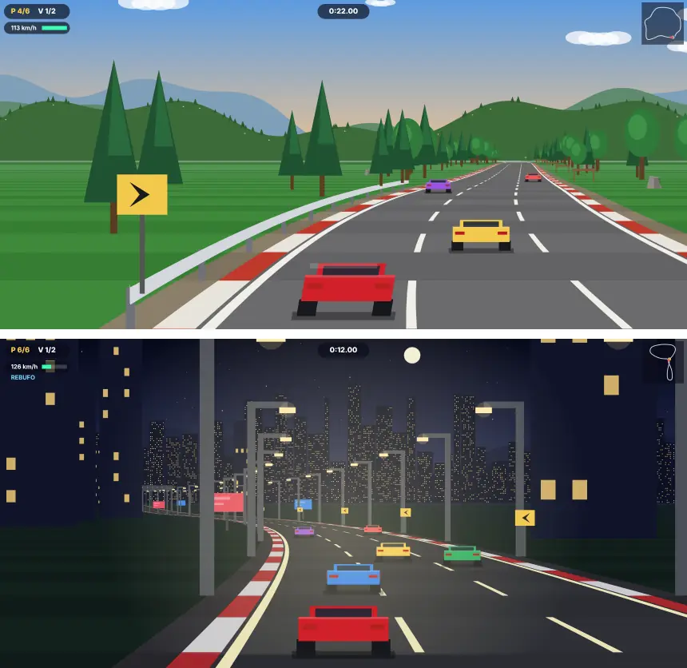
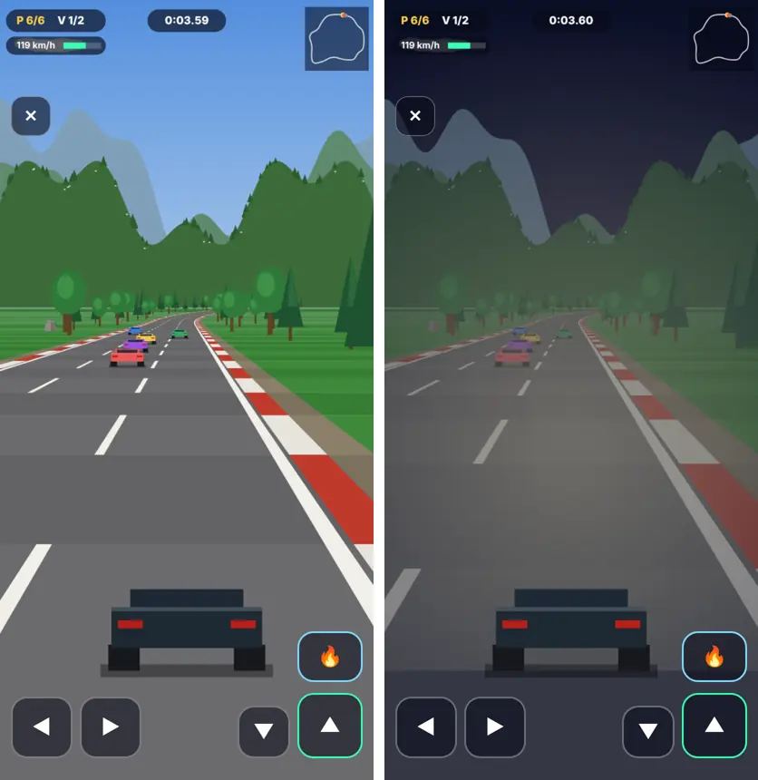
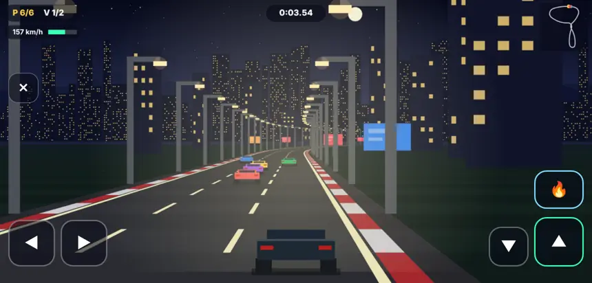

# Fase 4 · Carreras retro pseudo‑3D en Turno Cero (`MC.Pista`, Motor City 5.4.0)

**Claude · 25‑nov‑2026.** Informe de lote de la Fase 4 del renacimiento cenital. El autor pidió seguir con las fases siguientes («haz lo mejor»; después, «retoma y sigue»). La Fase 4 vive **solo en `motorcity`**; Turno Cero es 18+, pero las carreras no tienen violencia. Nada se publicó (la APK espera el OK del autor) y nada pasó a `main`.

```text
LOTE: Fase 4 · MC.Pista (carreras retro pseudo‑3D) y «🏎️ Carreras retro» en Turno Cero; Motor City 5.4.0

REPO / RAMA / COMMIT(S): motorcity, rama ccr-4f6eeea5-yulqk1 (ver git log). Nada en main.
  js/47-pista.js (nuevo; MC.Pista), juegos/getaway/70-retro.js (nuevo, aditivo), pruebas/pista-retro.mjs (nueva, en
  motor-city-qa.yml), VERSION.json y js/00-nucleo.js 5.4.0, MOTOR.md (§ 9d e historial), BITACORA.md, dist/ reconstruido,
  este informe, las láminas (reportes/img/claude-fase4/) y el relevo.

ESTADO: terminado y en verde (ver PRUEBAS). La APK con apk-juegos.yml espera el OK del autor.

QUÉ LEÍ: docs/PROMPT-RELEVO (§ 4, Fase 4), js/47-clasicos.js (MC.Arcade, carroAtras, cieloRetro), js/50-run.js (MC.Run: el patrón
  de entrar, capa, bucle y alSalir), juegos/getaway/60-modos.js (Modos.DEF, empezar, terminar, records), 50-extras.js (cómo Run
  pausa el mundo y vuelve), 20-juego.js (t0), herramientas/construir.mjs (qué fragmentos entran) y pruebas/modos.mjs. La técnica
  clásica de segmentos se tomó de su descripción pública; no se copió código de ningún proyecto.
```

## 1. `MC.Pista` (`js/47-pista.js`)

**El nombre del archivo.** El prompt decía `js/47b-pista.js`. `herramientas/construir.mjs` solo toma fragmentos que cumplen `^\d\d-`, así que con esa `b` el archivo habría quedado fuera del motor. Con `47-pista.js` queda después de `47-clasicos.js` y usa `carroAtras` y `cieloRetro`, como pedía el prompt.

**La pista:**
- Segmentos de 200 de largo. Cada uno tiene `p1` y `p2` con mundo (`m`), cámara (`c`) y pantalla (`s`), y además su `curva`, su banda de color (alterna cada 3 segmentos), sus objetos, sus carros y su `clip`.
- **Colinas cosenoidales:** `y = y0 + (y1 − y0)·(1 − cos πt)/2` en cada tramo. La vuelta cierra en altura (el último tramo baja lo que subieron los demás).
- **Curvas acumuladas:** `x += dx; dx += curva`. La curva de cada tramo entra y sale suave (una rampa del 30 %), así que nunca salta.
- **Fuerza centrífuga:** `x −= 0,42 · curva · (v/vmax)² · dt`. A fondo, una curva de 6,5 saca más de lo que gira el carro: en la horquilla toca levantar el pie.
- **Unidades:** un segmento son 0,6 m, la vía mide 12 m (tres carriles) y un carro 4,5 m de largo.

**La proyección:** `d = 1/tan(FOV/2)`, `s = d/(z − camZ)`, `X = W/2 + k·s·(x − camX)`, `Y = yh − k·s·(y − camY)`, con 280 segmentos a la vista.
- **En horizontal:** `k = W/2` y `yh = H/2`, la fórmula clásica.
- **En vertical (412 × 860):** la misma `k` en los dos ejes y el horizonte al 40 %. Con `H/2` en el eje vertical, como dice la fórmula literal, la imagen saldría estirada al doble.

**Las dos pasadas:**
1. **De cerca a lejos, con `maxY`:**
   - descarta lo que está detrás de la cámara, lo que da la espalda (la bajada después de una cresta) y lo que queda debajo de `maxY`;
   - recorta el segmento que queda a medias contra `maxY`, así que nada se pinta dos veces;
   - guarda `seg.clip = maxY` y pone niebla en los últimos 45 segmentos (6 niveles).
   - **Las franjas van juntas por color y nivel de niebla:** pasto, berma, pianos, asfalto, líneas y la baranda. Como los segmentos no se montan entre sí, el orden no importa, y queda en **unos 40 rellenos por cuadro**. `MC.Arcade` pinta unas mil figuras.
2. **De lejos a cerca:** los objetos de la orilla y los rivales de **todos** los segmentos frente a la cámara, también los que tapa una cresta, recortados abajo contra `seg.clip`.
   - Un carro detrás de una cresta asoma el techo y nunca se pinta debajo de ella.
   - Lo que queda entero debajo de la línea no se dibuja.

**Más allá de lo pedido:**
- **Paralaje de 3 capas**, que se dibujan una vez por tamaño en lienzos aparte: el cielo (nubes, o estrellas y luna), las montañas del Valle (dos cordilleras) y el horizonte cercano (la ciudad con ventanas de noche, o lomas con pinos). Se mueve con `curva · velocidad` y baja o sube con la altura de la cámara.
- **El carro del jugador con 6 estados:** recto, giro suave y giro brusco, en plano y en subida.
- **Efectos del manejo:** vibración en la berma, chispas y humo al derrapar, y llamas con el nitro.
- **Rebufo:** a menos de 15 segmentos detrás de un rival y en su carril, el arrastre baja y se carga el nitro.
- **Nitro:** el FOV pasa de 100° a 116°, con líneas de velocidad y una sacudida corta.
- **Los rivales:** cambian de carril cuando alcanzan a uno más lento, a 0,75 por segundo y sin saltos; frenan antes de las curvas fuertes; llevan un poco de goma (±5 %).
- **HUD:** posición, vuelta, tiempo, velocidad, nitro y el minimapa del circuito. El minimapa sale de las curvas, cerrado repartiendo la diferencia.
- **Controles táctiles en las esquinas:** ◀ ▶, y ▲, ▼ y 🔥. En vertical, el carro va encima de la fila de botones, así que la zona libre del centro queda limpia. En el teléfono, el acelerador va solo.
- **Todo el arte es procedural:** pinos, árboles, rocas, la baranda continua, señales de curva, miradores, casas, postes con luz, torres con ventanas, vallas sin marcas, arcos, puentes y el arco de la meta.

**Los dos circuitos** (1,6 km cada uno, a 2 vueltas contra 5 rivales):

| Circuito | Segmentos | Curva máxima | Desnivel | Lo que tiene |
|---|---|---|---|---|
| **Subida a Las Palmas** (`palmas`) | 2.680 | 6,5 (la horquilla) | 57 m | subida larga, curvas encadenadas, lomas con cresta, el mirador, el alto y la bajada por Escobero; baranda por fuera de las curvas |
| **Autopista Regional nocturna** (`regional`) | 2.660 | 2,2 | 8 m | alta velocidad (vmax 14.500, unos 157 km/h), puentes y arcos encima de la vía, postes con luz y la silueta de la ciudad |

**Sin pantalla, para las pruebas y para quien la use:**
- `crear(id)` y `crearDe(def)`;
- `carrera(P, op)`, `paso(S, dt, ent)` (paso fijo de 1/120 s) y `bot(S)`, el piloto: carril libre, contra la curva, frena antes de las horquillas y usa el nitro en las rectas;
- `simular(id, op)`, `perfil(P)` y `cieloDe(E)`.



## 2. Turno Cero · «🏎️ Carreras retro» (`juegos/getaway/70-retro.js`)

Es un archivo aditivo: suma `retro` a `Modos.DEF` y envuelve `Modos.empezar`, sin tocar los otros modos.

1. En 🎮 Modos aparece «🏎️ Carreras retro». Ahí se elige el circuito, cada uno con su récord.
2. Mientras corres, **el mundo abierto se pausa**, como en Run.
3. Corres con el color de tu carro de Turno Cero.
4. **El cielo de Las Palmas sale de la hora y el clima del mundo** (`cieloRetro`, con `MC.Pista.cieloDe`). Si allá es de noche, la pista se oscurece y se prenden los faros. La Regional siempre es de noche.
5. Al cruzar la meta hay **premio** (💵 500, 250 y 100) y **récord** por circuito. «Otra vez» repite la carrera, y cada carrera cuenta.
6. Al salir (con «Volver al mundo abierto» o con ✕ a mitad de carrera) **vuelves al mismo punto**: misma posición, rumbo y carro, y el mundo sigue andando.




## 3. Pruebas

**`pruebas/pista-retro.mjs`** (nueva, en `motor-city-qa.yml`; Chromium de escritorio con `dist/juegos/getaway.html`):

| # | Qué exige | Resultado |
|---|---|---|
| 1 | **La cresta recorta.** Una pista de prueba con una loma y un rival en 36 posiciones, de la cresta a 70 segmentos después: ningún píxel del carro debajo de la cresta. Con el recorte apagado sí se asoma, así se sabe que la prueba mide algo. | **0 píxeles debajo** con el recorte, 280 sin él; el techo se asoma; el carro antes de la loma se ve (112 píxeles) |
| 2 | **La curva acumulada es continua:** salto de curva ≤ 0,3, sin saltos de altura, y la vuelta cierra | Las Palmas 0,25 y la Regional 0,05; altura 0; cierre 0 |
| 3 | **El bot completa los dos circuitos,** con 2 vueltas y su posición | Las Palmas en 101,3 s (mejor vuelta 48,6) y la Regional en 76,3 s (36,4), primero en las dos |
| 4 | **p95 por debajo de 16,7 ms,** un cuadro por `requestAnimationFrame` como en el juego | paso + dibujo, p95 de **5,2 a 5,9 ms** en 412 × 860 y en 860 × 412; entre cuadros, p95 de 16,7 ms (60 fps); 37 a 44 rellenos por cuadro |
| 5 | **Turno Cero:** el modo en 🎮; el mundo se pausa; premio, récord y vuelta al mismo punto; salir con ✕ | todo ✓ (premio de 💵 500, de primero) |
| 6 | **0 errores de consola** | 0 |

**El resto de la batería del motor:**
- `node motor.mjs prueba`: 146 bien;
- `node motor.mjs prueba --navegador`: **158 bien**;
- `node motor.mjs skills --verificar`: ✓;
- `node pruebas/getaway-contenido.mjs`: ✓;
- `node pruebas/modos.mjs`: ✓ en dos corridas. Una tercera falló solo en el umbral del ⏫ acelerador fijo (8,7 m/s contra más de 10): esa medida depende de los cuadros reales de SwiftShader, y la propia prueba lo advierte. Es de antes y no toca las carreras retro.

**Peso:** `js/47-pista.js` pesa 52 KB y `70-retro.js` 5 KB, contra la meta de unos 150 KB para el módulo retro. Con ellos, `getaway.html` pesa 29.392 KB.

## 4. Lo que sigue
1. **La APK** de Turno Cero con `apk-juegos.yml`, y **pasar a `main`**: los dos con el OK del autor.
2. **La Fase 5:**
   - las cápsulas: el paso entre el mundo abierto y las carreras conserva el estado;
   - el garaje y la colección en 2D pixel con las fichas de `MC.Taller`, el perfil de moto y los ganchos de la capa aérea;
   - los controles táctiles en el WebView de Android, midiendo 60 cuadros por segundo con 📏.
