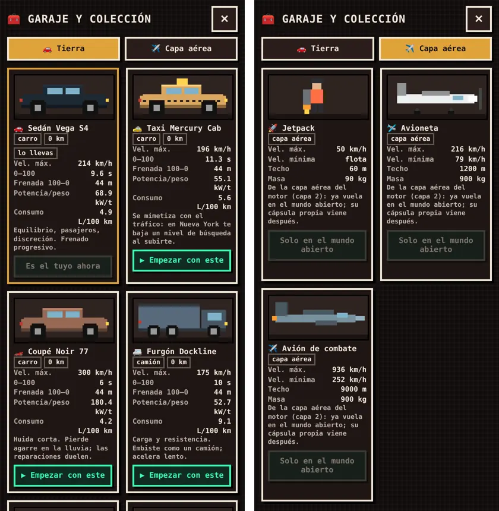

# Fase 5 · Turno Cero en cápsulas y en el celular (Motor City 5.4.1)

**Claude · 25‑nov‑2026.** Informe de lote de la Fase 5, la última del renacimiento cenital. El autor pidió seguir con las fases siguientes («retoma y sigue»). Vive **solo en `motorcity`**. Nada se publicó, y la APK y pasar a `main` esperan el OK del autor.

```text
LOTE: Fase 5 · Turno Cero en cápsulas y en el celular; Motor City 5.4.1

REPO / RAMA / COMMIT(S): motorcity, rama ccr-4f6eeea5-yulqk1 (ver git log). Nada en main.
  juegos/getaway/71-garaje.js (nuevo, aditivo: la cápsula 3, solo la interfaz), juegos/getaway/70-retro.js (📏 de las carreras y
  vibración), js/47-pista.js (ultimoMs), juegos/getaway/68-medir.js (arreglo de raíz de una carrera intermitente),
  pruebas/capsulas.mjs (nueva, en motor-city-qa.yml), 5.4.1 (VERSION.json, 00-nucleo.js, MOTOR.md, BITACORA.md), dist/,
  este informe, la lámina (reportes/img/claude-fase5/) y el relevo.

ESTADO: terminado y en verde (ver PRUEBAS).

QUÉ LEÍ: docs/PROMPT-RELEVO (§ 4, Fase 5), js/36-taller.js (MC.Taller.disenar y sus fichas), js/37-dinamica.js (DIN_CLASE.moto y
  hoja), js/31-vehiculos.js (la capa aérea: vuela, techo y vmin), juegos/getaway/10-contenido.js (TC.VEHICULOS), 20-juego.js
  (G.veh, G.tengo, cambiarVeh, el taller y EXTRAS), 60-modos.js, 68-medir.js, 90-inicio.js (la portada) y pruebas/medir.mjs.
```

## 1. Las cápsulas y el paso entre ellas
El selector ya existía: `G.Modos.DEF`. Esta fase le suma dos cápsulas: «🏎️ Carreras retro» (Fase 4) y «🧰 Garaje y colección».

**El paso entre el mundo abierto cenital y las Carreras retro conserva el estado.** Lo prueba `pruebas/capsulas.mjs`:
- se va a la Regional y se vuelve con ✕;
- quedan iguales la posición, el rumbo, el carro, la plata, el nivel de búsqueda, el clima, la cámara (cenital) y el modo (libre);
- el reloj del mundo no avanza mientras se corre.

## 2. La cápsula 3, solo la interfaz: 🧰 Garaje y colección (`juegos/getaway/71-garaje.js`)
- **Fichas en 2D pixel:**
  - cada vehículo trae su dibujo de lado en pixel art, procedural (64 × 28, agrandado sin suavizar): sedán, taxi, 4×4, camión, moto, jetpack, avioneta y avión;
  - también las cifras de **`MC.Taller.disenar`** con su ficha real (masa, kW, N·m, Cd y área): velocidad máxima, 0–100 km/h, frenada desde 100, potencia por peso y consumo.
- **La moto** (`tc_arrow`) trae su perfil de **`MC.Dinamica`**: peso adelante, centro de masa, agarre μ, marchas con su corte, y que se inclina en las curvas.
- **La capa aérea** (pestaña «✈️ Capa aérea»):
  - lo que vuela en la capa 2 (el jetpack, la avioneta y el avión), con su velocidad máxima, su velocidad mínima, su techo y su masa;
  - solo cifras que el motor tiene: sin una ficha con alas reales, la pérdida no se inventa;
  - **`G.Garaje.capaAerea()`** es el gancho para cuando exista la cápsula del aire. En el mundo abierto ya se pueden usar desde el garaje.
- **Sin cargar el núcleo:** el botón 🧰 de la portada abre el garaje sin cargar ninguna ciudad, y el carro que eliges ahí es con el que empieza el mundo abierto. En el mundo abierto se abre desde 🎮 Modos, pausa el mundo y cambia el carro ahí mismo.
- **La colección:** los kilómetros de cada vehículo se cuentan mientras manejas y se guardan (`km`).



## 3. En el celular
- **📏 de las carreras retro:** `G.Retro.medir()` o `?medir=retro`.
  - El bot corre en Las Palmas, y Medir (`68-medir.js`) cuenta cada cuadro con su reloj y lo que tardó el dibujo de la pista (`MC.Pista.entrar` da `ultimoMs`).
  - El panel es el de siempre: fps, p50, p95, p99, tirones, memoria y GPU, con 📋 para pegarlo en el chat de las IA.
  - El `?medir` de siempre (las tres cámaras del mundo abierto) no cambia.
  - En Chromium de escritorio: 60 fps y dibujo con p95 de unos 6 ms. En el celular del autor queda por medir.
- **Controles táctiles:** en las esquinas, fuera de la zona libre del centro (5.4.0). En vertical, el carro va encima de la fila de botones, y en el teléfono el acelerador va solo. Ahora suman una **vibración corta** al chocar y con el nitro: `navigator.vibrate` existe en el WebView de Android, y donde no existe, no pasa nada.
- **Peso:** el módulo retro (`47-pista.js` + `70-retro.js`) y el garaje pesan juntos **71 KB**; la meta era unos 150 KB.

## 4. Un arreglo de raíz: la carrera intermitente de 📏
`pruebas/medir.mjs` fallaba de vez en cuando, también en `main`, con «Cannot read properties of undefined (reading '0')».
- **La causa:** el sello de tiempo de `requestAnimationFrame` es el del comienzo del cuadro, y puede ser anterior al `performance.now()` con que Medir empezó. Entonces `seg` daba negativo, `i = −1`, y `TRAMOS[−1][0]` rompía.
- **El arreglo** (`68-medir.js`): `seg` nunca baja de 0.

Con el arreglo, `medir.mjs` pasó 3 de 3 corridas, y `capsulas.mjs` (que mide las carreras) también.

## 5. Pruebas

| Prueba | Resultado |
|---|---|
| `node pruebas/capsulas.mjs` (nueva) | ✓ en 3 de 3, más la corrida con capturas |
| `node pruebas/medir.mjs` | ✓ en 3 de 3 (antes, intermitente) |
| `node pruebas/pista-retro.mjs` | ✓ |
| `node pruebas/modos.mjs` | ✓ |
| `node pruebas/getaway-contenido.mjs` | ✓ |
| `node motor.mjs prueba` | 146 bien |
| `node motor.mjs prueba --navegador` | **158 bien** |

## 6. El renacimiento cenital, completo

| Fase | Qué | Dónde |
|---|---|---|
| 0 | Auditoría y línea base | `docs/AUDITORIA-FASE0-CENITAL.md` |
| 1 | El Valle saneado (Motor del Valle 1.3.0) | `reportes/2026-11-24-claude-fase1-cenital.md` |
| 2 | El cenital con bandera; Motor City 5.3.2 con los mundos saneados | `reportes/2026-11-24-claude-fase2-cenital.md` |
| 3 | La bandera encendida: El Metro 3.9.0, EnCicla 3.9.0 con las huellas reales; Motor del Valle 1.3.1 | `reportes/2026-11-25-claude-fase3-cenital.md` |
| 4 | `MC.Pista` y las carreras retro de Turno Cero (5.4.0) | `reportes/2026-11-25-claude-fase4-pista.md` |
| 5 | Las cápsulas, el garaje y 📏 en el celular (5.4.1) | este informe |

**Esperan al autor:**
1. publicar El Metro 3.9.0 y EnCicla 3.9.0 (las páginas y las APK) y la APK de Turno Cero;
2. pasar las ramas a `main`. En BicicletasUno y MetroZero el push a `main` lo niegan los permisos, así que va con un PR del autor;
3. medir en su celular con 📏: «Carreras retro» y las tres cámaras;
4. decidir si el HTML de EnCicla puede pesar 9,99 MB (Fase 3, § 2.4).
