# Reporte Técnico y Visual V4: Revolución Visual de los Biomas y el Modo Arcade
**Identificación oficial:** `Gemini Antigravity — Motor City V4`  
**Fecha:** `2026-11-23`  
**Rama:** `ia/antigravity/v4-paralaje-biomas` (base `origin/main` `f1510e1`, Motor City `4.9.0`)  
**Encargo:** [Issue #14 — GEMINI ANTIGRAVITY — MOTOR CITY 4.9+ · MISIÓN V4](https://github.com/juanfeliperico369-stack/motorcity/issues/14)

---

## 1. Síntesis de lectura obligatoria (5 líneas)

1. **Un solo mundo 3D para todas las cámaras:** Motor City `4.9.0` y *Turno Cero* mantienen un único mundo físico y vial (`MC.Mundo` en ciudades y `MC.Planeta` + `Generador.carretera` en las autopistas de 7 biomas de `js/13-planeta.js`) que todas las vistas (`VistaTres`, `VistaGL`, cenital y `MC.Arcade` en `js/47-clasicos.js`) proyectan sin duplicar estado, tráfico ni coordenadas.
2. **Evolución 4.7 → 4.9:** En `4.8` y `4.9`, Claude integró `⚙️ Flexibilidad`, el renderizador `MC.VistaTres` (three.js r128 MIT incrustado offline con sombras solares y ventanas nocturnas) y los 17 pedidos de ChatGPT (`docs/PEDIDOS-CHATGPT-4.9.md`), dejando lista la base para renovar los horizontes y biomas de `MC.Arcade`.
3. **Arquitectura de `MC.Arcade` y empaquetado:** `MC.Arcade` (`js/47-clasicos.js:119-280`) proyecta la carretera real por segmentos estilo *OutRun* y calcula iluminación/niebla con `cieloRetro(E)`, mientras que `herramientas/construir.mjs` ensambla todos los `js/NN-*.js` en orden alfabético exigiendo cero comentarios `//` de una sola línea.
4. **Implementación V4:** Creamos las 18 texturas originales `1024 × 256` RGBA WebP sin costuras (`6 biomas × 3 capas`: `lejos`, `medio`, `cerca`) junto con `arte/arcade/biomas/manifiesto.json` y el módulo aditivo `js/47-paralaje-biomas.js` (`MC.ParalajeBiomas`), que inserta el paralaje detrás de la calzada, lo entinta con el sol/noche/niebla del motor, limita la memoria con una caché LRU de `2` biomas, reduce capas en dispositivos lentos y cae al respaldo procedural si falta un asset o en `llanura`.
5. **No interferencia absoluta con Codex y Claude:** Todos los cambios viven en archivos nuevos de nuestra rama (`arte/arcade/biomas/*`, `js/47-paralaje-biomas.js`, `pruebas/paralaje-biomas.mjs`, `docs/PLAN-V4-PARALAJE-GEMINI.md`, `reportes/gemini-v4-paralaje-biomas.md`), con **0 líneas modificadas** en `js/45-tres.js`, `js/45-gl.js`, `js/47-clasicos.js`, `arte/fachadas/medellin/`, `geo/territorio.py`, `datos/medellin/mundo.mc4` y `juegos/getaway/60-modos.js`.

---

## 2. Catálogo verificado de las 18 texturas (`1024 × 256` RGBA WebP)

Todas las texturas fueron generadas en sala limpia con supersampling `2×` (`2048 × 512 → 1024 × 256` Lanczos), funciones armónicas periódicas en `2π·x / 1024`, barrancos geológicos simétricos (`gully_field`), identidad regional colombiana (estrías de la Piedra del Peñol y orillas de tierra roja saprolítica en `lagos`, guayacanes en flor, helechos arbóreos y cintas de neblina andina en `bosque`, cascada plateada y frailejones de páramo en `montana`, mesetas estratificadas y agaves en `desierto`, espuma de rompiente, faro lejano y pasto de duna en `costa`, grietas glaciares en `nieve`) y codificación WebP RGBA lossless exacta (`exact=True`), logrando **`costura_mae = 0.0000`** en las 18 capas y un peso total en disco de **`540.58 KB` (`553,550 bytes`)**:

| ID | Bioma | Capa | Dimensiones | Velocidad | Peso (KB) | Bytes | Transp. (%) | Opacidad (%) | Costura MAE | Color medio RGB | SHA-256 (16) |
|---|---|---|---:|---:|---:|---:|---:|---:|---:|---|---|
| `costa_lejos` | `costa` | `lejos` | `1024×256` | `0.12` | `23.15` | `23,708` | `38.5 %` | `61.5 %` | `0.0000` | `[83, 133, 156]` | `6c65f3744bda1f19` |
| `costa_medio` | `costa` | `medio` | `1024×256` | `0.35` | `37.35` | `38,248` | `56.9 %` | `43.1 %` | `0.0000` | `[104, 136, 92]` | `37ee4ea2230f60df` |
| `costa_cerca` | `costa` | `cerca` | `1024×256` | `0.70` | `51.91` | `53,156` | `71.7 %` | `28.3 %` | `0.0000` | `[128, 139, 94]` | `7cc89551ebeab919` |
| `desierto_lejos` | `desierto` | `lejos` | `1024×256` | `0.12` | `29.18` | `29,876` | `38.0 %` | `62.0 %` | `0.0000` | `[169, 119, 86]` | `0f32ee979206de23` |
| `desierto_medio` | `desierto` | `medio` | `1024×256` | `0.35` | `26.48` | `27,116` | `55.1 %` | `44.9 %` | `0.0000` | `[189, 138, 86]` | `a235b20632085cad` |
| `desierto_cerca` | `desierto` | `cerca` | `1024×256` | `0.70` | `17.87` | `18,300` | `77.8 %` | `22.2 %` | `0.0000` | `[150, 120, 73]` | `c3ef90531ea8dcf6` |
| `bosque_lejos` | `bosque` | `lejos` | `1024×256` | `0.12` | `29.35` | `30,058` | `31.0 %` | `69.0 %` | `0.0000` | `[68, 111, 97]` | `6a0246181a43ebdb` |
| `bosque_medio` | `bosque` | `medio` | `1024×256` | `0.35` | `30.56` | `31,290` | `56.0 %` | `44.0 %` | `0.0000` | `[54, 99, 60]` | `d1b56e63573c48b9` |
| `bosque_cerca` | `bosque` | `cerca` | `1024×256` | `0.70` | `27.17` | `27,824` | `72.7 %` | `27.3 %` | `0.0000` | `[54, 91, 49]` | `236f3467dd11cafd` |
| `montana_lejos` | `montana` | `lejos` | `1024×256` | `0.12` | `36.38` | `37,250` | `25.5 %` | `74.5 %` | `0.0000` | `[90, 101, 114]` | `1a912edc6b78eeb9` |
| `montana_medio` | `montana` | `medio` | `1024×256` | `0.35` | `29.05` | `29,752` | `51.7 %` | `48.3 %` | `0.0000` | `[93, 104, 76]` | `8545a05a0268fc23` |
| `montana_cerca` | `montana` | `cerca` | `1024×256` | `0.70` | `26.65` | `27,288` | `76.3 %` | `23.7 %` | `0.0000` | `[86, 99, 68]` | `c6513bb0668a83f4` |
| `nieve_lejos` | `nieve` | `lejos` | `1024×256` | `0.12` | `36.68` | `37,556` | `24.6 %` | `75.4 %` | `0.0000` | `[182, 195, 213]` | `095bf5448dfbcddc` |
| `nieve_medio` | `nieve` | `medio` | `1024×256` | `0.35` | `33.91` | `34,726` | `57.7 %` | `42.3 %` | `0.0000` | `[181, 194, 207]` | `8a8f509fcdbc162e` |
| `nieve_cerca` | `nieve` | `cerca` | `1024×256` | `0.70` | `27.92` | `28,586` | `79.0 %` | `21.0 %` | `0.0000` | `[178, 190, 199]` | `c20b7cc05492086d` |
| `lagos_lejos` | `lagos` | `lejos` | `1024×256` | `0.12` | `25.46` | `26,068` | `34.1 %` | `65.9 %` | `0.0000` | `[74, 114, 116]` | `ac0ba97ef0851802` |
| `lagos_medio` | `lagos` | `medio` | `1024×256` | `0.35` | `22.59` | `23,134` | `60.5 %` | `39.5 %` | `0.0000` | `[83, 125, 77]` | `5e926edc3ea1a349` |
| `lagos_cerca` | `lagos` | `cerca` | `1024×256` | `0.70` | `28.92` | `29,614` | `76.8 %` | `23.2 %` | `0.0000` | `[66, 107, 63]` | `14d58c86d157914c` |

---

## 3. Verificación de repetición horizontal 3× sin costuras

Cada vista previa concatena `3` repeticiones horizontales consecutivas (`x ∈ [0, 3072)`) de las capas `lejos`, `medio`, `cerca` y la composición superpuesta:

### 3.1 Costa tropical (`costa`)
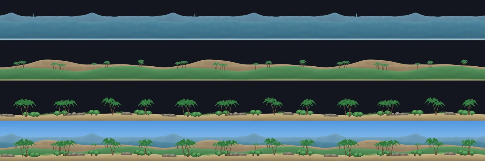

### 3.2 Desierto (`desierto`)
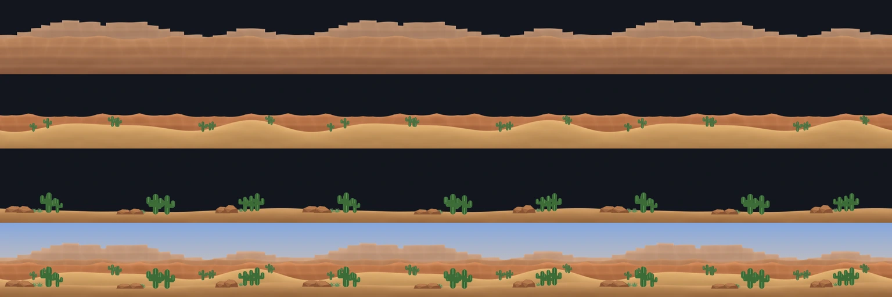

### 3.3 Bosque andino (`bosque`)
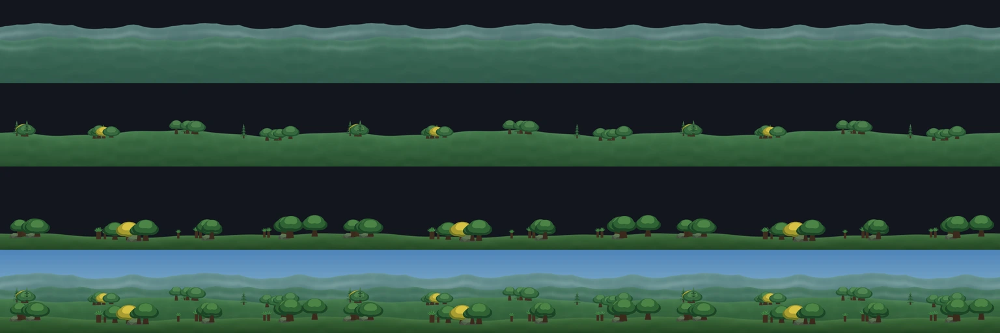

### 3.4 Montaña (`montana`)
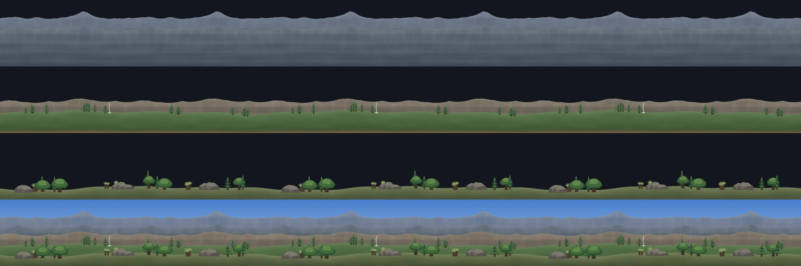

### 3.5 Nieve (`nieve`)
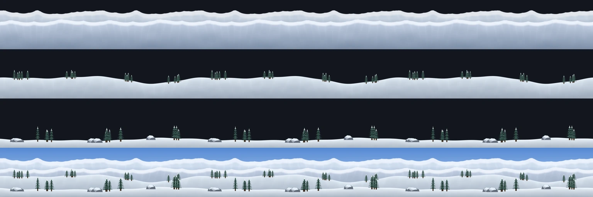

### 3.6 Lagos (`lagos`)
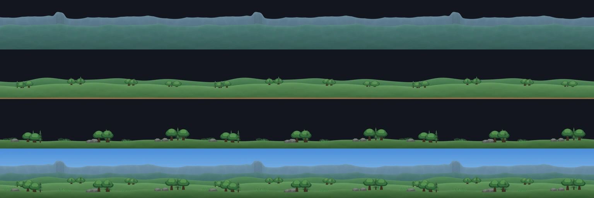

---

## 4. Comparativa visual Antes (procedural) vs Después (Paralaje V4) en `MC.Arcade`

### 4.1 Vista móvil vertical `412 × 860` (6 biomas, día `10:30`)

| Bioma | Antes (montañas procedurales 4.9.0) | Después (Paralaje 3 capas V4) |
|---|---|---|
| **`costa`** (`ruta_atlantico`, `y = 1800`) | 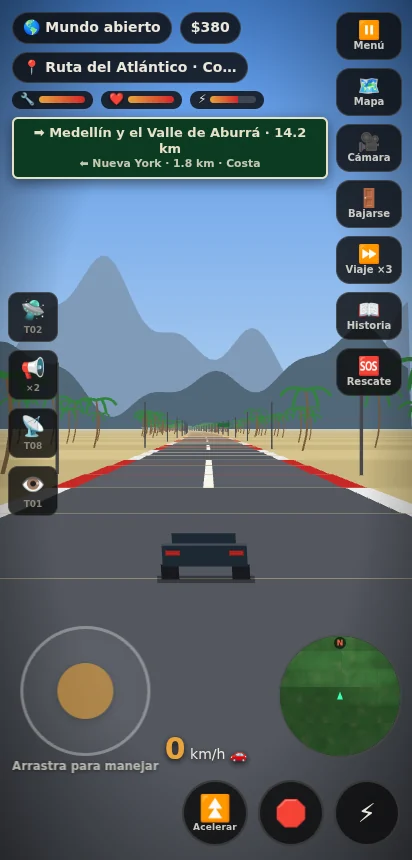 | 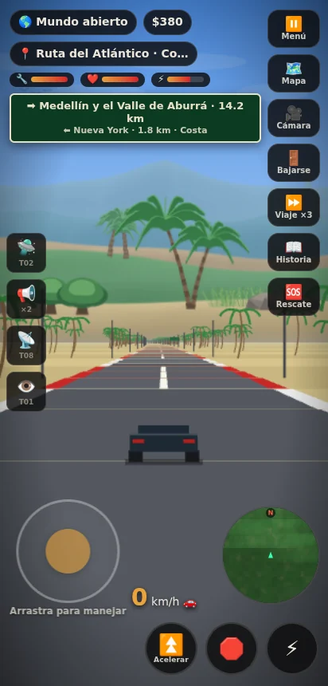 |
| **`desierto`** (`ruta_atlantico`, `y = 10000`) | 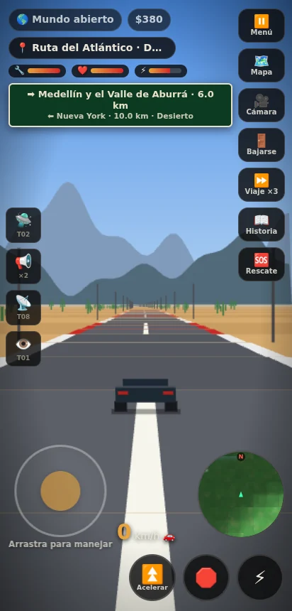 | 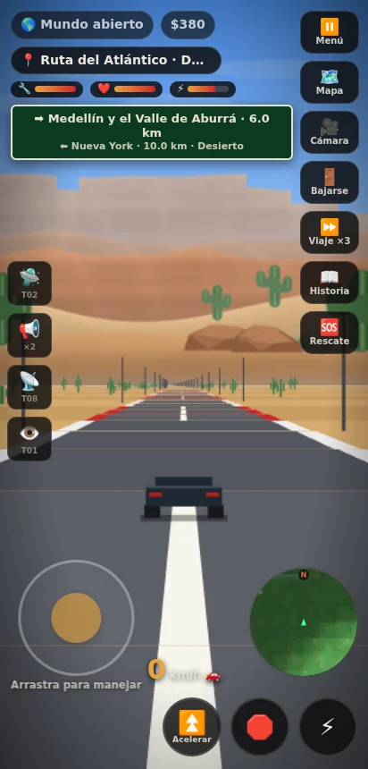 |
| **`bosque`** (`ruta_embalse`, `y = 6000`) | 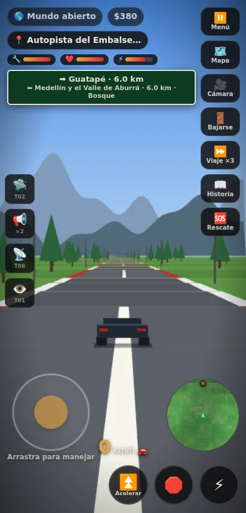 | 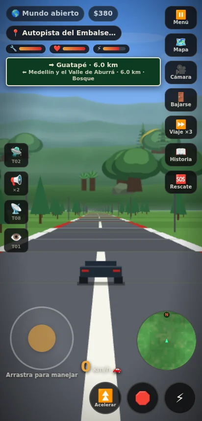 |
| **`montana`** (`ruta_atlantico`, `y = 14000`) | 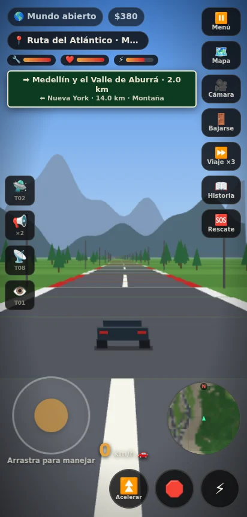 | 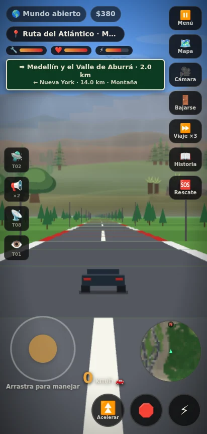 |
| **`nieve`** (`ruta_norte`, `y = 9400`) | 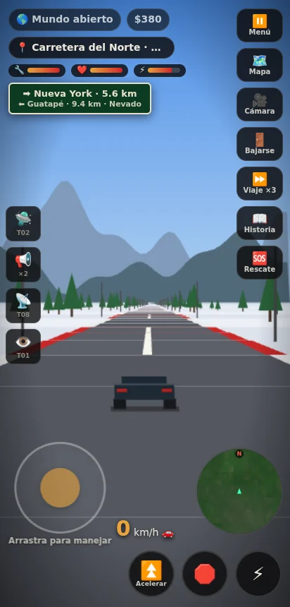 | 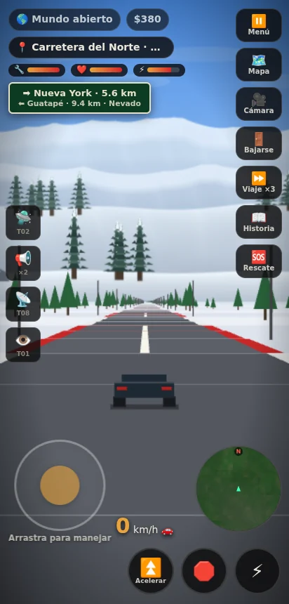 |
| **`lagos`** (`ruta_embalse`, `y = 10200`) | 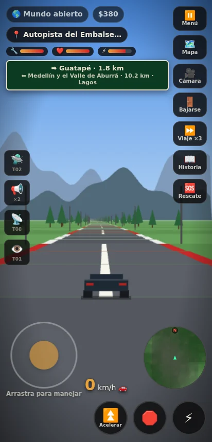 | 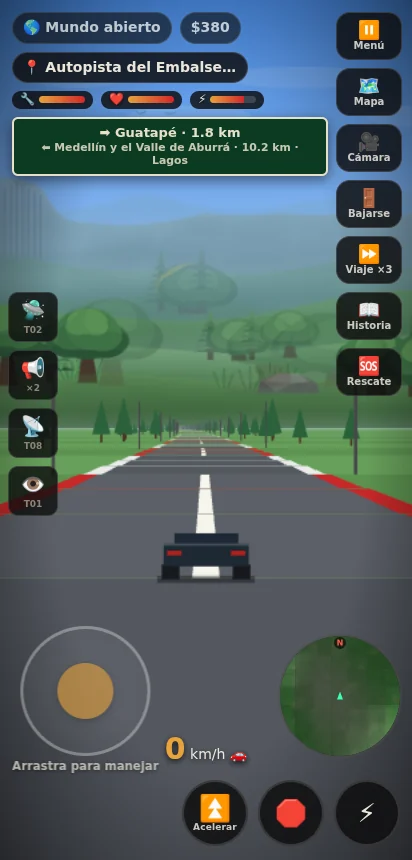 |

### 4.2 Ciclo Día / Noche y vista horizontal `860 × 412`

| Bioma | Día (`860 × 412`, `10:30`) | Noche (`860 × 412`, `21:00`) | Noche móvil (`412 × 860`, `21:00`) |
|---|---|---|---|
| **`costa`** | 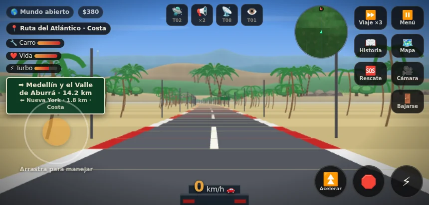 | 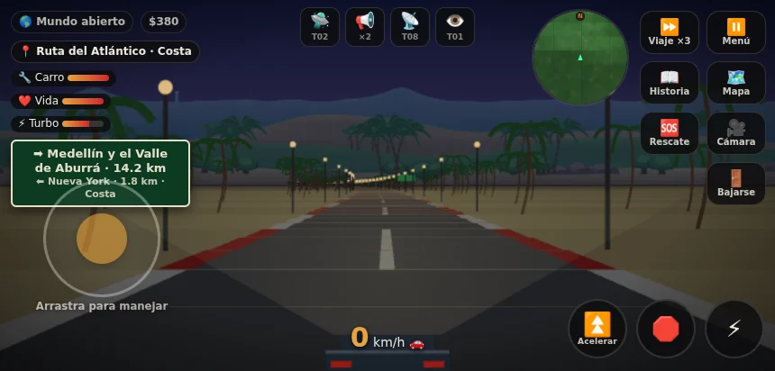 | 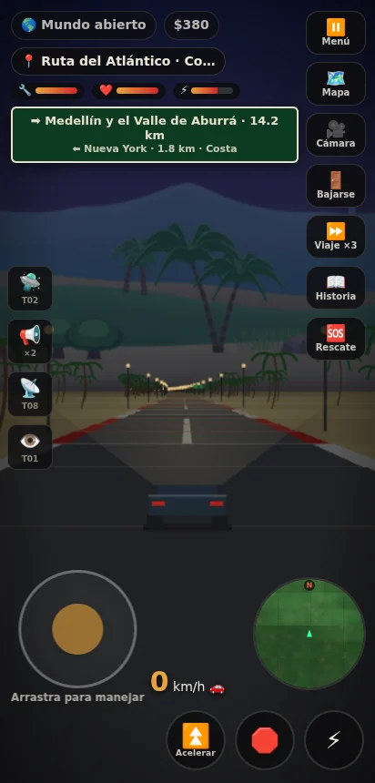 |
| **`montana`** | 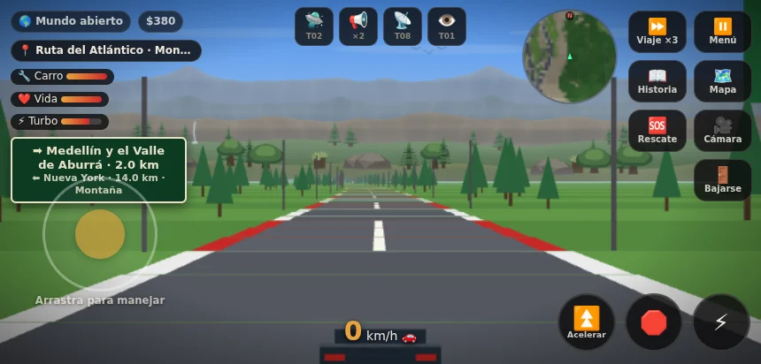 | 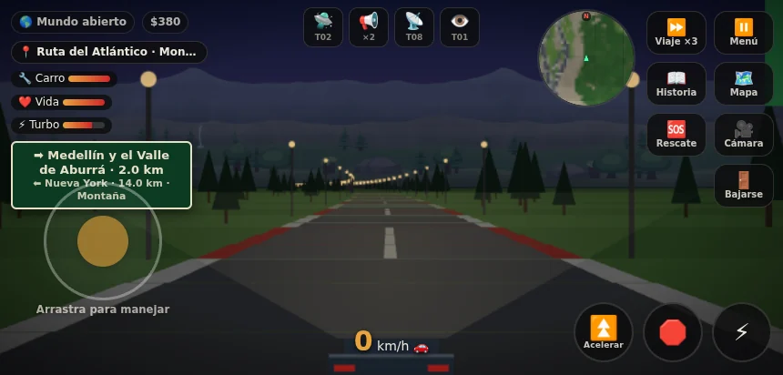 | 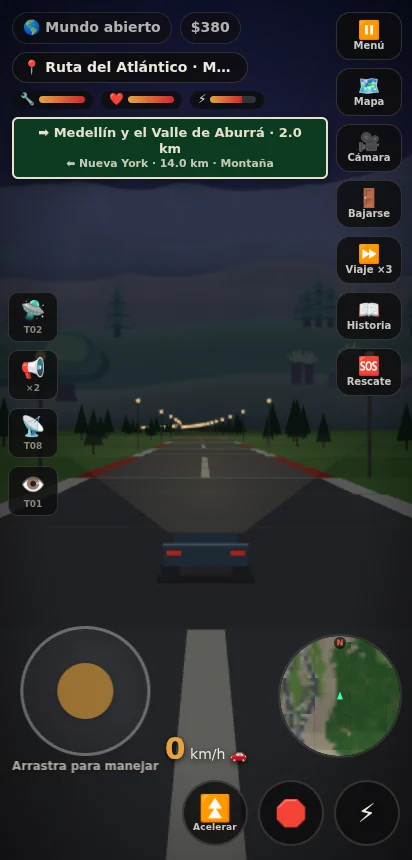 |
| **`nieve`** | 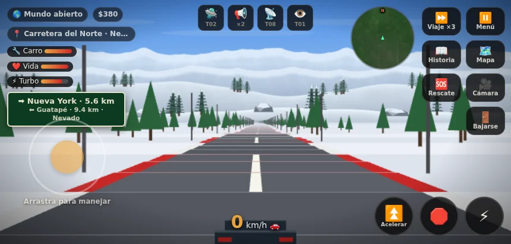 | 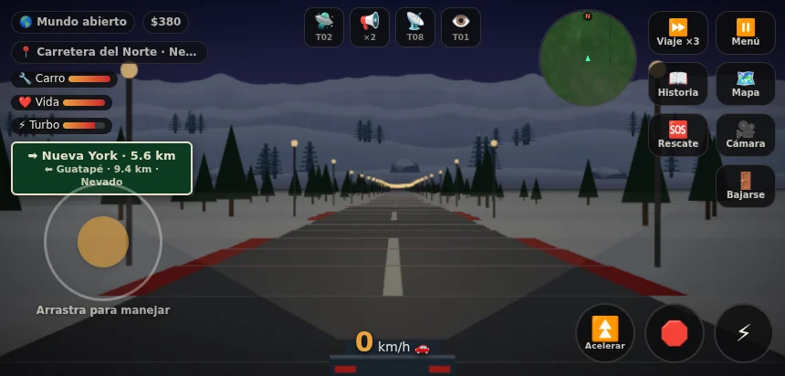 | 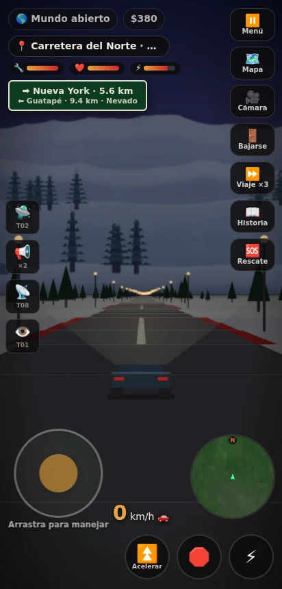 |

---

## 5. Telemetría, memoria y resultados de las 5 suites obligatorias

### 5.1 Métricas por bioma en `pruebas/paralaje-biomas.mjs`

| Bioma | Ruta real (`MC.Planeta`) | `y` (m) | `mismoMundo` | Capas activas | Draw calls | `difHorizonte` (RGB) | `% Horizonte cambiado` | `difCalzada` (RGB) | Respaldo procedural |
|---|---|---:|---|---:|---:|---:|---:|---:|---|
| **`costa`** | `ruta_atlantico` | `1800` | `true` | `3` | `5` | `26.07` | `66.9 %` | `0.2556` | `false` |
| **`llanura`** | `ruta_atlantico` | `5800` | `true` | `0` | `0` | `0.00` | `0.0 %` | `0.0000` | `true` (esperado) |
| **`desierto`** | `ruta_atlantico` | `10000` | `true` | `3` | `8` | `50.37` | `87.7 %` | `0.4094` | `false` |
| **`montana`** | `ruta_atlantico` | `14000` | `true` | `3` | `8` | `55.65` | `98.7 %` | `0.3624` | `false` |
| **`bosque`** | `ruta_embalse` | `6000` | `true` | `3` | `4` | `54.07` | `97.0 %` | `0.3370` | `false` |
| **`lagos`** | `ruta_embalse` | `10200` | `true` | `3` | `10` | `54.59` | `98.8 %` | `0.2780` | `false` |
| **`nieve`** | `ruta_norte` | `9400` | `true` | `3` | `3` | `55.29` | `98.1 %` | `0.3565` | `false` |

### 5.2 Impacto en tamaño, arranque y memoria
- **Peso de las 18 texturas WebP en disco:** `540.58 KB` (`553,550 bytes`).
- **Impacto en `dist/juegos/getaway.html` (HTML único offline):** `26,093 KB → 26,844 KB` (`+751 KB`, **`+2.88 %`**).
- **Tiempo al primer cuadro jugable (`msPrimerCuadro`):** `3,078 – 4,702 ms` (sin bloqueo; decodificación diferida por bioma).
- **Caché LRU acotada:** `lruMax = 2` biomas residentes (`imgsEnCache = 6` imágenes `1024×256`), `10` expulsiones limpias al recorrer los 6 biomas, `usedJSHeapSize = 110.6 MB`.
- **Degradación de calidad y respaldo ante fallo:**
  - `calidad = 0.50` → `capasMedia = 2` (`lejos` + `cerca`).
  - `calidad = 0.30` → `capasBaja = 0`, `fbBaja = true` (respaldo procedural).
  - Eliminación temporal de `costa_medio` → `fbEliminado = true`, `cieloNoNegro = true`, y restauración inmediata (`restauradoOk = true`) al recuperar el recurso.
  - `0` errores de consola/página y `0` peticiones de red externas.
